# Spezifikation — VMS für Arbeitnehmerüberlassung

**Status: Gliederung.** Dieses Dokument enthält heute nur die Struktur. Jeder
Abschnitt wird einzeln ausgearbeitet; unausgefüllte Punkte sind mit `TODO`
markiert. Keine Annahmen — ungeklärtes gehört in [Offene Fragen](#7-offene-fragen).

> **Rechtlicher Hinweis:** Die genannten Paragrafen dienen der Orientierung.
> Vor der Implementierung ist jede Regel gegen den aktuellen Gesetzestext und
> den einschlägigen Tarifvertrag zu prüfen. Dieses Dokument ist keine
> Rechtsberatung.

---

## 1. Kontext und Abgrenzung

- 1.1 Zweck des Systems — TODO
- 1.2 Betreibermodell: MSP / Personaldienstleister steuert mehrere Kunden
  (Entleiher) und mehrere Lieferanten (Sub-Verleiher) — TODO ausarbeiten
- 1.3 Mandantentrennung: was sieht wer nicht — TODO
- 1.4 Nicht im Umfang (Lohnabrechnung, Zeitwirtschaft des Entleihers,
  Bewerbermanagement des Lieferanten) — TODO
- 1.5 Glossar DE → EN (Fachbegriff, englischer Bezeichner, Definition) — die
  Begriffe aus Kapitel 2, die Objekt- und Attributbezeichner aus Kapitel 3 und
  die Status- und Übergangsbegriffe aus Kapitel 4 sind unten gemappt; die
  Rechenbegriffe aus Kapitel 5 und die Datenschutzbegriffe aus Kapitel 6 folgen
  mit diesen Kapiteln — TODO (Kapitel 5–6)

### 1.5 Glossar DE → EN

Enthält die Begriffe aus Kapitel 2 (Rollen, Berechtigung, Mandant, Vertretung,
Eskalation), die Objekt- und Attributbezeichner aus Kapitel 3 und die Status-
und Übergangsbegriffe aus Kapitel 4. Weitere Begriffe werden in **diese**
Tabelle ergänzt, nicht in eine zweite.

**Zu den Statuswerten aus Kapitel 4:** Dieselbe Bedeutung trägt denselben
Bezeichner, auch über Modelle hinweg; die Spalte „Bedeutung" nennt deshalb die
Modelle, in denen ein Wert vorkommt. Wo ein Zustand fachlich etwas anderes ist,
trägt er einen anderen Namen (4.0, Namenskonvention).

| Deutsch | Englischer Bezeichner | Bedeutung |
|---|---|---|
| Betreiber (MSP) | `operator` | Personaldienstleister, der das VMS betreibt und mehrere Kunden und Lieferanten steuert |
| MSP-Administrator | `operatorAdmin` | Rolle: verantwortet Mandanten, Benutzer, Stammdaten und Regelwerk |
| MSP-Disponent | `operatorCoordinator` | Rolle: operative Steuerung des Kernprozesses |
| Bedarfsträger | `demandOwner` | Rolle auf Kundenseite: meldet Bedarf, entscheidet fachlich über Kandidaten |
| Genehmiger | `approver` | Rolle auf Kundenseite: Budget- und Zeitfreigabe |
| Einkauf / Controlling | `procurementController` | Rolle auf Kundenseite: kaufmännischer Rahmen und Auswertung |
| Lieferantendisponent | `supplierCoordinator` | Rolle beim Lieferanten: Angebote, Kandidaten, Zeiten |
| Lieferantenadministrator | `supplierAdmin` | Rolle beim Lieferanten: Stammdaten, Nachweise, Benutzer |
| Leiharbeitnehmer | `temporaryWorker` | überlassene Person; eigener Zugang ist offene Frage 4 |
| Rolle | `role` | Funktion mit festgelegten Rechten, keine Person |
| Rollenzuweisung | `roleAssignment` | Verbindung aus Benutzer, Rolle und Mandant |
| Berechtigung | `permission` | Recht einer Rolle auf eine Operation an einem Objekt |
| Berechtigungsmatrix | `permissionMatrix` | Zuordnung Rolle × Objekt × Operation (Kapitel 2.2) |
| Operation | `operation` | `create`, `read`, `update`, `transition`, `delete` |
| Statuswechsel | `statusTransition` | Übergang eines Objekts in einen anderen Status (Kapitel 4) |
| Mandant | `tenant` | Organisation mit eigenem Datenraum (Betreiber, Kunde, Lieferant) |
| Mandantenzuordnung | `tenantAssignment` | Zuordnung eines Benutzers zu einem Mandanten |
| Betreuungszuordnung | `accountAssignment` | Einschränkung eines MSP-Benutzers auf eine Teilmenge der Kunden |
| Zuständigkeit | `responsibilityScope` | Einschränkung innerhalb eines Mandanten (Standort, Kostenstelle) |
| Sichtbarkeitsregel | `visibilityRule` | Regel, welche Objekte ein Mandant sehen darf (Kapitel 2.3) |
| Datenminimierung | `dataMinimization` | Beschränkung der übermittelten Daten auf das Erforderliche |
| Pseudonymisiertes Profil | `pseudonymizedProfile` | Kandidatenprofil ohne Klardaten (Kapitel 6.4) |
| Vier-Augen-Prinzip | `dualControl` | Erstellen und Freigeben nicht durch dieselbe Person |
| Übersteuerung | `override` | dokumentiertes Abweichen von einer Systemsperre (Kapitel 5.5) |
| Vertretung | `delegation` | befristete Übertragung der Rechte einer Rollenzuweisung |
| Vertreter | `delegate` | Person, die eine Rollenzuweisung vertritt |
| Vertretungszeitraum | `delegationPeriod` | Beginn und Ende einer Vertretung |
| Vertretungsvermerk | `delegationNote` | Kennzeichnung einer Handlung in Vertretung |
| Eskalation | `escalation` | Weitergabe eines liegengebliebenen Vorgangs an eine weitere Stelle |
| Eskalationsstufe | `escalationLevel` | Position in der Stufenfolge einer Eskalation |
| Eskalationsfrist | `escalationDeadline` | Frist, nach deren Ablauf eskaliert wird |
| Mandantentyp | `tenantType` | `operator`, `customer` oder `supplier` (Kapitel 3.11) |
| Fachliche Kennung | `…Number` | lesbare, mandantenweit eindeutige Nummer eines Objekts (z. B. `customerNumber`) |
| Gültigkeitsbeginn / -ende | `validFrom` / `validTo` | fachlicher Gültigkeitszeitraum; `validTo` leer = unbefristet |
| Deaktivierung | `deactivatedAt` | fachliches „Löschen" (Kapitel 2.2, 6.6) |
| Fremdsystemkennung | `externalReference` | Kennung desselben Sachverhalts in einem Fremdsystem (offene Frage 7) |
| Kunde / Entleiher | `customer` | Organisation, die Leiharbeitnehmer entleiht (Kapitel 3.1) |
| Standort | `site` | konkreter Einsatzort eines Kunden (Kapitel 3.1) |
| Kostenstelle | `costCenter` | kaufmännische Zuordnung beim Kunden (Kapitel 3.1) |
| Konzernzugehörigkeit | `corporateGroup` | Konzernverbund des Kunden; relevant für die Drehtürklausel (Kapitel 5.3) |
| Lieferant / Verleiher | `supplier` | Sub-Verleiher, der Personal stellt (Kapitel 3.2) |
| AÜG-Erlaubnis | `supplierPermit` | Erlaubnis zur Arbeitnehmerüberlassung eines Lieferanten (Kapitel 3.2) |
| Erlaubnisnummer | `permitNumber` | Aktenzeichen der Erlaubnis |
| Erlaubnisbehörde | `issuingAuthority` | ausstellende Agentur für Arbeit |
| Rahmenvertrag | `masterAgreement` | Vertragsrahmen zwischen Betreiber und einem Kunden oder Lieferanten (Kapitel 3.3) |
| Preisliste | `rateCard` | Satz von Konditionen zu einem Rahmenvertrag (Kapitel 3.3) |
| Preisposition | `rateCardItem` | eine Kondition der Preisliste (Grundsatz oder Zuschlagssatz) |
| Verrechnungssatz | `hourlyRate` | Stundensatz einer Preisposition |
| Einkaufspreisliste | `supplierRateCard` | Konditionen Betreiber ↔ Lieferant |
| Kundenpreisliste | `customerRateCard` | Konditionen Betreiber ↔ Kunde |
| Tarifzuordnung | `collectiveAgreementAssignment` | anzuwendender Tarifvertrag für Lieferant, Kunde oder Standort (Kapitel 3.3) |
| Tarifvertrag | `collectiveAgreement` | Katalogwert (iGZ, BAP, Branchenzuschlagstarif …); der Katalog ist Konfiguration (3.3) |
| Branchenzuschlag | `industryPremium` | tariflicher Zuschlag nach Einsatzbranche (Kapitel 5.2) |
| Höchstüberlassungsdauer | `maxAssignmentDuration` | zulässige Dauer der Überlassung an denselben Entleiher (Kapitel 5.1) |
| Equal-Pay-Frist | `equalPayDeadline` | Frist, ab der Equal Pay greift (Kapitel 5.2) |
| Vergleichsentgelt | `comparableWage` | Entgelt eines vergleichbaren Stammarbeitnehmers (Kapitel 5.2) |
| Bedarfsanfrage | `demandRequest` | gemeldeter Personalbedarf eines Kunden (Kapitel 3.4) |
| Tätigkeitsbeschreibung | `activityDescription` | Konkretisierung der Tätigkeit (Kapitel 5.3) |
| Anforderung (Qualifikation) | `qualificationRequirement` | geforderte Qualifikation einer Bedarfsanfrage |
| Anzahl / Kopfzahl | `headcount` | Zahl der gesuchten bzw. angebotenen Personen |
| Angebotsfrist | `offerDeadline` | Frist für den Eingang von Angeboten |
| Ausschreibung | `tender` | Verteilung einer freigegebenen Bedarfsanfrage an Lieferanten (Kapitel 3.5) |
| Ausschreibungsrunde | `tenderRound` | Zählung wiederholter Ausschreibungen zur selben Anfrage |
| Einladung | `tenderInvitation` | Teilnahme genau eines Lieferanten an einer Ausschreibung |
| Lieferantenangebot | `supplierOffer` | Antwort eines Lieferanten auf eine Einladung (Kapitel 3.5) |
| Angebotsposition | `supplierOfferItem` | Preis- und Mengenangabe eines Angebots je Qualifikation |
| Bindefrist | `offerValidUntil` | Frist, bis zu der ein Angebot gilt |
| Kandidat | `candidate` | Person, die ein Lieferant für Überlassungen führt (Kapitel 3.6) |
| Profilvorschlag | `candidateSubmission` | Vorlegen eines Kandidaten auf eine konkrete Anfrage (Kapitel 3.6) |
| Offenlegungsstufe | `disclosureLevel` | `pseudonymized` oder `identified` (Kapitel 6.4) |
| Personenidentität | `workerIdentity` | betreiberseitige Verknüpfung von Kandidatensätzen derselben Person (Kapitel 3.6) |
| Drehtürklausel | `revolvingDoorRule` | Regel zur Vorbeschäftigung beim Entleiher (Kapitel 5.3) |
| Einsatz / Überlassung | `assignment` | konkrete Überlassung einer Person an einen Kunden (Kapitel 3.7) |
| Verlängerung | `assignmentExtension` | Verlängerung eines Einsatzes (Kapitel 3.7) |
| Unterbrechung | `assignmentInterruption` | dokumentierte Unterbrechung der Überlassung (Kapitel 5.1) |
| Vorzeitige Beendigung | `earlyTermination` | Beendigung vor dem geplanten Ende |
| Stundenzettel | `timesheet` | Zeitnachweis eines Einsatzes für einen Abrechnungszeitraum (Kapitel 3.8) |
| Zeitposition | `timeEntry` | einzelner Zeitnachweis eines Tages bzw. Abschnitts (Kapitel 3.8) |
| Freigabeschritt | `timesheetApproval` | eine Stufe der Stundenzettelgenehmigung (offene Frage 5) |
| Zuschlagsart | `premiumType` | Katalogwert für Zuschläge (Nacht, Sonntag, Feiertag …) (Kapitel 3.8) |
| Abwesenheitsart | `absenceType` | Grund für fehlende Arbeitsleistung (offene Frage 21) |
| Abrechnungsperiode | `billingPeriod` | Zeitraum, für den abgerechnet wird (Kapitel 3.9) |
| Abrechnungsbeleg | `billingDocument` | kaufmännischer Beleg über Überlassungsleistung (Kapitel 3.9) |
| Belegposition | `billingDocumentItem` | eine Position eines Abrechnungsbelegs |
| Gutschrift | `creditNote` | Belegart im Gutschriftverfahren — im Prototyp das Verfahren der Lieferantenseite (3.9) |
| Rechnung | `invoice` | Belegart im Rechnungseingangsverfahren — dokumentiert, im Prototyp nicht umgesetzt (3.9) |
| Beanstandung | `dispute` | Widerspruch gegen einen Abrechnungsbeleg (Kapitel 4.5) |
| Dokument / Nachweis | `document` | hinterlegtes Schriftstück mit Nachweisfunktion (Kapitel 3.10) |
| Nachweisart | `documentCategory` | Katalogwert der Dokumentart |
| Erlaubnisurkunde | `permitCertificate` | Urkunde zur AÜG-Erlaubnis |
| Unterweisung | `safetyBriefing` | Arbeitsschutzunterweisung am Einsatzort |
| Qualifikationsnachweis | `qualificationCertificate` | Nachweis einer Qualifikation |
| Unbedenklichkeitsbescheinigung | `clearanceCertificate` | Bescheinigung über abgeführte Beiträge und Steuern |
| Vertragsunterlage | `agreementDocument` | Nachweisart für Unterlagen zum Rahmenvertrag |
| Arbeitserlaubnis | `workPermit` | aufenthalts- und arbeitsrechtlicher Nachweis eines Kandidaten |
| Anerkennung (Nachweis) | `verificationStatus` | `submitted`, `accepted`, `rejected` (Kapitel 5.4) |
| Benutzer | `user` | Person mit Zugang zum System (Kapitel 3.11) |
| Rollenkürzel | `roleCode` | technischer Code einer Rolle (`operatorAdmin` …) |
| Audit-Eintrag | `auditEntry` | fachlicher Protokollsatz (Kapitel 3.12) |
| Statusmodell | `statusModel` | Satz zulässiger Zustände und Übergänge eines Objekts (Kapitel 4) |
| Zustand | `state` | ein Wert des Statusmodells |
| Endzustand | `terminalState` | Zustand, aus dem kein Übergang herausführt (4.0, Regel 9) |
| Übergang | `transition` | Wechsel von einem Zustand in einen anderen |
| Auslösende Rolle | `triggeringRole` | Rolle, die einen Übergang auslöst; braucht `S` in 2.2 |
| Vorbedingung | `precondition` | Bedingung, die vor einem Übergang erfüllt sein muss |
| Nebenwirkung | `sideEffect` | Folge eines Übergangs: Benachrichtigung, Sperre, Protokolleintrag, Fristenlauf |
| Systemübergang | `systemTransition` | Übergang ohne Benutzerhandlung, zeitgesteuert oder abgeleitet (4.0, Regel 10) |
| Prozessfrist | `processDeadline` | Frist des Verfahrens ohne rechtliche Wirkung; Vorbelegungen in 4.0 |
| Fristvorbelegung | `…DeadlineDays` | Konfigurationsschlüssel einer Prozessfrist in `processDeadlineConfig` (3.1), Werte in 4.0 |
| Fristenlauf | `deadlineClock` | Beginn und Fortlauf einer Frist, die ein Übergang in Gang setzt |
| Prüfergebnis | `ruleCheckResult` | Ergebnis einer AÜG-Prüfung (Kapitel 4.7, 5.5) |
| Information (Ergebnisart) | `info` | Übergang findet statt, Ergebnis wird vermerkt (4.7) |
| Warnung (Ergebnisart) | `warning` | Übergang findet statt, erzeugt Benachrichtigung und Eskalationsanlass (4.7) |
| Sperre (Ergebnisart) | `block` | Übergang findet nicht statt; Übersteuerung nur nach 5.5 (4.7) |
| Entwurf | `draft` | Anfangszustand: Bedarfsanfrage (4.1), Angebot und Profilvorschlag (4.2), Rahmenvertrag und Preisliste (3.3) |
| Eingereicht | `submitted` | zur Entscheidung vorgelegt: Bedarfsanfrage, Angebot, Profilvorschlag, Stundenzettel (4.1, 4.2, 4.4); auch Anerkennungsstatus eines Nachweises (5.4) |
| Freigegeben / genehmigt | `approved` | kundenseitig entschieden: Bedarfsanfrage (4.1), Verlängerung (4.3), Stundenzettel (4.4); auch Anerkennungsstatus eines Nachweises (5.4) |
| Ausgeschrieben | `tendered` | Bedarfsanfrage ist an Lieferanten verteilt (4.1) |
| In Auswahl | `inSelection` | mindestens ein Profil ist dem Kunden vorgelegt (4.1) |
| Besetzt | `filled` | so viele Einsätze wie `headcount` (4.1) |
| Storniert | `cancelled` | Vorgang aufgehoben: Bedarfsanfrage (4.1), Abrechnungsbeleg (4.5) |
| Abgelaufen | `expired` | Frist verstrichen, ohne dass etwas zustande kam: Bedarfsanfrage, Einladung, Angebot (4.1, 4.2); auch Preisliste und Rahmenvertrag (3.3) |
| Eingeladen | `invited` | Einladung zugestellt (4.2) |
| Zur Kenntnis genommen | `viewed` | Einladung geöffnet (4.2) |
| Angebot abgegeben | `offerSubmitted` | Einladung ist mit einem Angebot beantwortet (4.2) |
| Abgesagt | `declined` | Lieferant bietet nicht an; vom Lieferantendisponenten selbst gesetzt (4.2.1, [46]) |
| Gesichtet | `reviewed` | Betreiber hat Angebot bzw. Profilvorschlag bewertet (4.2) |
| Dem Kunden vorgelegt | `releasedToCustomer` | Profilvorschlag ist pseudonymisiert beim Kunden (4.2, 6.4) |
| Interview vereinbart | `interviewScheduled` | Kunde will die Person kennenlernen (4.2) |
| Zugesagt | `accepted` | Zuschlag bzw. fachliche Zusage (4.2); auch Anerkennungsstatus eines Nachweises (5.4) |
| Abgelehnt | `rejected` | Absage mit Begründung: Angebot, Profilvorschlag, Verlängerung, Stundenzettel (4.2–4.4); auch Anerkennungsstatus eines Nachweises (5.4) |
| Zurückgezogen | `withdrawn` | durch den Einreicher beendet: Angebot, Profilvorschlag, Verlängerung (4.2, 4.3) |
| Geplant | `planned` | Einsatz angelegt, Überlassung nicht begonnen (4.3) |
| Aktiv | `active` | läuft: Einsatz (4.3), Lieferant (4.6); auch Preisliste und Rahmenvertrag (3.3) |
| Unterbrochen | `interrupted` | dokumentierte Unterbrechung der Überlassung läuft (4.3) |
| Beendet | `completed` | Einsatz regulär zum geplanten Ende abgelaufen (4.3) |
| Vorzeitig beendet | `terminatedEarly` | Einsatz endet vor dem geplanten Ende (4.3) |
| Beantragt | `requested` | Verlängerung beantragt, nicht entschieden (4.3) |
| Wirksam | `effective` | Verlängerung vollzogen, `plannedEndDate` verschoben (4.3) |
| Erfasst | `recorded` | Stundenzettel in Erfassung, Zeitpositionen änderbar (4.4) |
| In Prüfung (Stundenzettel) | `inApproval` | mindestens ein Freigabeschritt offen (4.4) *(offene Frage 5)* |
| Korrigiert | `corrected` | Stundenzettel durch eine genehmigte Korrekturfassung ersetzt (4.4) |
| Korrekturfassung | `correctionOf` | neuer Stundenzettel, der einen genehmigten ersetzt (3.8, 4.4) |
| Offen (Periode) | `open` | Abrechnungsperiode nimmt Zeiten und Belege auf (4.5) |
| Geschlossen (Periode) | `closed` | Abrechnungsperiode abgeschlossen (4.5) |
| Erstellt | `created` | Abrechnungsbeleg erzeugt, nicht abgegeben (4.5) |
| In Prüfung (Beleg) | `inReview` | Abrechnungsbeleg wird vor der Freigabe geprüft (4.5) |
| Freigegeben (Beleg) | `released` | Vier-Augen-Freigabe erfolgt, Beleg abgegeben (4.5) |
| Beanstandet | `disputed` | Gegenseite widerspricht dem Beleg (4.5) |
| Bestätigt | `confirmed` | Gegenseite bestätigt den Beleg; nur Einkaufsseite (4.5) |
| Onboarding | `onboarding` | Lieferant angelegt, Voraussetzungen unvollständig (4.6) |
| Gesperrt | `blocked` | Teilnahme des Lieferanten ausgesetzt (4.6) |
| Inaktiv | `inactive` | Beauftragung des Lieferanten beendet (4.6); auch Kandidat (3.6) |
| Gekündigt | `terminated` | Rahmenvertrag beendet (3.3); Statusmodell noch nicht geführt (4.0) |
| Höchstüberlassungsprüfung | `maxDurationCheck` | Prüfung P1 (4.7, 5.1) |
| Unterbrechungsprüfung | `interruptionResetCheck` | Prüfung P2 (4.7, 5.1) |
| Equal-Pay-Fristprüfung | `equalPayDeadlineCheck` | Prüfung P3 (4.7, 5.2) |
| Vergleichsentgeltprüfung | `comparableWageCheck` | Prüfung P4 (4.7, 5.2) |
| Branchenzuschlagsprüfung | `industryPremiumCheck` | Prüfung P5 (4.7, 5.2) |
| Drehtürprüfung | `revolvingDoorCheck` | Prüfung P6 (4.7, 5.3) |
| Arbeitskampfprüfung | `industrialActionCheck` | Prüfung P7 (4.7, 5.3) |
| Konkretisierungsprüfung | `concretizationCheck` | Prüfung P8 (4.7, 5.3) |
| Erlaubnisprüfung | `permitValidityCheck` | Prüfung P9 (4.7, 5.4) |
| Nachweisprüfung | `mandatoryDocumentCheck` | Prüfung P10 (4.7, 5.4) |
| Arbeitsverhältnisprüfung | `employmentRelationshipCheck` | Prüfung P11 (4.7, 5.3) |

## 2. Rollen und Berechtigungen

Rollen beschreiben **Funktionen, nicht Personen**. Eine Person kann mehrere
Rollen tragen, aber nur innerhalb **einer** Organisation (Betreiber, Kunde oder
Lieferant). Eine Rolle, die über Organisationsgrenzen hinweg gilt, gibt es
nicht.

Die wirksame Berechtigung eines Benutzers ist die **Schnittmenge** aus drei
Angaben:

1. **Rolle** — was darf diese Funktion fachlich (Kapitel 2.2)?
2. **Mandantenzuordnung** — auf welche Organisation wirkt das Recht
   (Kapitel 2.3)?
3. **Zuständigkeit** — auf welche Objekte innerhalb dieser Organisation
   (Standort, Kostenstelle, Betreuungszuordnung)?

Fehlt eine der drei, besteht kein Zugriff. Rollen erben nicht voneinander: eine
„höhere" Rolle hat nicht automatisch die Rechte einer „niedrigeren".

> **Abhängigkeit von offenen Fragen.** Dieses Kapitel ist so formuliert, dass
> es beide Antworten auf **offene Frage 4** (eigener Zugang für
> Leiharbeitnehmer) und **offene Frage 8** (eine Instanz pro MSP oder getrennte
> Instanzen) verträgt:
>
> - Zu Frage 4: Die Rolle `Leiharbeitnehmer` ist durchgängig als *optionaler*
>   Zugang beschrieben. Alle Vorgänge, die sie betrifft, haben eine zweite
>   Zuständigkeit (Lieferant: Disponent, siehe Fußnote [27] in 2.2). Wird die
>   Frage mit „kein eigener Zugang" beantwortet, entfällt die Spalte `AN` der
>   Berechtigungsmatrix vollständig, ohne dass eine andere Regel nachzuziehen
>   ist. Betroffene Stellen sind mit *(offene Frage 4)* gekennzeichnet.
> - Zu Frage 8: Kapitel 2.3 formuliert **fachliche** Sichtbarkeitsregeln. Sie
>   gelten unabhängig davon, ob alle Kunden eines MSP in einer Instanz oder in
>   getrennten Instanzen betrieben werden. Bei getrennten Instanzen sind
>   einzelne Regeln bereits durch die Betriebsform erfüllt — sie entfallen
>   dadurch nicht als Anforderung. Betroffene Stellen sind mit
>   *(offene Frage 8)* gekennzeichnet.

### 2.1 Rollenübersicht

#### Betreiber / MSP-Administrator (`operatorAdmin`)

**Zweck.** Verantwortet das System als Ganzes: Mandanten, Benutzer, Stammdaten
und Regelwerk. Die einzige Rolle mit Querschnittssicht über alle Kunden und
Lieferanten.

**Typische Aufgaben**

- Kunden, Lieferanten, Standorte und Kostenstellen anlegen und pflegen
- Benutzer, Rollen und Mandantenzuordnungen verwalten (Kapitel 3.11)
- Rahmenverträge, Preislisten und Tarifzuordnungen hinterlegen (Kapitel 3.3)
- Lieferanten freischalten, sperren und entsperren (Kapitel 4.6)
- Schwellen, Fristen und Regelverhalten des AÜG-Regelwerks konfigurieren
  (Kapitel 5.5)
- Berechtigungsreview und Auswertung der Audit-Einträge (Kapitel 6.8)

**Abgrenzung.** Gegenüber dem MSP-Disponenten: der Administrator richtet ein
und konfiguriert, er führt das Tagesgeschäft nicht. Gegenüber allen
Kundenrollen: er ersetzt keine Kundenentscheidung — er kann weder genehmigen
noch Stundenzettel freigeben, auch nicht in Vertretung (Kapitel 2.4).
Fremderstellte Inhalte (Lieferantenangebote, Profilvorschläge) kann er sperren
oder stornieren, aber nicht inhaltlich ändern.

#### MSP-Disponent (`operatorCoordinator`)

**Zweck.** Operative Steuerung des Kernprozesses Bedarf → Ausschreibung →
Besetzung → Einsatz → Abrechnung für die ihm zugeordneten Kunden.

**Typische Aufgaben**

- Bedarfsanfragen prüfen, ggf. im Auftrag des Kunden anlegen (Kapitel 3.4)
- Ausschreibung an geeignete Lieferanten verteilen und steuern (Kapitel 3.5)
- Lieferantenangebote und Profilvorschläge sichten, dem Kunden pseudonymisiert
  vorlegen, Zu- und Absagen gegenüber dem Lieferanten führen (Kapitel 3.6)
- Einsätze anlegen, verlängern, beenden (Kapitel 3.7)
- Stundenzettel überwachen, Korrekturen mit Begründung erfassen (Kapitel 3.8)
- Abrechnungsbelege erstellen, Beanstandungen klären (Kapitel 3.9)
- AÜG-Prüfergebnisse bearbeiten und eskalieren (Kapitel 5)

**Abgrenzung.** Gegenüber dem MSP-Administrator: keine Stammdaten-, Vertrags-
und Benutzerhoheit. Gegenüber dem Lieferanten: er bewertet und vermittelt
Angebote, erstellt aber keine eigenen Profilvorschläge. Gegenüber dem
Bedarfsträger: er führt den Prozess, trifft aber nicht die fachliche
Auswahlentscheidung.

#### Kunde: Bedarfsträger / Fachbereich (`demandOwner`)

**Zweck.** Meldet den Personalbedarf seines Fachbereichs und entscheidet
fachlich über die vorgeschlagenen Kandidaten.

**Typische Aufgaben**

- Bedarfsanfrage im Entwurf erstellen und zur Freigabe einreichen
- Anforderungsprofil, Einsatzort, Zeitraum und Qualifikationen beschreiben
- Vorgelegte Profile fachlich beurteilen, Interviews durchführen, zusagen oder
  ablehnen
- Einsätze seines Bereichs verfolgen, Verlängerung oder vorzeitige Beendigung
  beantragen
- Einsatzbezogene Nachweise einsehen (Unterweisung, Qualifikation)

**Abgrenzung.** Gegenüber dem Genehmiger: er beantragt, er genehmigt nicht —
weder Budget noch Zeiten, soweit Kapitel 4 die Freigabe dem Genehmiger
zuweist. Gegenüber Einkauf/Controlling: keine Sicht auf Konditionen und
Preislisten. Gegenüber dem MSP-Disponenten: keine Kommunikation mit dem
Lieferanten und keine Statusführung des Angebots.

#### Kunde: Genehmiger (`approver`)

**Zweck.** Trägt die Freigabeverantwortung auf Kundenseite — Budget- und
Zeitfreigaben.

**Typische Aufgaben**

- Bedarfsanfragen freigeben oder ablehnen (Kapitel 4.1)
- Verlängerung und vorzeitige Beendigung von Einsätzen genehmigen
  (Kapitel 4.3)
- Stundenzettel genehmigen oder ablehnen, soweit Kapitel 4.4 ihm diese Stufe
  zuweist — Stufenzahl und Zuständigkeit sind **offene Frage 5**
- Kostenwirkung des zu genehmigenden Vorgangs beurteilen

**Abgrenzung.** Gegenüber dem Bedarfsträger: er beschreibt keinen Bedarf und
trifft keine fachliche Kandidatenauswahl; wer beantragt, genehmigt nicht
(Vier-Augen-Prinzip, Kapitel 2.4). Gegenüber Einkauf/Controlling: er entscheidet
den Einzelfall, nicht den Rahmen. Gegenüber dem Betreiber: seine Entscheidung
ist nicht delegierbar an den MSP — unentschiedene Vorgänge werden eskaliert,
nicht übernommen.

#### Kunde: Einkauf / Controlling (`procurementController`)

**Zweck.** Verantwortet den kaufmännischen Rahmen und die Nachvollziehbarkeit
des Volumens auf Kundenseite.

**Typische Aufgaben**

- Rahmenvertrag, Preisliste und Konditionen des eigenen Kunden einsehen
- Kostenstellen und Standorte des eigenen Kunden pflegen
- Abrechnungsbelege prüfen und beanstanden (Kapitel 4.5)
- Volumen, Laufzeiten und Kennzahlen des eigenen Kunden auswerten
- Gültigkeitsstatus der AÜG-Erlaubnis der beauftragten Lieferanten verfolgen
  (Kapitel 5.4)

**Abgrenzung.** Gegenüber dem Genehmiger: keine Einzelfallfreigabe von Bedarfen
und Zeiten. Gegenüber dem Bedarfsträger: keine Sicht auf Kandidatendaten.
Gegenüber dem MSP-Administrator: er pflegt keine systemweiten Stammdaten, nur
die seines eigenen Kunden.

#### Lieferant: Disponent (`supplierCoordinator`)

**Zweck.** Bearbeitet die Anfragen, zu denen der eigene Lieferant eingeladen
ist, und stellt Personal.

**Typische Aufgaben**

- Eingeladene Bedarfsanfragen sichten und bewerten
- Angebot abgeben, ändern bis zur Sichtung, zurückziehen
- Kandidaten und Profilvorschläge einstellen und pflegen (Kapitel 3.6)
- Eigene Einsätze verfolgen, Beendigung durch den Lieferanten anzeigen
- Stundenzettel erfassen oder im Namen des Leiharbeitnehmers einreichen,
  solange dieser keinen eigenen Zugang hat *(offene Frage 4)*
- Eigene Gutschriften prüfen, bestätigen oder beanstanden (3.9, 4.5)
- Nachweise zu Kandidaten und Einsätzen hochladen

**Abgrenzung.** Gegenüber dem Lieferantenadministrator: keine Benutzer- und
Stammdatenhoheit der eigenen Organisation, keine Pflege der AÜG-Erlaubnis.
Gegenüber anderen Lieferanten: keinerlei Einblick (Kapitel 2.3). Gegenüber dem
MSP-Disponenten: er bietet an, er entscheidet nicht über die Besetzung.

#### Lieferant: Administrator (`supplierAdmin`)

**Zweck.** Verantwortet die eigene Lieferantenorganisation im System:
Stammdaten, Nachweise, Benutzer.

**Typische Aufgaben**

- Eigene Stammdaten und Ansprechpartner pflegen
- AÜG-Erlaubnis und weitere Nachweise hochladen und aktuell halten
  (Kapitel 5.4)
- Benutzer und Rollen der eigenen Organisation verwalten, Vertretungen
  einrichten
- Eigene Angebote, Einsätze und Belege lesend überblicken

**Abgrenzung.** Gegenüber dem Lieferantendisponenten: keine operative
Bearbeitung von Anfragen, Angeboten und Kandidaten. Gegenüber dem
MSP-Administrator: Hoheit nur über die eigene Organisation; Freischaltung und
Entsperrung des Lieferanten bleiben beim Betreiber.

#### Leiharbeitnehmer (`temporaryWorker`) — *optionaler Zugang, offene Frage 4*

**Zweck.** Sieht die eigenen Einsatzdaten und erfasst — sofern ein Zugang
eingeräumt wird — die eigenen Zeiten.

**Typische Aufgaben** *(nur bei eigenem Zugang)*

- Eigenen Einsatz, Einsatzort und Zeitraum einsehen
- Eigene Zeiten erfassen und zur Genehmigung einreichen
- Eigene Nachweise und Unterweisungen einsehen
- Eigenes Profil einsehen

**Abgrenzung.** Keine Sicht auf andere Leiharbeitnehmer, auf Konditionen,
Preise, Kundendaten über den eigenen Einsatz hinaus oder auf Abrechnungsbelege.
Diese Rolle ist nicht vertretbar (Kapitel 2.4). Ohne eigenen Zugang übernimmt
der Lieferantendisponent alle hier genannten Vorgänge in seinem Namen; die
übrigen Regeln dieses Kapitels bleiben unverändert.

### 2.2 Berechtigungsmatrix Rolle × Objekt × Operation

**Rollenkürzel**

| Kürzel | Rolle |
|---|---|
| MA | Betreiber / MSP-Administrator |
| MD | MSP-Disponent |
| KB | Kunde: Bedarfsträger / Fachbereich |
| KG | Kunde: Genehmiger |
| KE | Kunde: Einkauf / Controlling |
| LD | Lieferant: Disponent |
| LA | Lieferant: Administrator |
| AN | Leiharbeitnehmer *(offene Frage 4)* |

**Operationen:** `A` anlegen · `L` lesen · `Ä` ändern · `S` Status wechseln ·
`X` löschen · `–` kein Zugriff. `[n]` verweist auf die Fußnoten unter der
Tabelle.

**Lesart**

- Die Matrix nennt das **Maximum** je Rolle. Mandantengrenze (Kapitel 2.3) und
  Zuständigkeit gehen vor: ein Recht wirkt nur auf Objekte der eigenen
  Organisation bzw. des betreuten Kunden.
- `L` heißt nicht „alle Felder". Feldeinschränkungen stehen in den Fußnoten;
  die Datenminimierung bei Kandidatendaten regelt Kapitel 6.4.
- `S` meint nur die Übergänge, die **Kapitel 4** der Rolle zuweist. Die Matrix
  sagt, *wer überhaupt*; Kapitel 4 sagt, *welchen Übergang wann*.
- `X` ist im Regelfall Deaktivierung oder Stornierung, nicht physische
  Löschung. Physisches Löschen folgt ausschließlich dem Löschkonzept
  (Kapitel 6.6).
- Die Matrix bleibt auf der Objektgranularität von Kapitel 3. Mit der
  Ausarbeitung von Kapitel 3 sind die Zeilen zu 3.2 (AÜG-Erlaubnis), 3.3
  (Rahmenvertrag, Preisliste, Tarifzuordnung), 3.6 (Personenidentität), 3.8
  (Stundenzettel, Zeitposition) und 3.11 (Vertretung) verfeinert worden; die
  dort getroffenen Entscheidungen bleiben unverändert.
- **Unterobjekte teilen die Zeile ihres Hauptobjekts**, wo Kapitel 3 das
  ausdrücklich sagt: Angebotsposition zum Lieferantenangebot, Verlängerung und
  Unterbrechung zum Einsatz, Freigabeschritt zum Stundenzettel, Belegposition
  zum Abrechnungsbeleg, Preisposition zur Preisliste.

| Objekt (Kap.) | MA | MD | KB | KG | KE | LD | LA | AN |
|---|---|---|---|---|---|---|---|---|
| Kunde / Entleiher (3.1) | A L Ä S X | L Ä[1] | L[2] | L[2] | L[2] Ä[1] | L[3] | L[3] | L[4] |
| Standort (3.1) | A L Ä S X | L Ä[1] | L[2] | L[2] | A[2] L[2] Ä[2] | L[3] | L[3] | L[4] |
| Kostenstelle (3.1) | A L Ä X | L | L[2] | L[2] | A[2] L[2] Ä[2] X[2] | – | – | – |
| Lieferant / Verleiher (3.2) | A L Ä S X | L Ä[1] S[5] | L[6] | – | L[6] | L[7] | L[7] Ä[7] | – |
| AÜG-Erlaubnis (3.2) | A L Ä S X | L S[34] | – | – | L[36] | L[7] | A[7] L[7] Ä[37] S[20] | – |
| Rahmenvertrag (3.3) | A L Ä S X | L | – | – | L[2] | L[40] | L[40] | – |
| Preisliste, Preisposition (3.3) | A L Ä S X | L | – | L[8] | L[2] L[41] | L[9] L[42] | L[9] L[42] | – |
| Tarifzuordnung (3.3) | A L Ä S X | L | – | – | L[2] | L[7] | L[7] | – |
| Bedarfsanfrage (3.4) | A L Ä S X | A[10] L Ä S | A L[2] Ä[11] S[12] | L[2] S[13] | L[2] | L[14] | – | – |
| Ausschreibung, Einladung (3.5) | A L Ä S X | A L Ä S | L[15] | – | L[15] | L[16] S[46] | – | – |
| Lieferantenangebot, Angebotsposition (3.5) | L S X | L S[17] | L[18] | – | L[2] | A L[7] Ä[19] S[20] X[21] | L[7] | – |
| Kandidat / Profilvorschlag (3.6) | L S X | L Ä[22] S[17] | L[23] S[24] | – | – | A L[7] Ä[7] S[20] X[21] | L[7] | L[4] |
| Personenidentität (3.6) | A L Ä X | A L Ä[43] | – | – | – | – | – | – |
| Einsatz, Verlängerung, Unterbrechung (3.7) | A L Ä S X | A L Ä S | L[2] S[25] | L[2] S[26] | L[2] | L[7] S[25] | L[7] | L[4] |
| Stundenzettel, Freigabeschritt (3.8) | A L Ä S X | A[27] L Ä[28] S | L[2] S[29] | L[2] S[29] | L[2] | A[27] L[7] Ä[28] S[20] | L[7] | A[4] L[4] Ä[4] S[4] |
| Zeitposition (3.8) | A L Ä X[44] | A[27] L Ä[28] | L[2] | L[2] | L[2] | A[27] L[7] Ä[28] | L[7] | A[4] L[4] Ä[4] |
| Zuschlagsart (Katalog, 3.8) | A L Ä X | L | – | – | L[2] | L[9] | – | – |
| Abrechnungsbeleg, Belegposition (3.9) | A L Ä S X | A L S[30] | – | – | L[2] S[31] | L[7] S[32] | L[7] | – |
| Abrechnungsperiode (3.9) | A L Ä S X | L S[33] | – | – | L[2] | L[7] | L[7] | – |
| Dokument / Nachweis (3.10) | A L Ä S X | L S[34] | L[35] | – | L[36] | A L[7] Ä[37] | A L[7] Ä[37] X[37] | L[4] |
| Benutzer, Rollenzuweisung, Mandantenzuordnung, Zuständigkeit (3.11) | A L Ä S X | L[38] | – | – | L[2] | – | A[7] L[7] Ä[7] S[7] X[7] | – |
| Vertretung (3.11) | A L Ä X | L[38] | A[45] L[45] X[45] | A[45] L[45] X[45] | A[45] L[45] X[45] | A[45] L[45] X[45] | A[7] L[7] Ä[7] X[7] | – |
| Audit-Eintrag (3.12) | L | L[39] | – | – | L[39] | – | L[39] | – |

**Fußnoten**

| # | Einschränkung |
|---|---|
| [1] | Nur Felder ohne kaufmännische Wirkung (Ansprechpartner, Anschrift, Beschreibung); Konditionen gehören zu 3.3. |
| [2] | Nur die eigene Organisation bzw. der eigene Kunde (Mandantengrenze, Kapitel 2.3). |
| [3] | Nur Kunden und Standorte, für die eine eigene Beauftragung besteht, und nur im Umfang, den Kapitel 2.3 zulässt. |
| [4] | Nur bei eigenem Zugang für Leiharbeitnehmer *(offene Frage 4)* und nur die eigenen Daten bzw. der eigene Einsatz. Ohne eigenen Zugang entfällt die Spalte `AN` vollständig. |
| [5] | Sperren ja, Entsperren nein; Entsperrung und Reaktivierung nur durch MA (Vier-Augen-Prinzip, Kapitel 2.4). |
| [6] | Nur Lieferanten mit Beauftragung für den eigenen Kunden; ob dem Kunden die Lieferantenidentität überhaupt angezeigt wird, ist **offene Frage 11**. |
| [7] | Nur die eigene Lieferantenorganisation. |
| [8] | Nur die Kostenwirkung des zu genehmigenden Vorgangs, nicht die Preisliste insgesamt. |
| [9] | Nur die eigenen Konditionen, nie die eines anderen Lieferanten (Kapitel 2.3). |
| [10] | Anlegen im Auftrag des Kunden, mit Kennzeichnung des Auftraggebers. |
| [11] | Nur eigene Anfragen bzw. Anfragen des eigenen Fachbereichs und nur im Status Entwurf. |
| [12] | Einreichen zur Freigabe und Stornieren; die Freigabe selbst erfolgt durch KG. |
| [13] | Freigeben oder ablehnen. |
| [14] | Nur Anfragen mit eigener Einladung, ohne Kostenstelle, ohne interne Vermerke und ohne Angebote anderer Lieferanten (Kapitel 2.3). |
| [15] | Nur Stand und Fortschritt zur eigenen Anfrage; Lieferantenidentität nach **offener Frage 11**. |
| [16] | Nur die eigene Einladung. |
| [17] | Annehmen, ablehnen oder zur Auswahl an den Kunden weiterleiten. |
| [18] | Fachliche Inhalte des Angebots; Preisbestandteile nur, soweit Kapitel 2.3 und 6.4 es zulassen. |
| [19] | Nur solange das eigene Angebot eingereicht und noch nicht gesichtet ist. |
| [20] | Einreichen und Zurückziehen des eigenen Vorgangs. |
| [21] | Nur im Status Entwurf. |
| [22] | Nur Pseudonymisierung und Freigabe der Sichtbarkeit (Kapitel 6.4), nicht die fachlichen Angaben des Lieferanten. |
| [23] | Im Umfang der Datenminimierung (Kapitel 6.4): pseudonymisiertes Profil, Klardaten erst nach Zusage. |
| [24] | Fachliche Auswahlentscheidung (Interview, Zusage, Ablehnung); die Statusführung gegenüber dem Lieferanten übernimmt MD. |
| [25] | Antrag auf Verlängerung oder vorzeitige Beendigung; wirksam wird der Übergang durch MD (Kapitel 4.3). |
| [26] | Genehmigung von Verlängerung und vorzeitiger Beendigung, soweit Kapitel 4.3 sie der Kundenseite zuweist. |
| [27] | Erfassung im Namen des Leiharbeitnehmers, solange dieser keinen eigenen Zugang hat *(offene Frage 4)*. |
| [28] | Korrektur nur mit Begründung und Protokolleintrag (Kapitel 3.12); genehmigte Zeiten nur über eine Korrekturfassung (Kapitel 4.4). |
| [29] | Genehmigen oder ablehnen; Anzahl der Stufen und die jeweils zuständige Rolle sind **offene Frage 5**. |
| [30] | Freigabe nicht durch dieselbe Person, die den Beleg erstellt hat (Vier-Augen-Prinzip, Kapitel 2.4). |
| [31] | Beanstandung; die Statusführung des Belegs bleibt beim Betreiber. |
| [32] | Bestätigen oder beanstanden. Im Gutschriftverfahren (Entscheidung zu offener Frage 6) legt der Lieferant keinen Beleg an — deshalb trägt die Zeile kein `A`. |
| [33] | Öffnen und Schließen einer Abrechnungsperiode. |
| [34] | Nachweis anerkennen oder zurückweisen (Kapitel 5.4). |
| [35] | Nur einsatzbezogene Nachweise zum eigenen Kunden (z. B. Unterweisung, Qualifikation), keine Vertragsunterlagen des Lieferanten. |
| [36] | Nur Gültigkeitsstatus der AÜG-Erlaubnis der beauftragten Lieferanten, ohne Urkundeninhalte. |
| [37] | Nur solange der Nachweis nicht anerkannt ist. |
| [38] | Nur lesend, zur Zuordnung von Vorgängen; die Rollenvergabe bleibt bei MA bzw. LA. Die kundenseitige Benutzerverwaltung liegt derzeit beim Betreiber — **offene Frage 12**. |
| [39] | Nur Einträge zu Objekten der eigenen Organisation bzw. des betreuten Kunden. Audit-Einträge entstehen ausschließlich durch das System und sind für jede Rolle unveränderlich — deshalb trägt die Zeile kein `Ä` und kein `X`. |
| [40] | Nur der eigene Rahmenvertrag mit dem Betreiber; der Rahmenvertrag eines anderen Mandanten ist nie sichtbar. Für KG entfällt die Zeile, weil [8] ausdrücklich nur die Kostenwirkung des Einzelvorgangs meint. |
| [41] | Nur die Kundenpreisliste des eigenen Kunden (Betreiber ↔ Kunde). Die Einkaufskonditionen des Betreibers gegenüber Lieferanten sind für Kundenrollen nicht sichtbar. |
| [42] | Nur die eigene Einkaufspreisliste (Betreiber ↔ eigener Lieferant); die Kundenpreisliste ist nie sichtbar. |
| [43] | Zusammenführen und Trennen von Kandidatensätzen derselben Person. Das Objekt ist ausschließlich beim Betreiber geführt; Kunden und Lieferanten sehen es und seine Existenz nicht (Kapitel 2.3, Regel 4). Ob es überhaupt geführt wird, ist **offene Frage 18**. |
| [44] | Die Zeitposition trägt keinen eigenen Status; genehmigt wird der Stundenzettel (Kapitel 4.4). `X` meint das Entfernen einer Position vor der Einreichung; Korrekturen genehmigter Zeiten laufen über eine Korrekturfassung ([28]). |
| [45] | Nur die eigene Vertretung für eine eigene Rollenzuweisung bei geplanter Abwesenheit (Kapitel 2.4, Regel 7). Unvorhergesehene Abwesenheit richtet der Administrator der eigenen Organisation ein (LA bzw. kundenseitig derzeit der Betreiber — **offene Frage 12**). Keine Rechteerweiterung, keine Ketten; `Ä` fehlt, weil eine laufende Vertretung beendet (`X`) und neu angelegt wird. Für AN entfällt die Zeile: die Rolle ist nicht vertretbar (Kapitel 2.4, Regel 8). |
| [46] | Nur die Absage der **eigenen** Einladung (`declined` mit `declineReason`, Kapitel 4.2.1), analog [20]. Keine weitere Statusführung: Annahme, Fristverlängerung und der Fortschritt der Ausschreibung bleiben beim Betreiber. Entscheidung zu *offener Frage 23*. |

### 2.3 Sichtbarkeitsregeln

#### Grundsatz

Die Mandantengrenze geht dem Rollenrecht **vor**. Ein Recht aus Kapitel 2.2
wirkt nur auf Objekte der eigenen Organisation; der Betreiber ist die einzige
Ausnahme (siehe unten). Jede Liste, jede Suche, jeder Bericht, jede
Benachrichtigung und jeder Export unterliegt derselben Grenze — nicht nur die
Detailansicht.

Sichtbarkeit wird **positiv** festgelegt: sichtbar ist, was eine Regel
ausdrücklich erlaubt. Es gibt keine Sicht „aus Versehen", und das Fehlen einer
Regel bedeutet „nicht sichtbar".

#### Zwischen Lieferanten

Ein Lieferant sieht ausschließlich den eigenen Datenraum. Nicht sichtbar sind:

- **fremde Angebote** — Inhalt, Preise, Konditionen, Verfügbarkeiten, Zu- und
  Absagen anderer Lieferanten
- **fremde Kandidaten und Profile** — auch nicht pseudonymisiert oder
  aggregiert
- **die Teilnehmerliste einer Ausschreibung** — wer sonst eingeladen wurde,
  wie viele eingeladen wurden, wie viele Angebote eingegangen sind
- **die eigene Platzierung** — kein Rang, kein Hinweis auf Preisniveau („Ihr
  Angebot liegt über dem Durchschnitt"), keine Ablehnungsbegründung, die auf
  ein fremdes Angebot Bezug nimmt
- **Abrechnungs- und Volumendaten anderer Lieferanten**, auch nicht in
  Kennzahlen des Kunden

Daraus folgen Regeln, die über die reine Objektsichtbarkeit hinausgehen:

1. **Keine Rückschlüsse über Aggregate.** Kennzahlen und Auswertungen für einen
   Lieferanten enthalten nur eigene Werte. Ein Vergleichswert über alle
   Lieferanten ist auch dann unzulässig, wenn er aggregiert ist, solange sich
   daraus bei kleiner Lieferantenzahl ein Einzelwert ableiten lässt.
2. **Keine Rückschlüsse über Benachrichtigungen.** Nachrichten an Lieferanten
   enthalten keine Fremddaten und werden einzeln adressiert; mehrere
   Lieferanten stehen nie gemeinsam im Adressfeld einer Nachricht.
3. **Keine Rückschlüsse über Statusverläufe.** Dass eine Anfrage besetzt wurde,
   darf dem nicht ausgewählten Lieferanten mitgeteilt werden — nicht aber,
   durch wen, mit welchem Kandidaten und zu welchem Preis.
4. **Doppelvorschläge bleiben verdeckt.** Schlagen zwei Lieferanten denselben
   Kandidaten vor, erfährt keiner der beiden davon. Der Konflikt wird nur beim
   Betreiber sichtbar und dort entschieden. Dasselbe gilt für die Zählung der
   Höchstüberlassungsdauer über Lieferanten hinweg (Kapitel 5.1): sie findet
   beim Betreiber statt, und der Lieferant erfährt das Ergebnis nur als
   Information oder Sperre zum eigenen Vorgang — ohne die Einsatzhistorie bei
   anderen Lieferanten.

#### Zwischen Kunden eines MSP

Ein Kunde sieht ausschließlich seine eigene Organisation. Nicht sichtbar sind
Bedarfe, Ausschreibungen, Kandidaten, Einsätze, Stundenzettel, Belege,
Konditionen, Preislisten und Kennzahlen anderer Kunden — einschließlich der
Information, **dass** ein anderer Kunde existiert, soweit sie nicht ohnehin
bekannt ist.

1. Kundenübergreifende Vergleichs- oder Benchmarkauswertungen sind im
   Prototyp **nicht vorgesehen**. Wird so etwas später gewünscht, ist es eine
   eigene fachliche und datenschutzrechtliche Entscheidung und keine
   Erweiterung dieses Kapitels.
2. Lieferantenstammdaten und Nachweise werden beim Betreiber **einmal**
   geführt; ein Kunde sieht daran nur, was seine eigene Beauftragung betrifft
   (Fußnoten [3] und [6] in Kapitel 2.2), nie die Beauftragung eines anderen
   Kunden.
3. Teilt ein Leiharbeitnehmer Einsätze bei mehreren Kunden, sieht jeder Kunde
   nur den eigenen Einsatz. Der Fristenstand aus Kapitel 5.1 und 5.2 wird dem
   Kunden als Ergebnis mitgeteilt, nicht als Historie bei anderen Kunden.
4. Ein kundenseitiger Benutzer, der für mehrere Standorte oder Kostenstellen
   zuständig ist, bleibt innerhalb seiner Kundenorganisation. Eine
   Mandantenzuordnung über Kundengrenzen hinweg ist für Kundenrollen
   ausgeschlossen.

#### Betreiber: Querschnittssicht

Der Betreiber sieht alle Mandanten — das ist der Zweck des MSP-Modells und
keine Lücke. Er ist dabei an drei Bedingungen gebunden:

1. **Zweckbindung.** Zugriff nur zur Steuerung des beauftragten Prozesses.
2. **Betreuungszuordnung.** MSP-Benutzer können auf eine Teilmenge der Kunden
   eingeschränkt werden; die Querschnittssicht ist nicht automatisch jedem
   MSP-Benutzer zu geben.
3. **Protokollierung.** Lesende Zugriffe über Mandantengrenzen hinweg werden
   als Audit-Eintrag erfasst (Kapitel 3.12) und sind Gegenstand des
   Berechtigungsreviews (Kapitel 6.8).

#### Leiharbeitnehmer

Unabhängig davon, ob ein eigener Zugang eingeräumt wird *(offene Frage 4)*,
gilt: ein Leiharbeitnehmer sieht nur die eigenen Daten — eigenen Einsatz,
eigene Zeiten, eigene Nachweise, eigenes Profil. Nie sichtbar sind andere
Leiharbeitnehmer, Konditionen, Preise, Abrechnungsbelege und Kundendaten über
den eigenen Einsatz hinaus. Ohne eigenen Zugang entfällt die Regel nicht, sie
betrifft dann die Auskunft an den Leiharbeitnehmer über andere Wege
(Kapitel 6.7).

#### Unabhängigkeit von der Betriebsform

Die Regeln dieses Abschnitts sind fachliche Anforderungen an die
Sichtbarkeit, nicht an die Betriebsform. Sie gelten gleichermaßen, wenn alle
Kunden eines MSP in einer gemeinsamen Instanz betrieben werden und wenn jeder
Kunde eine eigene Instanz erhält *(offene Frage 8)*. Im Fall getrennter
Instanzen sind die Regeln zwischen Kunden technisch bereits erfüllt; die Regeln
zwischen Lieferanten, die Querschnittssicht des Betreibers und die
AÜG-Zählung über Kunden hinweg (Kapitel 5.1) bleiben aber auch dann zu lösen —
dann als Frage der Zusammenführung über Instanzgrenzen. Keine Regel dieses
Abschnitts darf mit „das trennt schon der Betrieb" begründet werden.

### 2.4 Vertretungs- und Eskalationsregeln

#### Vertretung

Eine **Vertretung** überträgt die Rechte einer Rollenzuweisung befristet auf
eine andere Person. Sie löst Abwesenheit, nicht fehlende Zuständigkeit.

1. **Befristet und personenbezogen.** Jede Vertretung nennt die vertretene
   Rollenzuweisung, die vertretende Person und einen Vertretungszeitraum mit
   Beginn und Ende. Unbefristete Vertretungen gibt es nicht.
2. **Keine Rechteerweiterung.** Der Vertreter erhält genau die Rechte der
   vertretenen Rollenzuweisung, begrenzt auf deren Mandanten und
   Zuständigkeit — nie mehr, auch nicht in Verbindung mit den eigenen Rollen.
3. **Nur innerhalb einer Organisation.** Kein Vertreter über Kunden-,
   Lieferanten- oder Organisationsgrenzen hinweg. Insbesondere vertritt der
   Betreiber keine Kundenentscheidung: eine liegengebliebene Freigabe wird
   eskaliert, nicht übernommen.
4. **Keine Vertretungsketten.** Ein Vertreter kann keinen Untervertreter
   bestimmen.
5. **Vier-Augen-Prinzip bleibt.** Wer einen Vorgang erstellt hat, darf ihn auch
   als Vertreter nicht freigeben. Das betrifft insbesondere Abrechnungsbelege
   (Fußnote [30] in Kapitel 2.2) und die Entsperrung eines Lieferanten
   (Fußnote [5]).
6. **Sichtbarer Vertretungsvermerk.** Jede Handlung in Vertretung trägt die
   handelnde Person **und** die vertretene Rollenzuweisung und wird als
   Audit-Eintrag protokolliert (Kapitel 3.12). Die fachliche Verantwortung
   bleibt bei der vertretenen Funktion.
7. **Einrichtung.** Geplante Abwesenheit richtet der Rolleninhaber selbst ein;
   unvorhergesehene Abwesenheit der Administrator der eigenen Organisation
   (LA für Lieferanten, kundenseitig derzeit der Betreiber — **offene
   Frage 12**). Beide Wege werden protokolliert.
8. **Nicht vertretbar.** Die Übersteuerung einer AÜG-Sperre (Kapitel 5.5,
   **offene Frage 10**) und die Rolle des Leiharbeitnehmers (personenbezogene
   Erfassung, unabhängig von **offener Frage 4**).
9. **Ende.** Mit Ablauf des Vertretungszeitraums enden die Rechte sofort.
   Begonnene, nicht abgeschlossene Vorgänge fallen an die vertretene Funktion
   zurück; der Vertreter verliert den Zugriff darauf.

#### Eskalation

Eine **Eskalation** adressiert einen Vorgang, der liegen bleibt oder blockiert
ist, an eine weitere Stelle. Sie ändert ihn nicht.

1. **Keine Genehmigungsfiktion.** Fristablauf genehmigt, verlängert oder
   besetzt nichts. Ein nicht genehmigter Stundenzettel bleibt nicht genehmigt
   und kann die Abrechnung blockieren; eine AÜG-Sperre hebt sich nicht durch
   Zeitablauf auf. Eskalation erzeugt Aufmerksamkeit, nie einen Statuswechsel.
2. **Stufenfolge.** Zuerst Erinnerung an die zuständige Rolle, dann an deren
   Vertretung, dann an die nächste Rolle derselben Organisation, erst zuletzt
   an den Betreiber. Die Organisationsgrenze wird nur in der letzten Stufe
   überschritten — und auch dann erhält der Betreiber die Information, nicht
   die Entscheidungsbefugnis.
3. **Sichtbarkeit gilt auch für Eskalationen.** Eine Eskalationsnachricht
   enthält nur Daten, die der Empfänger nach Kapitel 2.3 sehen darf. Die
   Eskalation eines Lieferantenvorgangs an den Betreiber offenbart dem
   Lieferanten nichts über andere Lieferanten.
4. **Protokollpflicht.** Jede Stufe wird als Audit-Eintrag erfasst
   (Kapitel 3.12), mit Anlass, Adressat und Zeitpunkt.
5. **Fristwerte.** Die Zahlenwerte der Eskalationsfristen sind je Kunde
   konfigurierbar (Pflege durch den Betreiber). Die Vorbelegungen werden in
   Kapitel 4 für die Prozessfristen und in Kapitel 5 für die AÜG-Fristen
   festgelegt, nicht hier.

**Eskalationsanlässe**

| Anlass | Zuständig | Eskalation an | Verweis |
|---|---|---|---|
| Bedarfsanfrage liegt zur Freigabe und wird nicht entschieden | KG | Vertretung → KB → MD | 4.1 |
| Ausschreibung ohne Angebot bis zum Ende der Angebotsfrist | LD | Vertretung → LA → MD | 4.2 |
| Vorgelegtes Profil ohne Rückmeldung des Kunden | KB | Vertretung → KG → MD | 4.2 |
| Stundenzettel nicht eingereicht | AN *(offene Frage 4)* bzw. LD | LD → LA → MD | 4.4 |
| Stundenzettel nicht genehmigt vor Periodenschluss | KG *(offene Frage 5)* | Vertretung → KE → MD | 4.4, 3.9 |
| AÜG-Erlaubnis läuft ab oder Nachweis fehlt | LA | LD → MD → MA | 5.4 |
| Warnschwelle Höchstüberlassungsdauer erreicht | MD | MA, zusätzlich Information an KB | 5.1 |
| Equal-Pay-Frist erreicht, Vergleichsentgelt fehlt | MD | MA, zusätzlich Information an KE | 5.2 |
| Abrechnungsbeleg beanstandet und nicht geklärt | MD | MA | 4.5 |
| AÜG-Sperre blockiert einen Vorgang | MD | MA | 5.5, offene Frage 10 |

## 3. Objekte / Datenmodell

Dieses Kapitel beschreibt **fachliche Objekte, keine Tabellen**. Es nennt keine
Datentypen einer konkreten Datenbank, keine Schlüsselstrategie, keine Indizes
und keine Migrationen; das Schema entsteht erst mit der Umsetzung (Prisma auf
PostgreSQL, siehe CLAUDE.md). Die Angaben unter „Typ / Wertebereich" sind
fachliche Wertebereiche.

Die englischen Bezeichner sind im Glossar 1.5 gemappt. Die Objektgranularität
entspricht den Zeilen der Berechtigungsmatrix in Kapitel 2.2; wo dieses Kapitel
feiner ist, ist die Matrix mitgezogen worden (siehe Lesart in 2.2).

### 3.0 Konventionen für alle Objekte

Die folgenden Angaben gelten für **jedes** Objekt und werden in den einzelnen
Attributtabellen nicht wiederholt.

| Deutsch | Bezeichner | Typ / Wertebereich | Pflicht | Bemerkung |
|---|---|---|---|---|
| Technische Identität | `id` | undurchsichtiger Schlüssel | Pflicht | Form folgt der Umsetzung; nie fachlich interpretiert |
| Fachliche Kennung | `…Number` | Text, eindeutig je Mandant | Pflicht, wo in der Tabelle genannt | lesbare Nummer für Kommunikation und Belege |
| Mandant | `tenantId` | Verweis auf `tenant` (3.11) | Pflicht bei mandantengebundenen Objekten | trägt die Mandantengrenze aus Kapitel 2.3 |
| Angelegt am / von | `createdAt` / `createdBy` | Zeitpunkt / Verweis auf `user` | Pflicht | erzeugt zusätzlich einen Audit-Eintrag (3.12) |
| Geändert am / von | `updatedAt` / `updatedBy` | Zeitpunkt / Verweis auf `user` | Pflicht ab der ersten Änderung | |
| Deaktiviert am / von | `deactivatedAt` / `deactivatedBy` | Zeitpunkt / Verweis auf `user` | optional | fachliches „Löschen" (`X` in 2.2); physische Löschung nur über 6.6 |
| Status | `status` | Wertebereich des jeweiligen Statusmodells | Pflicht, wo ein Statusmodell existiert | Übergänge ausschließlich nach Kapitel 4 |

**Weitere Festlegungen**

1. **Geldbeträge** werden als Dezimalwert mit Währung geführt (`currency`,
   ISO 4217; im Prototyp `EUR`). Rundungs- und Nachkommaregeln gehören zu
   Kapitel 3.9 und sind dort je Belegart zu entscheiden.
2. **Gültigkeitszeiträume** werden als `validFrom` / `validTo` geführt, halb
   offen: `validTo` leer heißt unbefristet. Stammdaten werden nicht
   überschrieben, wenn sich der Wert mit Wirkung für die Zukunft ändert —
   dann entsteht ein neuer Zeitraum. Die Stichtagslogik dazu steht in 5.5.
3. **Abgeleitete Felder** (Fristenstände, Summen) sind Ergebnisse des
   Regelwerks aus Kapitel 5 bzw. der Zeitobjekte aus 3.8, keine Eingaben. Sie
   werden am Objekt geführt, damit Warnungen und Sperren nachvollziehbar
   bleiben, und sind in den Tabellen als *abgeleitet* gekennzeichnet.
4. **Anmeldedaten** (Passwörter, Hashes, Token, Zwei-Faktor-Geheimnisse) sind
   **nicht** Teil dieses Datenmodells und gehören auch nicht in Beispiel- oder
   Testdaten (CLAUDE.md, Regel 2). Das Authentifizierungsverfahren wird mit der
   Umsetzung festgelegt und ist nicht Teil dieses Kapitels.
5. **Zahlungsdaten** (Bankverbindungen, Mandate) sind im Prototyp nicht
   vorgesehen; Zahlungsabwicklung und Mahnwesen sind nach 1.4 nicht im Umfang.
6. **Keine Echtdaten.** Alle Beispiel- und Entwicklungsdaten sind synthetisch
   (CLAUDE.md, Regel 3).

> **Abhängigkeit von offenen Fragen.** Dieses Kapitel ist so formuliert, dass
> es beide Antworten auf die Fragen **4** (Zugang für Leiharbeitnehmer),
> **5** (Genehmigungsstufen), **6** (Gutschrift oder Rechnung), **7**
> (Schnittstellen), **8** (eine Instanz oder getrennte Instanzen), **11**
> (Lieferantenidentität gegenüber dem Kunden), **12** (kundenseitige
> Benutzerverwaltung), **13** (Doppelrolle Kunde/Lieferant) und **14**
> (Zuständigkeit auf Standort- und Kostenstellenebene) verträgt. Die
> betroffenen Stellen sind im Text mit *(offene Frage n)* gekennzeichnet. Eine
> Festlegung wird dort **nicht** vorweggenommen: die Felder sind so
> geschnitten, dass die jeweils nicht gewählte Antwort das Feld entfallen
> lässt, ohne dass ein anderes Objekt nachzuziehen ist.
>
> Allgemein gilt zu **Frage 7**: Die Objekte dieses Kapitels tragen jeweils ein
> optionales Feld `externalReference` (Text) für die Kennung desselben
> Sachverhalts in einem Fremdsystem. Es ist ohne Schnittstelle leer und ohne
> fachliche Wirkung; eine Schnittstellenbeschreibung ist es nicht. Zu
> **Frage 8** gilt: Die Objektbeschreibungen sind von der Betriebsform
> unabhängig. Bei getrennten Instanzen bleiben die mandantenübergreifenden
> Objekte (`workerIdentity` in 3.6, die Zählungen aus 5.1) als Anforderung
> bestehen — dann als Frage der Zusammenführung über Instanzgrenzen.

### 3.1 Kunde (Entleiher), Standort, Kostenstelle

#### Kunde (`customer`)

**Zweck.** Die Entleiher-Organisation, die den Betreiber beauftragt hat.
**Abgrenzung:** Der Kunde ist die Vertragspartei und der Datenraum; der
konkrete Einsatzort ist der Standort, die kaufmännische Zuordnung die
Kostenstelle. Rechtliche Fristen des AÜG, insbesondere die
Höchstüberlassungsdauer (5.1), zählen **je Kunde**, nicht je Standort und nicht
je Kostenstelle.

| Deutsch | Bezeichner | Typ / Wertebereich | Pflicht | Bemerkung |
|---|---|---|---|---|
| Kundennummer | `customerNumber` | Text, betreiberweit eindeutig | Pflicht | fachliche Identität |
| Firmenname | `legalName` | Text | Pflicht | |
| Rechtsform | `legalForm` | Katalogwert | optional | |
| Anschrift | `address` | strukturierte Anschrift | Pflicht | Sitz der Gesellschaft |
| Handelsregisternummer | `commercialRegisterNumber` | Text | optional | |
| Branche | `industrySector` | Katalogwert | optional | wirkt auf Branchenzuschläge (5.2) über das Zuschlagsschema der Tarifzuordnung (3.3) |
| Tarifbindung des Entleihers | `customerCollectiveAgreement` | Verweis auf `collectiveAgreementAssignment` (3.3) | optional | Grundlage für Equal Pay (5.2) |
| Konzernzugehörigkeit | `corporateGroup` | Text oder Verweis | optional | relevant für die Drehtürklausel (5.3) |
| Ansprechpartner | `contacts` | Liste (Name, Funktion, E-Mail, Telefon) | mindestens einer | personenbezogen |
| Prozessfristen | `processDeadlineConfig` | Satz von Fristwerten in Tagen | optional | Eskalationsfristen je Kunde (2.4, Regel 5); die Werte legt Kapitel 4 bzw. 5 fest, nicht dieses Kapitel |
| Gültigkeitszeitraum | `validFrom` / `validTo` | Zeitraum | `validFrom` Pflicht | Ende der Beauftragung |
| Fremdsystemkennung | `externalReference` | Text | optional | *(offene Frage 7)* |

**Mandant und Eigentümer.** Der Kunde **ist** ein Mandant: zu jedem `customer`
gehört genau ein `tenant` mit `tenantType = customer` (3.11). Pflegehoheit liegt
beim Betreiber (`MA`); der MSP-Disponent darf nur Felder ohne kaufmännische
Wirkung ändern (Fußnote [1] in 2.2), Einkauf/Controlling des Kunden nur lesen.

**Beziehungen.** 1 Kunde : n Standorte · 1 Kunde : n Kostenstellen · 1 Kunde :
n Rahmenverträge (3.3) · 1 Kunde : n Bedarfsanfragen (3.4) · 1 Kunde :
n Einsätze (3.7). Ein Standort gehört zu genau einem Kunden.

**Statusmodell.** Kapitel 4 führt für den Kunden **kein** eigenes Statusmodell.
Der Lebenszyklus beschränkt sich auf aktiv/inaktiv über `deactivatedAt` bzw.
`validTo`; die Matrix sieht `S` für `MA` vor, damit ein Onboarding-Modell
analog 4.6 nachgetragen werden kann, ohne die Matrix zu ändern.

**Datenkategorie (→ 6.3).** Kontaktdaten der Ansprechpartner =
Beschäftigtendaten des Kunden. Keine besonderen Kategorien nach Art. 9 DSGVO.

> *(offene Frage 13)* Ob eine Organisation gleichzeitig Kunde und Lieferant
> sein darf, ist offen. Dieses Kapitel trägt beide Antworten: `customer` und
> `supplier` sind getrennte Objekte mit getrennten Mandanten. Wird die
> Doppelrolle zugelassen, kommt ein Merkmal `organizationRef` hinzu, das beide
> Sätze verknüpft und **nur** für den Betreiber sichtbar ist — die
> Sichtbarkeitsregeln aus 2.3 bleiben unverändert. Wird sie nicht zugelassen,
> entfällt das Merkmal ersatzlos.

#### Standort (`site`)

**Zweck.** Der konkrete Einsatzort beim Kunden. Er trägt die Angaben, die die
Kennzeichnungs- und Konkretisierungspflicht des Überlassungsvertrags verlangt
(§ 1 Abs. 1 AÜG, siehe 5.3), und die Grundlage für die Unterweisungspflicht.

| Deutsch | Bezeichner | Typ / Wertebereich | Pflicht | Bemerkung |
|---|---|---|---|---|
| Standortnummer | `siteNumber` | Text, eindeutig je Kunde | Pflicht | |
| Bezeichnung | `name` | Text | Pflicht | |
| Kunde | `customerRef` | Verweis auf `customer` | Pflicht | |
| Anschrift | `address` | strukturierte Anschrift | Pflicht | Einsatzort im Sinne von 5.3 |
| Betriebsvereinbarung | `worksCouncilAgreement` | Verweis auf `document` (3.10) | optional | kann die Höchstüberlassungsdauer abweichend regeln (5.1) |
| Tarifzuordnung | `collectiveAgreementRef` | Verweis (3.3) | optional | Branchenzuschlag je Einsatzbranche (5.2) |
| Regelarbeitszeit | `standardWeeklyHours` | Dezimalzahl, Stunden | optional | Vorbelegung für Bedarfsanfrage und Einsatz |
| Unterweisung erforderlich | `safetyBriefingRequired` | ja/nein | Pflicht | steuert den Pflichtnachweis (3.10, 5.4) *(offene Frage 20)* |
| Ansprechpartner vor Ort | `contacts` | Liste | optional | personenbezogen |
| Gültigkeitszeitraum | `validFrom` / `validTo` | Zeitraum | `validFrom` Pflicht | |
| Fremdsystemkennung | `externalReference` | Text | optional | *(offene Frage 7)* |

**Mandant und Eigentümer.** Kundenmandant. Pflege durch Betreiber (`MA`) und
durch Einkauf/Controlling des Kunden (`KE`, Fußnote [2] in 2.2).

**Beziehungen.** 1 Standort : n Kostenstellen (optional zugeordnet) ·
1 Standort : n Bedarfsanfragen · 1 Standort : n Einsätze. Ein Lieferant sieht
Standorte nur im Umfang der eigenen Beauftragung (Fußnote [3]).

**Statusmodell.** Keines in Kapitel 4; aktiv/inaktiv wie beim Kunden.

**Datenkategorie (→ 6.3).** Kontaktdaten der Ansprechpartner vor Ort.

#### Kostenstelle (`costCenter`)

**Zweck.** Die kaufmännische Zuordnung eines Bedarfs, Einsatzes oder einer
Belegposition innerhalb der Kundenorganisation. **Abgrenzung:** sie ist eine
interne Zuordnung des Kunden und für Lieferanten **nie** sichtbar
(Fußnote [14] in 2.2).

| Deutsch | Bezeichner | Typ / Wertebereich | Pflicht | Bemerkung |
|---|---|---|---|---|
| Kostenstellennummer | `costCenterNumber` | Text, eindeutig je Kunde | Pflicht | |
| Bezeichnung | `name` | Text | Pflicht | |
| Kunde | `customerRef` | Verweis auf `customer` | Pflicht | |
| Standort | `siteRef` | Verweis auf `site` | optional | |
| Verantwortlich | `responsibleUserRef` | Verweis auf `user` (3.11) | optional | *(offene Frage 14)* — wer die Zuständigkeit pflegt, ist offen |
| Budgetrahmen | `budgetAmount` | Betrag + Währung | optional | Kennzahlenbedarf ist **offene Frage 9** |
| Gültigkeitszeitraum | `validFrom` / `validTo` | Zeitraum | `validFrom` Pflicht | |
| Fremdsystemkennung | `externalReference` | Text | optional | *(offene Frage 7)* |

**Mandant und Eigentümer.** Kundenmandant; Pflege durch `KE` und `MA`.

**Beziehungen.** 1 Kostenstelle : n Bedarfsanfragen · 1 Kostenstelle :
n Einsätze · 1 Kostenstelle : n Belegpositionen (3.9) · 1 Kostenstelle :
n Zeitpositionen bei abweichender Zuordnung (3.8).

**Statusmodell.** Keines in Kapitel 4.

**Datenkategorie (→ 6.3).** Nur über `responsibleUserRef` personenbezogen.

> *(offene Frage 14)* Ob Kundenrollen auf einzelne Standorte und Kostenstellen
> eingeschränkt werden dürfen, ist offen. Die Einschränkung ist in 3.11 als
> eigenes Objekt `responsibilityScope` vorgesehen; wird die Frage mit „keine
> Einschränkung" beantwortet, entfällt dieses Objekt ersatzlos, und die
> Felder in 3.1 bleiben unberührt.

### 3.2 Lieferant (Verleiher) inkl. AÜG-Erlaubnis und Vertragsrahmen

#### Lieferant (`supplier`)

**Zweck.** Ein Sub-Verleiher, der dem Betreiber Personal zur Überlassung
stellt. **Abgrenzung:** Der Lieferant ist Vertragspartei und Datenraum; seine
Erlaubnis ist ein eigenes Objekt (unten), seine Konditionen stehen in 3.3.

| Deutsch | Bezeichner | Typ / Wertebereich | Pflicht | Bemerkung |
|---|---|---|---|---|
| Lieferantennummer | `supplierNumber` | Text, betreiberweit eindeutig | Pflicht | |
| Firmenname | `legalName` | Text | Pflicht | |
| Rechtsform | `legalForm` | Katalogwert | optional | |
| Anschrift | `address` | strukturierte Anschrift | Pflicht | |
| Handelsregisternummer | `commercialRegisterNumber` | Text | optional | |
| Tarifbindung des Verleihers | `supplierCollectiveAgreement` | Verweis (3.3) | Pflicht ab Status `active` | Grundlage für die Abweichung vom Gleichstellungsgrundsatz (5.2); welches Tarifwerk gilt, ist Konfiguration am Zuordnungsobjekt (3.3) |
| Ansprechpartner | `contacts` | Liste | mindestens einer | personenbezogen |
| Lieferantenstatus | `status` | siehe 4.6 | Pflicht | `onboarding`, `active`, `blocked`, `inactive` |
| Sperrgrund | `blockReason` | Text | Pflicht bei `blocked` | |
| Gesperrt am / von | `blockedAt` / `blockedBy` | Zeitpunkt / Verweis | Pflicht bei `blocked` | Entsperrung nur durch `MA` (Fußnote [5] in 2.2) |
| Gültigkeitszeitraum | `validFrom` / `validTo` | Zeitraum | `validFrom` Pflicht | |
| Fremdsystemkennung | `externalReference` | Text | optional | *(offene Frage 7)* |

**Mandant und Eigentümer.** Der Lieferant **ist** ein Mandant
(`tenantType = supplier`). Stammdatenhoheit: Betreiber (`MA`) für Nummer,
Status und Freischaltung; der Lieferantenadministrator (`LA`) pflegt die
eigenen Angaben und Ansprechpartner (Fußnote [7]).

**Beziehungen.** 1 Lieferant : n AÜG-Erlaubnisse (historisiert) ·
1 Lieferant : n Rahmenverträge (3.3) · 1 Lieferant : n Einladungen (3.5) ·
1 Lieferant : n Angebote (3.5) · 1 Lieferant : n Kandidaten (3.6) ·
1 Lieferant : n Einsätze (3.7).

**Statusmodell.** → **4.6** (Onboarding → aktiv → gesperrt → inaktiv).

**Datenkategorie (→ 6.3).** Kontaktdaten der Ansprechpartner.

**Nicht geführt.** Bankverbindungen und Zahlungsdaten (siehe 3.0, Festlegung 5).

#### AÜG-Erlaubnis (`supplierPermit`)

**Zweck.** Der Nachweis, dass ein Lieferant Arbeitnehmerüberlassung betreiben
darf (§ 1 AÜG). **Abgrenzung:** Das Objekt trägt die *Daten* der Erlaubnis
(Nummer, Behörde, Gültigkeit); die *Urkunde* ist ein Dokument nach 3.10. Die
Überwachung von Fristen und die Sperrwirkung regelt 5.4.

| Deutsch | Bezeichner | Typ / Wertebereich | Pflicht | Bemerkung |
|---|---|---|---|---|
| Lieferant | `supplierRef` | Verweis auf `supplier` | Pflicht | |
| Erlaubnisnummer | `permitNumber` | Text | Pflicht | Aktenzeichen der Behörde |
| Erlaubnisbehörde | `issuingAuthority` | Text | Pflicht | zuständige Agentur für Arbeit |
| Erlaubnisart | `permitType` | `fixedTerm`, `unlimited` | Pflicht | unbefristete Erlaubnis nach dreijähriger Erteilung |
| Erteilt am | `issuedOn` | Datum | Pflicht | |
| Gültig von / bis | `validFrom` / `validTo` | Datum | `validTo` Pflicht bei `fixedTerm`, leer bei `unlimited` | |
| Beschränkungen | `restrictions` | Text | optional | z. B. Beschränkung auf Branchen |
| Urkunde | `documentRef` | Verweis auf `document` (3.10) | Pflicht | Nachweisart `permitCertificate` |
| Anerkennungsstatus | `verificationStatus` | `submitted`, `accepted`, `rejected` | Pflicht | Anerkennung durch `MD` (Fußnote [34]) |
| Anerkannt am / von | `verifiedAt` / `verifiedBy` | Zeitpunkt / Verweis | Pflicht bei `accepted` | |
| Zurückweisungsgrund | `rejectionReason` | Text | Pflicht bei `rejected` | |
| Vorgänger | `supersedesRef` | Verweis auf `supplierPermit` | optional | Verlängerung erzeugt einen **neuen** Satz; der alte bleibt erhalten |

**Mandant und Eigentümer.** Lieferantenmandant; eingestellt und aktuell
gehalten vom `LA`, anerkannt oder zurückgewiesen vom `MD`. Einkauf/Controlling
des Kunden sieht ausschließlich Gültigkeitsstatus und Ablaufdatum der
beauftragten Lieferanten, **nicht** die Urkunde (Fußnote [36]).

**Beziehungen.** n Erlaubnissätze : 1 Lieferant · 1 Erlaubnis : 1 Urkunde
(3.10).

**Statusmodell.** Die Anerkennung folgt dem Nachweisfluss aus **5.4**; die
Sperrwirkung auf den Lieferanten läuft über **4.6**. Ein eigenes Statusmodell
in Kapitel 4 gibt es nicht und ist dort auch nicht nötig — die Werte von
`verificationStatus` sind in 5.4 zu beschreiben.

**Datenkategorie (→ 6.3).** Keine personenbezogenen Daten außer den
Bearbeitungsvermerken (`verifiedBy`).

#### Vertragsrahmen

Der Vertragsrahmen eines Lieferanten besteht aus Rahmenvertrag, Preisliste und
Tarifzuordnung und ist in **3.3** beschrieben, weil er für Kunden und
Lieferanten dieselbe Struktur hat.

### 3.3 Rahmenvertrag, Preisliste / Konditionen, Tarifzuordnung

#### Rahmenvertrag (`masterAgreement`)

**Zweck.** Die vertragliche Grundlage zwischen dem Betreiber und **einem**
anderen Mandanten. **Abgrenzung:** Der Prototyp kennt nur zwei Vertragsstrecken
— Betreiber ↔ Kunde und Betreiber ↔ Lieferant. Ein Direktvertrag zwischen Kunde
und Lieferant ist **nicht** vorgesehen; er wäre eine eigene fachliche
Entscheidung und keine Erweiterung dieses Kapitels.

| Deutsch | Bezeichner | Typ / Wertebereich | Pflicht | Bemerkung |
|---|---|---|---|---|
| Vertragsnummer | `agreementNumber` | Text, betreiberweit eindeutig | Pflicht | |
| Vertragsart | `agreementType` | `customerAgreement`, `supplierAgreement` | Pflicht | bestimmt die Gegenpartei und die Sichtbarkeit ([40] in 2.2) |
| Gegenpartei | `counterpartyRef` | Verweis auf `customer` oder `supplier` | Pflicht | genau eine |
| Laufzeit | `validFrom` / `validTo` | Zeitraum | `validFrom` Pflicht | `validTo` leer = unbefristet |
| Kündigungsfrist | `noticePeriodDays` | Ganzzahl, Tage | optional | |
| Zahlungsziel | `paymentTermsDays` | Ganzzahl, Tage | optional | kaufmännische Angabe, keine Zahlungsabwicklung (1.4) |
| Vertragsunterlage | `documentRefs` | Liste von Verweisen (3.10) | optional | Nachweisart `agreementDocument` |
| Vertragsstatus | `status` | `draft`, `active`, `expired`, `terminated` | Pflicht | siehe Hinweis unten |
| Fremdsystemkennung | `externalReference` | Text | optional | *(offene Frage 7)* |

**Mandant und Eigentümer.** Der Rahmenvertrag gehört dem **Betreiber**
(`tenantType = operator`) und ist der Gegenpartei zugeordnet. Pflege nur durch
`MA`; `KE` liest den eigenen Kundenvertrag, `LD`/`LA` den eigenen
Lieferantenvertrag ([40]).

**Beziehungen.** 1 Rahmenvertrag : n Preislisten · 1 Rahmenvertrag :
n Dokumente · n Rahmenverträge : 1 Gegenpartei (zeitlich aufeinanderfolgend
oder nach Leistungsart getrennt).

**Statusmodell.** Kapitel 4 führt heute **kein** Modell für den Rahmenvertrag.
Die vier oben genannten Werte sind der fachlich benötigte Mindestumfang; ein
vollständiges Modell mit Übergängen und auslösenden Rollen gehört nach
Kapitel 4 und ist dort nachzutragen.

**Datenkategorie (→ 6.3).** Keine personenbezogenen Daten.

#### Preisliste (`rateCard`) und Preisposition (`rateCardItem`)

**Zweck.** Die Konditionen zu einem Rahmenvertrag: Verrechnungssätze je
Qualifikation und Zuschlagssätze je Zuschlagsart. **Abgrenzung:** Die Preisliste
sagt, *was ein Satz kostet*; was tatsächlich abgerechnet wird, entsteht aus den
Zeiten (3.8) und steht im Beleg (3.9).

**Die Seitentrennung ist wesentlich:** eine Preisliste ist entweder
**Einkaufspreisliste** (Betreiber ↔ Lieferant) oder **Kundenpreisliste**
(Betreiber ↔ Kunde). Kundenrollen sehen nie die Einkaufsseite, Lieferantenrollen
nie die Kundenseite (Fußnoten [41] und [42] in 2.2). Die Differenz ist die
Marge des Betreibers und für beide Gegenseiten unsichtbar.

**Preisliste**

| Deutsch | Bezeichner | Typ / Wertebereich | Pflicht | Bemerkung |
|---|---|---|---|---|
| Preislistennummer | `rateCardNumber` | Text | Pflicht | |
| Rahmenvertrag | `masterAgreementRef` | Verweis | Pflicht | bestimmt die Gegenpartei |
| Seite | `rateCardScope` | `supplierRateCard`, `customerRateCard` | Pflicht | muss zur Vertragsart passen |
| Laufzeit | `validFrom` / `validTo` | Zeitraum | `validFrom` Pflicht | Preisrunden erzeugen neue Listen, keine Änderung der alten |
| Währung | `currency` | ISO 4217 | Pflicht | Prototyp `EUR` |
| Status | `status` | `draft`, `active`, `expired` | Pflicht | kein Modell in Kapitel 4; nachzutragen wie beim Rahmenvertrag |

**Preisposition**

| Deutsch | Bezeichner | Typ / Wertebereich | Pflicht | Bemerkung |
|---|---|---|---|---|
| Preisliste | `rateCardRef` | Verweis | Pflicht | |
| Positionsart | `itemType` | `baseRate`, `premiumRate` | Pflicht | trennt Grundsatz von Zuschlagssatz |
| Qualifikationsstufe | `qualificationLevel` | Katalogwert | Pflicht bei `baseRate` | |
| Tätigkeit | `activityDescription` | Text | optional | engere Fassung als die Qualifikationsstufe |
| Standort | `siteRef` | Verweis (3.1) | optional | standortabhängige Sätze |
| Zuschlagsart | `premiumTypeRef` | Verweis (3.8) | Pflicht bei `premiumRate` | |
| Verrechnungssatz | `hourlyRate` | Betrag je Stunde | Pflicht bei `baseRate` | |
| Zuschlagswert | `premiumValue` | Prozentsatz oder Betrag | Pflicht bei `premiumRate` | Berechnungsart kommt aus der Zuschlagsart |
| Mindestabrechnung | `minimumHours` | Dezimalzahl | optional | |
| Laufzeit | `validFrom` / `validTo` | Zeitraum | optional | abweichend von der Preisliste |

**Mandant und Eigentümer.** Betreibermandant, über den Rahmenvertrag der
Gegenpartei zugeordnet. Pflege nur durch `MA`.

**Beziehungen.** 1 Preisliste : n Preispositionen · 1 Preisposition :
n Einsätze (als vereinbarter Satz, 3.7) · 1 Zuschlagsart : n Preispositionen.

**Statusmodell.** Keines in Kapitel 4 (siehe oben).

**Datenkategorie (→ 6.3).** Keine personenbezogenen Daten.

> *(offene Frage 17, neu)* Ob je Einsatz ein von der Preisliste abweichender
> Satz vereinbart werden darf und wer die Abweichung genehmigt, ist offen.
> Dieses Kapitel trägt beide Antworten: der Einsatz (3.7) verweist mit
> `agreedRateCardItemRef` auf eine Preisposition und führt zusätzlich die
> optionalen Felder `agreedHourlyRate` und `rateDeviationReason`. Ist keine
> Abweichung zulässig, entfallen die beiden optionalen Felder.

#### Tarifzuordnung (`collectiveAgreementAssignment`)

**Zweck.** Ordnet einem Lieferanten (Verleihertarif), einem Kunden oder einem
Standort (Entleihertarif, Branchenzuschlag) den anzuwendenden Tarifvertrag zu.
**Abgrenzung:** Das Objekt hält die *Zuordnung und ihre Parameter*; die
Rechenregeln stehen in 5.1 und 5.2, nicht hier.

| Deutsch | Bezeichner | Typ / Wertebereich | Pflicht | Bemerkung |
|---|---|---|---|---|
| Tarifvertrag | `collectiveAgreement` | Katalogwert | Pflicht | Der Katalog ist **Konfiguration**, kein festverdrahteter Wertebereich (Entscheidung zu offener Frage 3); die Fristen und Stufen des jeweiligen Tarifwerks stehen in den folgenden Feldern |
| Gilt für | `appliesToType` | `supplier`, `customer`, `site` | Pflicht | |
| Zielobjekt | `appliesToRef` | Verweis | Pflicht | |
| Laufzeit | `validFrom` / `validTo` | Zeitraum | `validFrom` Pflicht | Tarifrunden erzeugen neue Zuordnungen |
| Abweichende Höchstüberlassungsdauer | `maxAssignmentDurationMonths` | Ganzzahl, Monate | optional | tarifliche oder betriebliche Abweichung von 18 Monaten (5.1); leer = Regelgrenze |
| Abweichende Equal-Pay-Frist | `equalPayDeadlineMonths` | Ganzzahl, Monate | optional | Abweichung von 9 Monaten (5.2); leer = Regelfrist |
| Branchenzuschlagsschema | `industryPremiumScheme` | Katalogwert | optional | Stufenfolge der Branchenzuschläge (5.2) |
| Rechtsgrundlage | `documentRef` | Verweis (3.10) | optional | Betriebsvereinbarung, Tarifauszug |

**Mandant und Eigentümer.** Betreibermandant (Regelwerkdaten); Pflege nur
durch `MA`. `LD`/`LA` lesen die eigene Zuordnung, `KE` die des eigenen Kunden.

**Beziehungen.** n Tarifzuordnungen : 1 Lieferant, Kunde oder Standort
(zeitlich aufeinanderfolgend) · 1 Tarifzuordnung : n Einsätze, über das
jeweilige Zielobjekt.

**Statusmodell.** Keines; die Gültigkeit ergibt sich aus dem Zeitraum.

**Datenkategorie (→ 6.3).** Keine personenbezogenen Daten.

### 3.4 Bedarfsanfrage (Anforderung)

#### Bedarfsanfrage (`demandRequest`)

**Zweck.** Der vom Kunden gemeldete Personalbedarf: Tätigkeit, Anforderungen,
Ort, Zeitraum, Menge. **Abgrenzung:** Die Bedarfsanfrage beschreibt den Bedarf.
Ihre Verteilung an Lieferanten ist die Ausschreibung (3.5), die Besetzung der
Profilvorschlag (3.6), die Durchführung der Einsatz (3.7). Eine Anfrage über
mehrere Köpfe (`headcount > 1`) kann zu mehreren Einsätzen führen.

| Deutsch | Bezeichner | Typ / Wertebereich | Pflicht | Bemerkung |
|---|---|---|---|---|
| Anfragenummer | `requestNumber` | Text, eindeutig je Kunde | Pflicht | |
| Kunde | `customerRef` | Verweis (3.1) | Pflicht | |
| Standort | `siteRef` | Verweis (3.1) | Pflicht | Einsatzort; Kennzeichnungspflicht (5.3) |
| Kostenstelle | `costCenterRef` | Verweis (3.1) | Pflicht | für Lieferanten **nicht** sichtbar (Fußnote [14]) |
| Bedarfsträger | `requestedBy` | Verweis auf `user` (3.11) | Pflicht | personenbezogen |
| Im Auftrag angelegt von | `createdOnBehalfOf` | Verweis auf `user` | Pflicht bei Anlage durch `MD` | Kennzeichnung nach Fußnote [10] |
| Titel | `title` | Text | Pflicht | |
| Tätigkeitsbeschreibung | `activityDescription` | Text | Pflicht | Konkretisierung (5.3) |
| Anforderungen | `qualificationRequirements` | Liste (Qualifikation, Pflicht/Wunsch) | mindestens eine | |
| Anzahl | `headcount` | Ganzzahl ≥ 1 | Pflicht | |
| Beginn | `startDate` | Datum | Pflicht | |
| Ende | `endDate` | Datum | optional | leer = unbefristeter Bedarf; die Höchstüberlassungsdauer begrenzt ihn trotzdem (5.1) |
| Wochenstunden | `weeklyHours` | Dezimalzahl | Pflicht | Vorbelegung aus dem Standort |
| Schichtmodell | `shiftPattern` | Katalogwert | optional | |
| Angebotsfrist | `offerDeadline` | Zeitpunkt | Pflicht ab Status „ausgeschrieben" | Eskalationsanlass (2.4, 4.2) |
| Kostenrahmen | `maxHourlyRate` | Betrag je Stunde | optional | sichtbar nur für `KG` ([8]) und `KE` ([2]) |
| Interner Vermerk | `internalNote` | Text | optional | für Lieferanten **nicht** sichtbar ([14]) |
| Freigegeben am / von | `approvedAt` / `approvedBy` | Zeitpunkt / Verweis | Pflicht ab Status „freigegeben" | Vier-Augen-Prinzip (2.4, Regel 5) |
| Stornogrund | `cancellationReason` | Text | Pflicht bei Storno | |
| Rückweisungsgrund | `rejectionReason` | Text | Pflicht bei Rückweisung | Begründung der Rückweisung `submitted` → `draft` durch `KG` (4.1); für den Bedarfsträger sichtbar, damit er weiß, was zu ändern ist |
| Status | `status` | siehe 4.1 | Pflicht | |
| Fremdsystemkennung | `externalReference` | Text | optional | *(offene Frage 7)* |

**Mandant und Eigentümer.** Kundenmandant. Eigentümer ist der Bedarfsträger
(`KB`); er darf nur im Status „Entwurf" ändern ([11]) und zur Freigabe
einreichen ([12]). Der `MD` darf im Auftrag des Kunden anlegen ([10]), der `KG`
freigeben oder ablehnen ([13]).

**Beziehungen.** 1 Bedarfsanfrage : n Ausschreibungen (Runden, 3.5) ·
1 Bedarfsanfrage : n Profilvorschläge, mittelbar über Angebote (3.6) ·
1 Bedarfsanfrage : n Einsätze (3.7, bis zu `headcount`) · n Bedarfsanfragen :
1 Standort · n Bedarfsanfragen : 1 Kostenstelle.

**Statusmodell.** → **4.1** (Entwurf → freigegeben → ausgeschrieben → in
Auswahl → besetzt → storniert / abgelaufen).

**Datenkategorie (→ 6.3).** `requestedBy`, `createdOnBehalfOf`, `approvedBy`
sind Beschäftigtendaten des Kunden bzw. des Betreibers. Keine Kandidatendaten.

> *(offene Frage 14)* Ob ein Bedarfsträger nur für seinen Standort oder seine
> Kostenstelle anfragen darf, entscheidet die Zuständigkeit aus 3.11, nicht
> dieses Objekt. Die Felder bleiben in beiden Fällen gleich.

### 3.5 Ausschreibung / Verteilung an Lieferanten, Lieferantenangebot

#### Ausschreibung (`tender`)

**Zweck.** Die vom Betreiber gesteuerte Verteilung einer freigegebenen
Bedarfsanfrage an ausgewählte Lieferanten. **Abgrenzung:** Die Ausschreibung ist
der Vorgang; die Teilnahme eines einzelnen Lieferanten ist die Einladung. Eine
Wiederholung (zweite Welle, erweiterter Lieferantenkreis) ist eine **neue**
Ausschreibung mit erhöhter Rundennummer, keine Änderung der alten.

| Deutsch | Bezeichner | Typ / Wertebereich | Pflicht | Bemerkung |
|---|---|---|---|---|
| Ausschreibungsnummer | `tenderNumber` | Text | Pflicht | |
| Bedarfsanfrage | `demandRequestRef` | Verweis (3.4) | Pflicht | |
| Runde | `tenderRound` | Ganzzahl ≥ 1 | Pflicht | |
| Verteilungsart | `distributionMode` | `simultaneous`, `staged` | Pflicht | gleichzeitig an alle oder in Wellen |
| Veröffentlicht am / von | `publishedAt` / `publishedBy` | Zeitpunkt / Verweis | Pflicht | `MD` oder `MA` |
| Angebotsfrist | `offerDeadline` | Zeitpunkt | Pflicht | kann die Frist der Anfrage je Runde verkürzen |
| Geschlossen am | `closedAt` | Zeitpunkt | optional | |

**Mandant und Eigentümer.** Betreibermandant — die Ausschreibung ist die
Steuerungshandlung des MSP. Der Kunde sieht nur Stand und Fortschritt zur
eigenen Anfrage ([15]), der Lieferant nur die eigene Einladung ([16]).

**Beziehungen.** n Ausschreibungen : 1 Bedarfsanfrage · 1 Ausschreibung :
n Einladungen (mindestens eine).

**Statusmodell.** Kapitel 4 führt **kein** eigenes Modell. Der Fortschritt
ergibt sich aus 4.1 (Status der Bedarfsanfrage) und aus den Einladungen; eine
Ausschreibung ist offen bis `closedAt`.

**Datenkategorie (→ 6.3).** Nur Bearbeitungsvermerke.

#### Einladung (`tenderInvitation`)

**Zweck.** Die Teilnahme genau **eines** Lieferanten an einer Ausschreibung.
Sie ist das Objekt, an dem die Mandantengrenze zum Lieferanten hängt: der
Lieferant sieht seine Einladung und nichts darüber hinaus.

| Deutsch | Bezeichner | Typ / Wertebereich | Pflicht | Bemerkung |
|---|---|---|---|---|
| Ausschreibung | `tenderRef` | Verweis | Pflicht | |
| Lieferant | `supplierRef` | Verweis (3.2) | Pflicht | |
| Eingeladen am | `invitedAt` | Zeitpunkt | Pflicht | |
| Zur Kenntnis genommen am | `viewedAt` | Zeitpunkt | optional | Grundlage für die Eskalation nach 4.2 |
| Beantwortet am | `respondedAt` | Zeitpunkt | optional | |
| Absagegrund | `declineReason` | Text | Pflicht bei Absage | |
| Einladungsstatus | `invitationStatus` | `invited`, `viewed`, `offerSubmitted`, `declined`, `expired` | Pflicht | siehe Hinweis |

**Mandant und Eigentümer.** Die Einladung gehört dem Betreiber, ist aber dem
Lieferanten zugänglich. **Nie sichtbar:** die Teilnehmerliste der Ausschreibung,
die Zahl der Eingeladenen und die Zahl der eingegangenen Angebote (2.3,
„Zwischen Lieferanten").

**Beziehungen.** n Einladungen : 1 Ausschreibung · 1 Einladung : 0..1
Lieferantenangebot · n Einladungen : 1 Lieferant.

**Statusmodell.** Die oben genannten Werte sind ein eigener, kleiner
Lebenszyklus, den Kapitel 4 heute nicht führt. Er gehört in **4.2** neben das
Angebot und ist dort nachzutragen.

**Datenkategorie (→ 6.3).** Nur Bearbeitungsvermerke.

#### Lieferantenangebot (`supplierOffer`) und Angebotsposition (`supplierOfferItem`)

**Zweck.** Die Antwort eines Lieferanten auf eine Einladung: Verfügbarkeit,
Menge, Preis — und, soweit vorhanden, Kandidaten. **Abgrenzung / Festlegung:**
Ein Angebot darf auch ohne Kandidaten abgegeben werden (reine Verfügbarkeits-
und Preismeldung); die Profilvorschläge sind eigene Objekte (3.6) und können
nachreichbar sein.

**Angebot**

| Deutsch | Bezeichner | Typ / Wertebereich | Pflicht | Bemerkung |
|---|---|---|---|---|
| Angebotsnummer | `offerNumber` | Text, eindeutig je Lieferant | Pflicht | |
| Einladung | `tenderInvitationRef` | Verweis | Pflicht | bestimmt Ausschreibung und Anfrage |
| Lieferant | `supplierRef` | Verweis | Pflicht | abgeleitet aus der Einladung, zur Sichtbarkeitsprüfung mitgeführt |
| Verfügbar ab | `availableFrom` | Datum | Pflicht | |
| Angebotene Anzahl | `offeredHeadcount` | Ganzzahl ≥ 1 | Pflicht | darf unter `headcount` der Anfrage liegen |
| Bindefrist | `offerValidUntil` | Zeitpunkt | optional | |
| Bemerkung | `note` | Text | optional | für den Kunden nur im Umfang von [18] |
| Eingereicht am | `submittedAt` | Zeitpunkt | Pflicht ab Status „eingereicht" | |
| Gesichtet am | `reviewedAt` | Zeitpunkt | optional | ab hier keine Änderung mehr durch `LD` ([19]) |
| Zurückgezogen am | `withdrawnAt` | Zeitpunkt | optional | |
| Status | `status` | siehe 4.2 | Pflicht | |

**Angebotsposition**

| Deutsch | Bezeichner | Typ / Wertebereich | Pflicht | Bemerkung |
|---|---|---|---|---|
| Angebot | `supplierOfferRef` | Verweis | Pflicht | |
| Qualifikationsstufe | `qualificationLevel` | Katalogwert | Pflicht | |
| Anzahl | `headcount` | Ganzzahl ≥ 1 | Pflicht | |
| Verrechnungssatz | `hourlyRate` | Betrag je Stunde | Pflicht | Einkaufsseite |
| Preisposition | `rateCardItemRef` | Verweis (3.3) | optional | gesetzt, wenn der Satz aus der Einkaufspreisliste kommt |
| Abweichungsgrund | `rateDeviationReason` | Text | Pflicht bei Abweichung von der Preisliste | *(offene Frage 17)* |
| Zuschläge | `premiumRates` | Liste (Zuschlagsart, Wert) | optional | Zuschlagsarten aus 3.8 |

**Mandant und Eigentümer.** Lieferantenmandant. Der `LD` legt an, ändert bis
zur Sichtung ([19]), reicht ein und zieht zurück ([20]); der `MA` kann sperren
oder stornieren, aber nicht inhaltlich ändern (2.1). Der Kunde sieht fachliche
Inhalte, Preisbestandteile nur im Umfang von [18].

**Beziehungen.** 1 Einladung : 0..1 Angebot · 1 Angebot : n Angebotspositionen
· 1 Angebot : n Profilvorschläge (3.6, auch null).

**Statusmodell.** → **4.2** (eingereicht → gesichtet → Interview → zugesagt →
abgelehnt → zurückgezogen).

**Datenkategorie (→ 6.3).** Keine Kandidatendaten im Angebot selbst; die
Personendaten stehen ausschließlich in 3.6.

> *(offene Frage 11)* Ob dem Kunden angezeigt wird, **welcher** Lieferant ein
> Angebot abgegeben hat, oder ob der Betreiber als einziger sichtbarer
> Vertragspartner auftritt, ist offen. Das Objekt trägt `supplierRef` in jedem
> Fall — die Zuordnung ist für die Abrechnung und die AÜG-Prüfungen zwingend.
> Offen ist allein die **Anzeige**; sie wird in 2.3 und 6.4 entschieden, nicht
> durch ein zusätzliches Feld.

### 3.6 Kandidat / Profilvorschlag

#### Kandidat (`candidate`)

**Zweck.** Eine Person, die ein Lieferant für Überlassungen führt.
**Abgrenzung:** Der Kandidat ist die Person **beim Lieferanten**; das Vorlegen
auf eine konkrete Anfrage ist der Profilvorschlag. Wird der Kandidat besetzt,
ist er im Einsatz (3.7) der Leiharbeitnehmer — dieselbe Person, anderes Objekt.

| Deutsch | Bezeichner | Typ / Wertebereich | Pflicht | Bemerkung |
|---|---|---|---|---|
| Kandidatennummer | `candidateNumber` | Text, eindeutig je Lieferant | Pflicht | |
| Lieferant | `supplierRef` | Verweis (3.2) | Pflicht | |
| Vorname / Name | `givenName` / `familyName` | Text | Pflicht | Klardaten; Sichtbarkeit nach 6.4 |
| Geburtsdatum | `dateOfBirth` | Datum | Pflicht | nötig für Identitätsabgleich (unten) und Drehtürprüfung (5.3) |
| Kontaktdaten | `contactData` | E-Mail, Telefon | optional | für den Kunden nur nach Zusage ([23]) |
| Pseudonym | `pseudonym` | Text | Pflicht | Anzeigeform für das pseudonymisierte Profil (6.4) |
| Qualifikationen | `qualifications` | Liste (Qualifikation, Nachweis) | optional | Nachweise als Dokumente (3.10) |
| Beschäftigungsverhältnis | `employmentStatusWithSupplier` | `employed`, `applicant` | Pflicht | Überlassung setzt ein Arbeitsverhältnis beim Verleiher voraus; Prüfzeitpunkt in 5.3 |
| Beschäftigt seit | `employedSince` | Datum | Pflicht bei `employed` | |
| Arbeitserlaubnis erforderlich | `workPermitRequired` | ja/nein | Pflicht | Nachweis als Dokument (3.10) |
| Erklärung zur Vorbeschäftigung | `previousEmploymentDeclaration` | Erklärung (Datum, Inhalt) | optional | Grundlage der Drehtürprüfung; **Herkunft und Form sind in 5.3 zu klären** |
| Personenidentität | `workerIdentityRef` | Verweis (unten) | optional | nur beim Betreiber sichtbar |
| Status | `status` | `active`, `inactive` | Pflicht | kein Modell in Kapitel 4; der Vorgangsstatus hängt am Profilvorschlag |

**Mandant und Eigentümer.** Lieferantenmandant; der Lieferant ist Eigentümer
der Personendaten. Der Betreiber darf **nicht** die fachlichen Angaben des
Lieferanten ändern, sondern nur Pseudonymisierung und Sichtbarkeitsfreigabe
([22]). Der Kunde sieht den Kandidaten nur im Umfang der Datenminimierung
([23], 6.4).

**Beziehungen.** n Kandidaten : 1 Lieferant · 1 Kandidat : n Profilvorschläge ·
1 Kandidat : n Einsätze (nicht gleichzeitig beim selben Kunden, siehe *offene
Frage 19*) · 1 Kandidat : n Dokumente (3.10) · n Kandidaten : 0..1
Personenidentität.

**Statusmodell.** Keines in Kapitel 4; die Vorgangsstatus stehen am
Profilvorschlag (4.2) und am Einsatz (4.3).

**Datenkategorie (→ 6.3).** **Der sensibelste Datenbestand des Systems:**
Bewerber- und Beschäftigtendaten einer natürlichen Person, einschließlich
Identifikationsmerkmalen (Name, Geburtsdatum). **Festlegung:** Der Prototyp
führt **keine** Gesundheitsdaten und keine anderen besonderen Kategorien nach
Art. 9 DSGVO im Kandidatenobjekt. Arbeitsmedizinische Eignung und ähnliche
Nachweise werden ausschließlich als *Vorliegen und Gültigkeit* geführt (3.10),
nicht inhaltlich. Löschfristen für abgelehnte Kandidaten: 6.5.

#### Profilvorschlag (`candidateSubmission`)

**Zweck.** Das Vorlegen eines Kandidaten auf eine konkrete Anfrage — der
Vorgang, der den Auswahlprozess trägt. **Abgrenzung:** Derselbe Kandidat kann
auf mehrere Anfragen vorgeschlagen werden; jeder Vorschlag hat seinen eigenen
Status und seine eigene Offenlegungsstufe.

| Deutsch | Bezeichner | Typ / Wertebereich | Pflicht | Bemerkung |
|---|---|---|---|---|
| Vorschlagsnummer | `submissionNumber` | Text | Pflicht | |
| Kandidat | `candidateRef` | Verweis | Pflicht | |
| Angebot | `supplierOfferRef` | Verweis (3.5) | Pflicht | bestimmt Einladung, Ausschreibung und Anfrage |
| Bedarfsanfrage | `demandRequestRef` | Verweis (3.4) | Pflicht | *abgeleitet*, zur Prüfung der Sichtbarkeit mitgeführt |
| Vorgelegt am | `submittedAt` | Zeitpunkt | Pflicht ab Status „eingereicht" | im Entwurf leer; die Matrix setzt mit `X[21]` einen Zustand `draft` voraus |
| Verfügbar ab | `availableFrom` | Datum | Pflicht | |
| Abweichender Satz | `offeredHourlyRate` | Betrag je Stunde | optional | wenn er von der Angebotsposition abweicht *(offene Frage 17)* |
| Offenlegungsstufe | `disclosureLevel` | `pseudonymized`, `identified` | Pflicht | Klardaten erst nach Zusage ([23], 6.4) |
| Dem Kunden vorgelegt am | `releasedToCustomerAt` | Zeitpunkt | optional | Freigabe durch `MD` ([22]) |
| Interview | `interviewScheduledAt` | Zeitpunkt | optional | |
| Entscheidung | `decision` | `accepted`, `rejected` | optional | fachlich durch `KB` ([24]) |
| Entscheidungsgrund | `decisionReason` | Text | Pflicht bei `rejected` | enthält **nie** Bezug auf ein fremdes Angebot (2.3, Regel 3) |
| Entschieden am / von | `decidedAt` / `decidedBy` | Zeitpunkt / Verweis | Pflicht bei Entscheidung | |
| Zurückgezogen am | `withdrawnAt` | Zeitpunkt | optional | durch `LD` ([20]) |
| Status | `status` | siehe 4.2 | Pflicht | |

**Mandant und Eigentümer.** Lieferantenmandant (der Vorschlag ist die Handlung
des Lieferanten), mit Statusführung gegenüber dem Kunden durch den `MD` ([17])
und fachlicher Entscheidung durch den `KB` ([24]).

**Beziehungen.** n Profilvorschläge : 1 Kandidat · n Profilvorschläge :
1 Angebot · 1 Profilvorschlag : 0..1 Einsatz (3.7).

**Statusmodell.** → **4.2** (eingereicht → gesichtet → Interview → zugesagt →
abgelehnt → zurückgezogen).

**Datenkategorie (→ 6.3).** Personenbezogen über den Kandidaten; die
Offenlegungsstufe ist die technische Umsetzung der Datenminimierung aus 6.4.
Jeder Zugriff auf Klardaten ist zu protokollieren (3.12).

#### Personenidentität (`workerIdentity`)

**Zweck.** Die betreiberseitige Information, dass Kandidatensätze
verschiedener Lieferanten **dieselbe Person** betreffen. Ohne dieses Objekt
sind die Zählung der Höchstüberlassungsdauer über Lieferanten und Kunden hinweg
(5.1), die Equal-Pay-Fristen (5.2), die Drehtürprüfung (5.3) und die Erkennung
von Doppelvorschlägen (2.3, Regel 4) **nicht möglich**.

| Deutsch | Bezeichner | Typ / Wertebereich | Pflicht | Bemerkung |
|---|---|---|---|---|
| Identitätsnummer | `identityNumber` | Text, betreiberweit eindeutig | Pflicht | nie an Kunden oder Lieferanten weitergegeben |
| Abgleichmerkmale | `matchingAttributes` | Satz von Merkmalen | Pflicht | welche Merkmale zulässig sind, ist **offene Frage 18** |
| Verknüpfte Kandidaten | `linkedCandidates` | Liste von Verweisen (3.6) | mindestens einer | lieferantenübergreifend |
| Bestätigt am / von | `confirmedAt` / `confirmedBy` | Zeitpunkt / Verweis | Pflicht bei bestätigter Verknüpfung | maschinelle Vorschläge werden manuell bestätigt |
| Verknüpfungshistorie | `mergeHistory` | Liste (Zeitpunkt, Handlung, Begründung) | Pflicht ab erster Änderung | Zusammenführen und Trennen bleiben nachvollziehbar |

**Mandant und Eigentümer.** **Ausschließlich Betreibermandant.** Kunden und
Lieferanten sehen das Objekt nicht und erfahren auch nicht, dass es existiert
(Fußnote [43] in 2.2, 2.3 Regel 4). Ergebnisse daraus erreichen sie nur als
Information oder Sperre zum eigenen Vorgang — nie als Historie.

**Beziehungen.** 1 Personenidentität : n Kandidaten · 1 Personenidentität :
n Einsätze (mittelbar, über die Kandidaten) — sie ist der Schlüssel, über den
5.1 über Lieferanten und Kunden hinweg zählt.

**Statusmodell.** Keines.

**Datenkategorie (→ 6.3).** **Die kritischste Kategorie des Modells:**
mandantenübergreifende Identifikationsdaten einer natürlichen Person. Die
Rechtsgrundlage ist in 6.1 und 6.3 zu bestimmen; die Zweckbindung ist eng auf
die AÜG-Prüfungen zu begrenzen.

> *(offene Frage 18, neu)* Ob der Betreiber eine solche Personenidentität
> führen darf, mit welchen Merkmalen und auf welcher Rechtsgrundlage, ist
> offen. Dieses Kapitel beschreibt das Objekt, **ohne** die Merkmale
> festzulegen. Wird die Frage mit „nein" beantwortet, entfällt das Objekt — und
> mit ihm die lieferantenübergreifende Zählung aus 5.1. Dann ist in Kapitel 5
> ein anderer Weg zu beschreiben (z. B. eine Erklärung des Kandidaten über
> Vorbeschäftigungen). Das ist keine Einzelheit, sondern eine
> Grundsatzentscheidung über die Leistungsfähigkeit des AÜG-Regelwerks.

### 3.7 Einsatz (Überlassung) mit Laufzeit, Verlängerung, Beendigung

#### Einsatz (`assignment`)

**Zweck.** Die konkrete Überlassung einer Person an einen Kunden für einen
Zeitraum — das zentrale Objekt für die AÜG-Fristen und für die Abrechnung.
**Abgrenzung:** Ein Einsatz ist **eine** Person bei **einem** Kunden an **einem**
Standort. Mehrere Köpfe einer Anfrage ergeben mehrere Einsätze.

| Deutsch | Bezeichner | Typ / Wertebereich | Pflicht | Bemerkung |
|---|---|---|---|---|
| Einsatznummer | `assignmentNumber` | Text, betreiberweit eindeutig | Pflicht | |
| Kunde | `customerRef` | Verweis (3.1) | Pflicht | Bezugspunkt der Höchstüberlassungsdauer (5.1) |
| Standort | `siteRef` | Verweis (3.1) | Pflicht | Einsatzort (5.3) |
| Kostenstelle | `costCenterRef` | Verweis (3.1) | Pflicht | für Lieferanten nicht sichtbar |
| Lieferant | `supplierRef` | Verweis (3.2) | Pflicht | Anzeige gegenüber dem Kunden nach *(offener Frage 11)* |
| Kandidat | `candidateRef` | Verweis (3.6) | Pflicht | |
| Personenidentität | `workerIdentityRef` | Verweis (3.6) | optional | nur Betreibersicht; Grundlage der Zählung *(offene Frage 18)* |
| Bedarfsanfrage | `demandRequestRef` | Verweis (3.4) | optional | leer bei Einsatz ohne vorangegangene Anfrage |
| Profilvorschlag | `candidateSubmissionRef` | Verweis (3.6) | optional | |
| Tätigkeitsbeschreibung | `activityDescription` | Text | Pflicht | Konkretisierungspflicht (5.3); **nicht** nur ein Verweis auf die Anfrage |
| Geplanter Beginn / Ende | `plannedStartDate` / `plannedEndDate` | Datum | `plannedStartDate` Pflicht | |
| Tatsächlicher Beginn / Ende | `actualStartDate` / `actualEndDate` | Datum | optional | |
| Wochenstunden | `weeklyHours` | Dezimalzahl | Pflicht | |
| Schichtmodell | `shiftModel` | Katalogwert | optional | |
| Vereinbarte Preisposition | `agreedRateCardItemRef` | Verweis (3.3) | Pflicht | Einkaufsseite |
| Abweichender Satz | `agreedHourlyRate` | Betrag je Stunde | optional | *(offene Frage 17)* |
| Abweichungsgrund | `rateDeviationReason` | Text | Pflicht bei Abweichung | *(offene Frage 17)* |
| Kundenseitige Preisposition | `customerRateCardItemRef` | Verweis (3.3) | Pflicht | Verkaufsseite; für Lieferanten nie sichtbar ([42]) |
| Vergleichsentgelt | `comparableWage` | Betrag je Stunde | optional | Angabe des Entleihers für Equal Pay (5.2) — *(offene Frage 15)* |
| Equal-Pay-Fälligkeit | `equalPayDueDate` | Datum | *abgeleitet* | Ergebnis aus 5.2 |
| Fristende Höchstüberlassung | `maxDurationEndDate` | Datum | *abgeleitet* | Ergebnis aus 5.1 |
| Angerechnete Dauer | `countedDurationDays` | Ganzzahl, Tage | *abgeleitet* | einschließlich Vorläufern derselben Person beim selben Kunden |
| Beendigungsgrund | `terminationReason` | Text | Pflicht bei vorzeitiger Beendigung | |
| Beendigung beantragt von | `terminationRequestedBy` | Verweis auf `user` | Pflicht bei Antrag | `KB` ([25]), `LD` ([25]) oder `MD` |
| Status | `status` | siehe 4.3 | Pflicht | |
| Fremdsystemkennung | `externalReference` | Text | optional | *(offene Frage 7)* |

**Mandant und Eigentümer.** Der Einsatz ist das Objekt an der Nahtstelle und
gehört dem **Betreibermandanten**; er ist gleichzeitig dem Kunden und dem
Lieferanten zugänglich, jedem nur im eigenen Umfang (Fußnoten [2] und [7]).
Anlegen, verlängern und beenden führt der `MD` aus; Kunde und Lieferant
beantragen ([25]), der Kunde genehmigt im Rahmen von 4.3 ([26]).

**Beziehungen.** n Einsätze : 1 Bedarfsanfrage · 1 Einsatz : 0..1
Profilvorschlag · n Einsätze : 1 Kandidat · 1 Einsatz : n Verlängerungen ·
1 Einsatz : n Unterbrechungen · 1 Einsatz : n Stundenzettel (3.8) · 1 Einsatz :
n Belegpositionen (3.9) · 1 Einsatz : n Dokumente (3.10, z. B. Unterweisung).

**Statusmodell.** → **4.3** (geplant → aktiv → unterbrochen → verlängert →
beendet → vorzeitig beendet).

**Datenkategorie (→ 6.3).** Beschäftigtendaten mit Arbeitsort und Arbeitszeit,
verknüpft mit Entgeltbezug über `comparableWage`. Löschfrist für beendete
Einsätze: 6.5.

> **Zur Asymmetrie zwischen Verlängerung und Beendigung.** Die Verlängerung ist
> ein eigener Vorgang (`assignmentExtension`, unten), die vorzeitige Beendigung
> dagegen nur ein Feldersatz am Einsatz (`terminationReason`,
> `terminationRequestedBy`). Ein beantragter, noch nicht entschiedener
> Beendigungsvorgang hat deshalb keinen eigenen Zustand — der Einsatz bleibt
> `active`, bis die Beendigung wirksam wird (4.3.1). Das ist bewusst so: die
> Verlängerung ändert die Laufzeit und damit Kosten und Fristen und wird
> **immer** genehmigt ([26]), die Beendigung wird je nach antragstellender
> Seite genehmigt oder nur unterrichtet. Soll die Beendigung später mehrstufig
> genehmigt werden, ist hier ein Vorgang analog `assignmentExtension`
> nachzutragen.

#### Verlängerung (`assignmentExtension`)

**Zweck.** Die Verschiebung des Einsatzendes nach hinten, als eigener,
protokollierter Vorgang. **Abgrenzung:** keine stille Änderung von
`plannedEndDate` — jede Verlängerung ist ein Satz mit Antrag, Genehmigung und
Wirksamkeit und löst die AÜG-Prüfungen aus (4.7).

| Deutsch | Bezeichner | Typ / Wertebereich | Pflicht | Bemerkung |
|---|---|---|---|---|
| Einsatz | `assignmentRef` | Verweis | Pflicht | |
| Neues Ende | `newEndDate` | Datum | Pflicht | muss nach dem bisherigen Ende liegen |
| Begründung | `reason` | Text | Pflicht | |
| Beantragt am / von | `requestedAt` / `requestedBy` | Zeitpunkt / Verweis | Pflicht | `KB` oder `LD` ([25]) |
| Genehmigt am / von | `approvedAt` / `approvedBy` | Zeitpunkt / Verweis | Pflicht ab Genehmigung | `KG`, soweit 4.3 es der Kundenseite zuweist ([26]) |
| Wirksam gesetzt am / von | `effectiveAt` / `effectiveBy` | Zeitpunkt / Verweis | Pflicht ab Wirksamkeit | `MD` ([25]) |
| Prüfergebnis | `ruleCheckResult` | Information, Warnung, Sperre | *abgeleitet* | Ergebnis der AÜG-Prüfung (5.1, 5.5) |
| Status | `status` | siehe 4.3 | Pflicht | |

**Mandant und Eigentümer.** Wie der Einsatz. Die Verlängerung **teilt die
Matrixzeile des Einsatzes** (2.2, Lesart).

**Beziehungen.** n Verlängerungen : 1 Einsatz.

**Statusmodell.** → **4.3**.

**Datenkategorie (→ 6.3).** Wie der Einsatz.

#### Unterbrechung (`assignmentInterruption`)

**Zweck.** Eine dokumentierte Unterbrechung der Überlassung. Sie ist fachlich
notwendig, weil eine Unterbrechung von mehr als drei Monaten die Zählung der
Höchstüberlassungsdauer zurücksetzt (5.1).

| Deutsch | Bezeichner | Typ / Wertebereich | Pflicht | Bemerkung |
|---|---|---|---|---|
| Einsatz | `assignmentRef` | Verweis | Pflicht | |
| Von / bis | `interruptionFrom` / `interruptionTo` | Datum | `interruptionFrom` Pflicht | `interruptionTo` leer = läuft noch |
| Grund | `reason` | Katalogwert + Text | Pflicht | |
| Zählwirksam | `countsAsReset` | ja/nein | *abgeleitet* | Ergebnis der Rechenvorschrift aus 5.1 |

**Festlegung und Grenze.** Dieses Objekt erfasst **dokumentierte**
Unterbrechungen innerhalb eines laufenden Einsatzes. Ob auch die Lücke
**zwischen** zwei Einsätzen derselben Person beim selben Kunden als
Unterbrechung zählt, ist eine Rechenfrage von 5.1 und keine Frage des
Datenmodells — die Lücke ergibt sich aus den Einsatzdaten und braucht kein
eigenes Objekt. Kapitel 3 lässt beide Rechenwege zu.

**Beziehungen.** n Unterbrechungen : 1 Einsatz. Teilt die Matrixzeile des
Einsatzes.

**Statusmodell.** Keines; relevant ist der Zeitraum. Der Einsatzstatus
„unterbrochen" steht in 4.3.

**Datenkategorie (→ 6.3).** Der Unterbrechungsgrund kann auf Abwesenheitsgründe
hinauslaufen und damit auf Gesundheitsdaten — siehe die Festlegung zu 3.8 und
*offene Frage 21*.

> *(offene Frage 19, neu)* Ob dieselbe Person mehrere **gleichzeitige**
> Einsätze beim selben Kunden haben darf (Teilzeit über zwei Kostenstellen) und
> wie das auf die Höchstüberlassungsdauer zählt, ist offen. Das Datenmodell
> lässt mehrere Einsätze zu; die Rechenvorschrift in 5.1 muss den Fall
> entscheiden.

### 3.8 Stundenzettel, Zeitposition, Zuschlagsart

#### Stundenzettel (`timesheet`)

**Zweck.** Die Zusammenfassung der Zeiten **eines** Einsatzes für **einen**
Abrechnungszeitraum — der Gegenstand der Genehmigung. **Abgrenzung:** Der
Stundenzettel wird genehmigt, nicht die einzelne Zeitposition
(Fußnote [44] in 2.2).

| Deutsch | Bezeichner | Typ / Wertebereich | Pflicht | Bemerkung |
|---|---|---|---|---|
| Zettelnummer | `timesheetNumber` | Text | Pflicht | |
| Einsatz | `assignmentRef` | Verweis (3.7) | Pflicht | |
| Abrechnungsperiode | `billingPeriodRef` | Verweis (3.9) | Pflicht | |
| Zeitraum von / bis | `periodFrom` / `periodTo` | Datum | Pflicht | innerhalb der Abrechnungsperiode |
| Erfasst von | `recordedBy` | Verweis auf `user` | Pflicht | Leiharbeitnehmer *(offene Frage 4)* oder `LD` in dessen Namen ([27]) |
| Eingereicht am / von | `submittedAt` / `submittedBy` | Zeitpunkt / Verweis | Pflicht ab Status „eingereicht" | |
| Summe Stunden | `totalHours` | Dezimalzahl | *abgeleitet* | Summe der Zeitpositionen |
| Summe je Zuschlagsart | `totalPremiumHours` | Liste (Zuschlagsart, Stunden) | *abgeleitet* | Grundlage der Belegpositionen (3.9) |
| Freigabeschritte | `approvals` | Liste von `timesheetApproval` | Pflicht ab Einreichung | Anzahl und Zuständigkeit sind **offene Frage 5** |
| Endgültig genehmigt am / von | `approvedAt` / `approvedBy` | Zeitpunkt / Verweis | Pflicht ab Status „genehmigt" | der letzte Freigabeschritt |
| Ablehnungsgrund | `rejectionReason` | Text | Pflicht bei Ablehnung | |
| Korrekturfassung zu | `correctionOf` | Verweis auf `timesheet` | optional | genehmigte Zeiten werden nur über eine Korrekturfassung geändert ([28], 4.4) |
| Status | `status` | siehe 4.4 | Pflicht | |
| Fremdsystemkennung | `externalReference` | Text | optional | *(offene Frage 7)* |

**Mandant und Eigentümer.** Der Stundenzettel entsteht auf der Lieferanten-
bzw. Arbeitnehmerseite und wird kundenseitig genehmigt; geführt wird er im
**Betreibermandanten**, weil er beide Seiten verbindet und Grundlage beider
Belegseiten ist (3.9). Erfassung: Leiharbeitnehmer oder `LD` ([27]);
Korrekturen nur mit Begründung und Protokolleintrag ([28]).

**Beziehungen.** n Stundenzettel : 1 Einsatz · n Stundenzettel :
1 Abrechnungsperiode · 1 Stundenzettel : n Zeitpositionen · 1 Stundenzettel :
n Freigabeschritte · 1 Stundenzettel : n Belegpositionen (3.9) ·
1 Stundenzettel : 0..1 Korrekturfassung.

**Statusmodell.** → **4.4** (erfasst → eingereicht → in Prüfung → genehmigt →
abgelehnt → korrigiert).

**Datenkategorie (→ 6.3).** Arbeitszeitdaten einer natürlichen Person;
zusammen mit dem Einsatz ein vollständiges Bild von Anwesenheit und Abwesenheit.

#### Freigabeschritt (`timesheetApproval`)

**Zweck.** Eine Stufe der Genehmigung. Das Objekt existiert, damit die Zahl der
Stufen **nicht** im Datenmodell festgeschrieben ist — *(offene Frage 5)*.

| Deutsch | Bezeichner | Typ / Wertebereich | Pflicht | Bemerkung |
|---|---|---|---|---|
| Stundenzettel | `timesheetRef` | Verweis | Pflicht | |
| Stufe | `level` | Ganzzahl ≥ 1 | Pflicht | |
| Zuständige Rolle | `assignedRoleCode` | Rollenkürzel (2.1) | Pflicht | welche Rolle welche Stufe trägt, ist **offene Frage 5** |
| Entscheidung | `decision` | `approved`, `rejected` | optional | leer = offen |
| Entschieden am / von | `decidedAt` / `decidedBy` | Zeitpunkt / Verweis | Pflicht bei Entscheidung | |
| Vertretungsvermerk | `delegationRef` | Verweis (3.11) | optional | Handlung in Vertretung (2.4, Regel 6) |
| Bemerkung | `comment` | Text | optional | |

**Mandant und Eigentümer.** Wie der Stundenzettel; **teilt dessen
Matrixzeile**. Bei einstufiger Genehmigung existiert genau ein Satz — das
Objekt bleibt dann trivial, aber die Struktur muss nicht geändert werden.

**Statusmodell.** Teil von **4.4**.

**Datenkategorie (→ 6.3).** Beschäftigtendaten der entscheidenden Person.

#### Zeitposition (`timeEntry`)

**Zweck.** Ein einzelner Zeitnachweis — ein Tag oder ein Abschnitt eines Tages.
**Abgrenzung:** Die Zeitposition trägt **keinen eigenen Status**; genehmigt wird
der Stundenzettel ([44]).

| Deutsch | Bezeichner | Typ / Wertebereich | Pflicht | Bemerkung |
|---|---|---|---|---|
| Stundenzettel | `timesheetRef` | Verweis | Pflicht | |
| Tag | `workDate` | Datum | Pflicht | |
| Beginn / Ende | `startTime` / `endTime` | Uhrzeit | optional | nur bei abschnittsweiser Erfassung — **offene Frage 16** |
| Pause | `breakMinutes` | Ganzzahl, Minuten | optional | |
| Stunden | `hours` | Dezimalzahl ≥ 0 | Pflicht | die abzurechnende Menge |
| Zuschläge | `premiums` | Liste (Zuschlagsart, Stunden) | optional | mehrere Zuschlagsarten je Position möglich |
| Abweichende Kostenstelle | `costCenterRef` | Verweis (3.1) | optional | wenn sie von der des Einsatzes abweicht |
| Abwesenheit | `absenceType` | Katalogwert | optional | **offene Frage 21** — siehe Festlegung unten |
| Bemerkung | `note` | Text | optional | |
| Korrektur von | `correctedFrom` | Verweis auf `timeEntry` | optional | |
| Korrekturgrund | `correctionReason` | Text | Pflicht bei Korrektur | ([28]) |

**Mandant und Eigentümer.** Wie der Stundenzettel; erfasst durch
Leiharbeitnehmer *(offene Frage 4)* oder `LD` ([27]).

**Beziehungen.** n Zeitpositionen : 1 Stundenzettel · n Zeitpositionen :
m Zuschlagsarten · n Zeitpositionen : 0..1 abweichende Kostenstelle.

**Statusmodell.** Keines ([44]).

**Datenkategorie (→ 6.3).** Arbeitszeitdaten. **Festlegung:** Die
Abwesenheitsart wird im Prototyp **nicht** mit medizinischem Gehalt geführt.
Ob überhaupt eine Abwesenheitsart erfasst wird — und wenn ja, ob differenziert
(„krank", „Urlaub", „Feiertag") oder nur als „keine Arbeitsleistung" — ist
**offene Frage 21**: „krank" ist ein Gesundheitsdatum nach Art. 9 DSGVO, und
die Lohnabrechnung ist nach 1.4 nicht im Umfang. Das Feld ist deshalb optional
und entfällt ersatzlos, wenn die Frage mit „nur keine Arbeitsleistung"
beantwortet wird.

#### Zuschlagsart (`premiumType`)

**Zweck.** Der Katalog der Zuschlagsarten — Nacht, Sonntag, Feiertag,
Überstunde, Erschwernis. **Abgrenzung:** Die Zuschlagsart sagt, *dass* und *wie*
gerechnet wird; *wie viel* steht in der Preisposition (3.3).

| Deutsch | Bezeichner | Typ / Wertebereich | Pflicht | Bemerkung |
|---|---|---|---|---|
| Kürzel | `code` | Text, betreiberweit eindeutig | Pflicht | |
| Bezeichnung | `name` | Text | Pflicht | |
| Berechnungsart | `calculationBase` | `percentage`, `absolute` | Pflicht | |
| Vorbelegung | `defaultValue` | Prozentsatz oder Betrag | optional | überschreibbar je Preisposition |
| Anlass | `appliesTo` | Katalogwert | Pflicht | Nacht, Sonntag, Feiertag, Überstunde, Erschwernis … |
| Rechtsgrundlage | `legalBasis` | `statutory`, `collectiveAgreement`, `contractual` | Pflicht | |
| Laufzeit | `validFrom` / `validTo` | Zeitraum | `validFrom` Pflicht | |

**Mandant und Eigentümer.** Betreibermandant (Katalog); Pflege nur durch `MA`.
Der Lieferant sieht nur Zuschlagsarten, die in seinen eigenen Konditionen
vorkommen ([9]).

**Beziehungen.** 1 Zuschlagsart : n Preispositionen (3.3) · 1 Zuschlagsart :
n Zeitpositionszuschläge · 1 Zuschlagsart : n Belegpositionen (3.9).

**Statusmodell.** Keines.

**Datenkategorie (→ 6.3).** Keine personenbezogenen Daten.

### 3.9 Abrechnungsbeleg (Gutschrift / Rechnung), Abrechnungsperiode

#### Abrechnungsperiode (`billingPeriod`)

**Zweck.** Der Zeitraum, für den Zeiten gesammelt und Belege erstellt werden.
Ihr Schluss ist die Frist, zu der genehmigte Stundenzettel vorliegen müssen
(Eskalationsanlass in 2.4).

| Deutsch | Bezeichner | Typ / Wertebereich | Pflicht | Bemerkung |
|---|---|---|---|---|
| Periodennummer | `periodNumber` | Text | Pflicht | z. B. Jahr und Monat |
| Kunde | `customerRef` | Verweis (3.1) | optional | leer = betreiberweite Periode |
| Von / bis | `periodFrom` / `periodTo` | Datum | Pflicht | |
| Schlusstermin | `closingDate` | Datum | Pflicht | Frist für die Genehmigung |
| Status | `status` | `open`, `closed` | Pflicht | Öffnen und Schließen durch `MD` ([33]) |
| Geöffnet / geschlossen am, von | `openedAt` / `openedBy` / `closedAt` / `closedBy` | Zeitpunkt / Verweis | Pflicht beim jeweiligen Vorgang | |

**Mandant und Eigentümer.** Betreibermandant; `MA` legt an, `MD` öffnet und
schließt ([33]).

**Beziehungen.** 1 Abrechnungsperiode : n Stundenzettel (3.8) ·
1 Abrechnungsperiode : n Abrechnungsbelege.

**Statusmodell.** Die beiden Werte sind der fachliche Mindestumfang; ein
vollständiges Modell gehört in **4.5** neben den Beleg und ist dort
nachzutragen.

**Datenkategorie (→ 6.3).** Nur Bearbeitungsvermerke.

#### Abrechnungsbeleg (`billingDocument`) und Belegposition (`billingDocumentItem`)

**Zweck.** Der kaufmännische Beleg über erbrachte Überlassungsleistung.
**Abgrenzung:** Der Beleg bildet ab, was genehmigte Zeiten und Konditionen
ergeben; er ist kein Zahlungsvorgang (Zahlungsabwicklung und Mahnwesen sind
nach 1.4 nicht im Umfang).

Es gibt zwei Belegseiten, die den Preislisten entsprechen (3.3): die
**Kundenseite** (Betreiber stellt dem Kunden) und die **Lieferantenseite**
(Betreiber und Lieferant rechnen ab). Auf der Lieferantenseite gilt das
**Gutschriftverfahren** (Entscheidung zu offener Frage 6): der Betreiber
erstellt die Gutschrift, der Lieferant bestätigt oder beanstandet sie.

**Beleg**

| Deutsch | Bezeichner | Typ / Wertebereich | Pflicht | Bemerkung |
|---|---|---|---|---|
| Belegnummer | `documentNumber` | Text, lückenlos je Nummernkreis | Pflicht | Nummernkreise je Belegart |
| Belegart | `documentType` | `customerInvoice`, `supplierCreditNote`, `supplierInvoice` | Pflicht | die beiden Lieferantenarten schließen sich aus; im Prototyp wird nur `supplierCreditNote` verwendet (Gutschriftverfahren) |
| Seite | `direction` | `sales`, `purchase` | Pflicht | folgt der Belegart |
| Kunde | `customerRef` | Verweis (3.1) | Pflicht bei `sales` | |
| Lieferant | `supplierRef` | Verweis (3.2) | Pflicht bei `purchase` | |
| Abrechnungsperiode | `billingPeriodRef` | Verweis | Pflicht | |
| Belegdatum | `issueDate` | Datum | Pflicht | |
| Netto / Steuer / Brutto | `netAmount` / `taxAmount` / `grossAmount` | Betrag | Pflicht | *abgeleitet* aus den Positionen |
| Währung | `currency` | ISO 4217 | Pflicht | |
| Zugrunde liegende Stundenzettel | `basedOnTimesheets` | Liste von Verweisen (3.8) | mindestens einer | nur **genehmigte** Zettel (4.4) |
| Erstellt von | `createdBy` | Verweis auf `user` | Pflicht | |
| Freigegeben am / von | `releasedAt` / `releasedBy` | Zeitpunkt / Verweis | Pflicht ab Freigabe | **nicht** dieselbe Person wie `createdBy` ([30], 2.4 Regel 5) |
| Beanstandung | `disputeReason` | Text | Pflicht bei Beanstandung | `KE` ([31]) bzw. `LD` ([32]) |
| Beanstandet am / von | `disputedAt` / `disputedBy` | Zeitpunkt / Verweis | Pflicht bei Beanstandung | |
| Storno zu | `cancellationOf` | Verweis auf `billingDocument` | optional | Storno erzeugt einen neuen Beleg, der alte bleibt |
| Status | `status` | siehe 4.5 | Pflicht | |
| Fremdsystemkennung | `externalReference` | Text | optional | *(offene Frage 7)* — hier besonders relevant für die ERP-Übergabe |

**Belegposition**

| Deutsch | Bezeichner | Typ / Wertebereich | Pflicht | Bemerkung |
|---|---|---|---|---|
| Beleg | `billingDocumentRef` | Verweis | Pflicht | |
| Einsatz | `assignmentRef` | Verweis (3.7) | Pflicht | |
| Stundenzettel | `timesheetRef` | Verweis (3.8) | Pflicht | Nachvollziehbarkeit bis zur Zeiterfassung |
| Zuschlagsart | `premiumTypeRef` | Verweis (3.8) | optional | leer = Grundleistung |
| Menge | `quantity` | Dezimalzahl | Pflicht | |
| Einheit | `unit` | `hour` | Pflicht | im Prototyp nur Stunden |
| Einzelpreis | `unitPrice` | Betrag | Pflicht | aus der jeweiligen Preisseite (3.3) |
| Betrag | `amount` | Betrag | Pflicht | *abgeleitet* |
| Kostenstelle | `costCenterRef` | Verweis (3.1) | Pflicht bei `sales` | aus Einsatz oder Zeitposition |

**Mandant und Eigentümer.** Betreibermandant; der Betreiber erstellt beide
Seiten. `KE` prüft und beanstandet die Kundenseite ([31]), `LD` bestätigt oder
beanstandet die Lieferantenseite ([32]). Die Statusführung bleibt in jedem Fall
beim Betreiber — im Gutschriftverfahren legt der Lieferant keinen Beleg an.

**Beziehungen.** n Belege : 1 Abrechnungsperiode · 1 Beleg :
n Belegpositionen · n Belegpositionen : 1 Stundenzettel · n Belegpositionen :
1 Einsatz · 1 Beleg : 0..1 Storno.

**Statusmodell.** → **4.5** (offen → erstellt → geprüft → freigegeben →
storniert).

**Datenkategorie (→ 6.3).** Mittelbar personenbezogen: über Einsatz und
Stundenzettel ist jede Position einer Person zuzuordnen. **Wichtig für 6.5:**
Belege unterliegen handels- und steuerrechtlichen Aufbewahrungspflichten; sie
sind von der Löschung personenbezogener Daten gesondert zu behandeln
(Löschkonzept 6.6).

> **Entschieden (vormals offene Frage 6).** Für den Prototyp gilt das
> **Gutschriftverfahren**: der Betreiber erstellt `supplierCreditNote`, der
> Lieferant bestätigt oder beanstandet. Der Rechnungseingang
> (`supplierInvoice`, vom Lieferanten eingereicht) bleibt als Belegart im
> Katalog und im Statusmodell 4.5 beschrieben, wird im Prototyp aber **nicht**
> umgesetzt — damit entfällt auch die Matrixänderung, die er verlangt hätte
> (ein `A[7]` für `LD`). Die Belegpositionen und ihre Herleitung aus den
> Stundenzetteln sind in beiden Verfahren gleich.

### 3.10 Dokument / Nachweis (Erlaubnisurkunde, Unterweisung, Qualifikation)

#### Dokument (`document`)

**Zweck.** Ein hinterlegtes Schriftstück mit fachlicher Nachweisfunktion.
**Abgrenzung:** Das Dokument ist die *Datei samt Nachweisangaben*; die fachlichen
Daten eines Nachweises stehen an dem Objekt, zu dem er gehört (z. B. die
Erlaubnisdaten an `supplierPermit`, 3.2). Ein Dokumentenmanagementsystem ist
das VMS nicht.

| Deutsch | Bezeichner | Typ / Wertebereich | Pflicht | Bemerkung |
|---|---|---|---|---|
| Dokumentnummer | `documentNumber` | Text | Pflicht | |
| Nachweisart | `documentCategory` | `permitCertificate`, `safetyBriefing`, `qualificationCertificate`, `workPermit`, `clearanceCertificate`, `agreementDocument`, `other` | Pflicht | Katalog; Pflichtcharakter je Art ist **offene Frage 20** |
| Bezugsobjekt (Art) | `subjectType` | `supplier`, `customer`, `candidate`, `assignment`, `site`, `masterAgreement` | Pflicht | |
| Bezugsobjekt | `subjectRef` | Verweis | Pflicht | genau eines |
| Ausgestellt von | `issuer` | Text | optional | |
| Ausgestellt am | `issuedOn` | Datum | optional | |
| Gültig von / bis | `validFrom` / `validTo` | Datum | optional | `validTo` steuert die Fristenüberwachung in 5.4 |
| Ablageverweis | `fileRef` | undurchsichtiger Verweis | Pflicht | Ablageort und -verfahren folgen den **offenen Fragen 1 und 2** |
| Dateiname | `fileName` | Text | Pflicht | |
| Dateityp | `mimeType` | Text | Pflicht | |
| Hochgeladen am / von | `uploadedAt` / `uploadedBy` | Zeitpunkt / Verweis | Pflicht | |
| Anerkennungsstatus | `verificationStatus` | `submitted`, `accepted`, `rejected` | Pflicht | Anerkennung durch `MD` ([34]); Änderung durch den Einsteller nur bis zur Anerkennung ([37]) |
| Anerkannt am / von | `verifiedAt` / `verifiedBy` | Zeitpunkt / Verweis | Pflicht bei `accepted` | |
| Zurückweisungsgrund | `rejectionReason` | Text | Pflicht bei `rejected` | |
| Pflichtnachweis | `mandatory` | ja/nein | Pflicht | *(offene Frage 20)* |
| Sichtbarkeitsklasse | `confidentiality` | `operatorOnly`, `operatorAndOwner`, `assignmentParties` | Pflicht | setzt [35] und [36] um: der Kunde sieht einsatzbezogene Nachweise, nicht die Vertragsunterlagen des Lieferanten |

**Mandant und Eigentümer.** Der Mandant folgt dem Bezugsobjekt; Eigentümer ist,
wer das Dokument eingestellt hat (`LA`/`LD` für Lieferanten- und
Kandidatennachweise, `MA` für Vertragsunterlagen). Die Anerkennung liegt beim
Betreiber ([34]). Der Kunde sieht nur einsatzbezogene Nachweise zum eigenen
Kunden ([35]) und beim Lieferanten nur den Gültigkeitsstatus der AÜG-Erlaubnis
ohne Urkundeninhalte ([36]).

**Beziehungen.** n Dokumente : 1 Bezugsobjekt (Lieferant, Kunde, Kandidat,
Einsatz, Standort oder Rahmenvertrag) · 1 Erlaubnisurkunde : 1 AÜG-Erlaubnis
(3.2).

**Statusmodell.** Kapitel 4 führt **kein** Modell. Die Anerkennung
(`submitted` → `accepted` / `rejected`) gehört fachlich zu **5.4** und ist dort
mit Fristen und Sperrwirkung zu beschreiben.

**Datenkategorie (→ 6.3).** Qualifikations- und Nachweisdaten einer
natürlichen Person, wenn das Bezugsobjekt ein Kandidat oder ein Einsatz ist.
**Festlegung:** Arbeitsmedizinische und ähnliche Nachweise werden **nur als
Vorliegen und Gültigkeit** geführt — kein Befundinhalt, keine Diagnose, keine
Eignungsbeurteilung im Volltext. Das ist die Umsetzung der Datenminimierung
(6.4) auf der Dokumentenebene.

> *(offene Frage 20, neu)* Welche Nachweisarten Pflicht sind — je Lieferant und
> je Einsatz — und ob ein fehlender Nachweis den Einsatzstart blockiert oder nur
> warnt, ist offen. Das Feld `mandatory` und die Sperrmechanik aus 5.5 tragen
> beide Antworten; der Pflichtkatalog selbst gehört nach 5.4.

### 3.11 Benutzer, Rolle, Mandantenzuordnung

Dieses Kapitel führt die Objekte, die die Regeln aus Kapitel 2 tragen. Die
**Rechte** einer Rolle sind **keine pflegbaren Daten**: sie stehen in der
Berechtigungsmatrix 2.2 und sind Teil des Regelwerks. Eine frei konfigurierbare
Rechteverwaltung ist im Prototyp ausdrücklich **nicht** vorgesehen.

#### Mandant (`tenant`)

**Zweck.** Der Datenraum einer Organisation. Jedes mandantengebundene Objekt
trägt genau einen `tenantId` (3.0).

| Deutsch | Bezeichner | Typ / Wertebereich | Pflicht | Bemerkung |
|---|---|---|---|---|
| Mandantennummer | `tenantNumber` | Text, systemweit eindeutig | Pflicht | |
| Mandantentyp | `tenantType` | `operator`, `customer`, `supplier` | Pflicht | genau **ein** Mandant mit `operator` |
| Organisation | `organizationRef` | Verweis auf `customer` oder `supplier` | Pflicht außer beim Betreiber | |
| Anzeigename | `displayName` | Text | Pflicht | |
| Aktiv | `deactivatedAt` | Zeitpunkt | optional | Deaktivierung sperrt alle Zugänge des Mandanten |

**Mandant und Eigentümer.** Betreibermandant; angelegt mit dem Kunden bzw.
Lieferanten. Deshalb trägt die Matrix in 2.2 **keine** eigene Zeile für den
Mandanten — er wird mit 3.1 bzw. 3.2 gepflegt.

**Beziehungen.** 1 Mandant : n Benutzer · 1 Mandant : 0..1 Kunde oder
Lieferant · 1 Mandant : n Objekte aller mandantengebundenen Arten.

**Statusmodell.** Keines.

> *(offene Frage 8)* Ob alle Mandanten eines MSP in einer Instanz liegen oder
> je Kunde eine Instanz betrieben wird, ändert dieses Objekt nicht. Bei
> getrennten Instanzen existiert in jeder Instanz ein Betreibermandant, und die
> mandantenübergreifenden Auswertungen aus 5.1 sind über Instanzgrenzen
> zusammenzuführen — als Anforderung bleiben sie bestehen (2.3).

#### Benutzer (`user`)

**Zweck.** Eine Person mit Zugang zum System.

| Deutsch | Bezeichner | Typ / Wertebereich | Pflicht | Bemerkung |
|---|---|---|---|---|
| Benutzernummer | `userNumber` | Text | Pflicht | |
| Mandant | `tenantRef` | Verweis | Pflicht | **genau einer** — Mehrfachrollen nur innerhalb einer Organisation (Kapitel 2) |
| Anmeldekennung | `loginIdentifier` | E-Mail-Adresse | Pflicht | personenbezogen; **kein** Geheimnis im Datenmodell (3.0, Festlegung 4) |
| Vorname / Name | `givenName` / `familyName` | Text | Pflicht | |
| Sprache | `language` | Sprachcode | optional | Oberfläche Deutsch im Prototyp |
| Aktiv | `deactivatedAt` | Zeitpunkt | optional | |

**Mandant und Eigentümer.** Mandant des Benutzers. Pflege durch `MA`
(Betreiber- und — derzeit — Kundenbenutzer) bzw. `LA` (eigene Organisation,
[7]). Wer kundenseitige Benutzer verwaltet, ist **offene Frage 12**: wird eine
kundenseitige Administratorrolle eingeführt, kommt eine Rolle in 2.1 und eine
Spalte in 2.2 hinzu — dieses Objekt bleibt unverändert.

**Beziehungen.** 1 Benutzer : n Rollenzuweisungen · 1 Benutzer :
n Betreuungszuordnungen (nur MSP-Benutzer) · 1 Benutzer : n Vertretungen (als
Vertreter) · 1 Benutzer : n Audit-Einträge (3.12).

**Statusmodell.** Keines; aktiv/inaktiv über `deactivatedAt`.

**Datenkategorie (→ 6.3).** Beschäftigtendaten. **Nicht enthalten:**
Anmeldegeheimnisse, Zugriffsprotokolle (die stehen in 3.12).

#### Rolle (`role`)

| Deutsch | Bezeichner | Typ / Wertebereich | Pflicht | Bemerkung |
|---|---|---|---|---|
| Rollenkürzel | `roleCode` | `operatorAdmin`, `operatorCoordinator`, `demandOwner`, `approver`, `procurementController`, `supplierCoordinator`, `supplierAdmin`, `temporaryWorker` | Pflicht | die acht Rollen aus 2.1 |
| Bezeichnung | `name` | Text | Pflicht | |
| Gilt für Mandantentyp | `appliesToTenantType` | `operator`, `customer`, `supplier` | Pflicht | verhindert Rollen über Organisationsgrenzen (Kapitel 2) |

**Festlegung.** Die Rollen sind ein **fester Katalog**, keine Nutzerdaten. Die
Rolle `temporaryWorker` existiert nur, wenn *(offene Frage 4)* mit „eigener
Zugang" beantwortet wird; andernfalls entfällt der Katalogwert ersatzlos, wie
die Spalte `AN` der Matrix.

#### Rollenzuweisung (`roleAssignment`)

| Deutsch | Bezeichner | Typ / Wertebereich | Pflicht | Bemerkung |
|---|---|---|---|---|
| Benutzer | `userRef` | Verweis | Pflicht | |
| Rolle | `roleRef` | Verweis | Pflicht | |
| Mandant | `tenantRef` | Verweis | Pflicht | muss dem Mandanten des Benutzers entsprechen |
| Zuständigkeiten | `responsibilityScopes` | Liste von `responsibilityScope` | optional | *(offene Frage 14)* |
| Laufzeit | `validFrom` / `validTo` | Zeitraum | `validFrom` Pflicht | |
| Vergeben von | `grantedBy` | Verweis auf `user` | Pflicht | Gegenstand des Berechtigungsreviews (6.8) |

**Festlegung.** Die Rollenzuweisung ist die Einheit, auf die sich Vertretung
(unten) und Audit-Eintrag (3.12) beziehen — nicht der Benutzer. Das wirksame
Recht ist die Schnittmenge aus Rolle, Mandant und Zuständigkeit (Kapitel 2).

#### Zuständigkeit (`responsibilityScope`)

| Deutsch | Bezeichner | Typ / Wertebereich | Pflicht | Bemerkung |
|---|---|---|---|---|
| Rollenzuweisung | `roleAssignmentRef` | Verweis | Pflicht | |
| Art | `scopeType` | `site`, `costCenter` | Pflicht | |
| Zielobjekt | `scopeRef` | Verweis (3.1) | Pflicht | |

**Festlegung.** Fehlt zu einer Rollenzuweisung jede Zuständigkeit, wirkt sie
auf den ganzen Mandanten. Ob die Einschränkung überhaupt eingeführt wird und
wer sie pflegt, ist **offene Frage 14**; wird sie verworfen, entfällt das Objekt
ersatzlos.

#### Betreuungszuordnung (`accountAssignment`)

| Deutsch | Bezeichner | Typ / Wertebereich | Pflicht | Bemerkung |
|---|---|---|---|---|
| MSP-Benutzer | `userRef` | Verweis | Pflicht | nur Benutzer des Betreibermandanten |
| Kunde | `customerRef` | Verweis (3.1) | Pflicht | |
| Laufzeit | `validFrom` / `validTo` | Zeitraum | `validFrom` Pflicht | |

**Festlegung.** Die Betreuungszuordnung schränkt die Querschnittssicht des
Betreibers ein (2.3). Fehlt sie für einen MSP-Benutzer vollständig, ist das eine
bewusste Entscheidung des `MA` und Gegenstand des Berechtigungsreviews (6.8) —
kein stiller Vollzugriff.

#### Vertretung (`delegation`)

| Deutsch | Bezeichner | Typ / Wertebereich | Pflicht | Bemerkung |
|---|---|---|---|---|
| Vertretene Rollenzuweisung | `delegatedRoleAssignmentRef` | Verweis | Pflicht | nicht der Benutzer, sondern die Zuweisung (2.4, Regel 2) |
| Vertreter | `delegateUserRef` | Verweis auf `user` | Pflicht | muss **demselben Mandanten** angehören (2.4, Regel 3) |
| Zeitraum | `periodFrom` / `periodTo` | Zeitpunkt | **beide Pflicht** | unbefristete Vertretungen gibt es nicht (2.4, Regel 1) |
| Grund | `reason` | Text | optional | |
| Eingerichtet von | `createdBy` | Verweis auf `user` | Pflicht | Rolleninhaber selbst oder Administrator ([45], 2.4 Regel 7) |
| Beendet am / von | `revokedAt` / `revokedBy` | Zeitpunkt / Verweis | optional | vorzeitiges Ende |

**Festlegung.** Keine Ketten (ein Vertreter kann keinen Untervertreter
bestimmen, 2.4 Regel 4), keine Rechteerweiterung, kein Übergang über
Organisationsgrenzen. Mit Ablauf des Zeitraums enden die Rechte sofort; offene
Vorgänge fallen an die vertretene Funktion zurück (2.4 Regel 9). Jede Handlung
in Vertretung trägt den Vertretungsvermerk im Audit-Eintrag (3.12).
Die Rolle `temporaryWorker` ist **nicht** vertretbar (2.4 Regel 8), ebenso
nicht die Übersteuerung einer AÜG-Sperre (5.5).

**Beziehungen.** n Vertretungen : 1 Rollenzuweisung · n Vertretungen :
1 Vertreter · 1 Vertretung : n Audit-Einträge.

**Statusmodell.** Keines; die Wirksamkeit ergibt sich aus dem Zeitraum und
`revokedAt`.

**Datenkategorie (→ 6.3).** Beschäftigtendaten beider beteiligten Personen.

### 3.12 Audit-Eintrag (fachliches Protokoll)

#### Audit-Eintrag (`auditEntry`)

**Zweck.** Das fachliche Protokoll: wer hat wann an welchem Objekt welche
Operation ausgeführt — in eigener Zuständigkeit oder in Vertretung.
**Abgrenzung:** Der Audit-Eintrag ist das *fachliche* Protokoll der
Geschäftsvorgänge, nicht das technische Betriebslog (Server-, Netz- und
Fehlerprotokolle sind nicht Gegenstand dieses Kapitels).

| Deutsch | Bezeichner | Typ / Wertebereich | Pflicht | Bemerkung |
|---|---|---|---|---|
| Eintragsnummer | `entryNumber` | fortlaufend, lückenlos | Pflicht | Lücken sind ein Befund, kein Betriebszustand |
| Zeitpunkt | `occurredAt` | Zeitpunkt | Pflicht | |
| Handelnder Benutzer | `actorUserRef` | Verweis (3.11) | Pflicht | bei Systemläufen ein Systemkennzeichen |
| Handelnde Rollenzuweisung | `actingAsRoleAssignmentRef` | Verweis (3.11) | Pflicht | sagt, *in welcher Funktion* gehandelt wurde |
| Vertretungsvermerk | `delegationRef` | Verweis (3.11) | Pflicht bei Handlung in Vertretung | 2.4, Regel 6 |
| Mandant des Objekts | `tenantRef` | Verweis | Pflicht | Grundlage der Sichtbarkeit nach [39] |
| Objektart | `objectType` | Objektname aus Kapitel 3 | Pflicht | |
| Objekt | `objectRef` | Verweis | Pflicht | |
| Operation | `operation` | `create`, `read`, `update`, `transition`, `delete` | Pflicht | dieselben Operationen wie in 2.2 |
| Status vorher / nachher | `statusFrom` / `statusTo` | Statuswert | Pflicht bei `transition` | |
| Geänderte Felder | `changedFields` | Liste (Feld, vorher, nachher) | Pflicht bei `update` | Umfang und Aufbewahrung siehe 6.6 |
| Begründung | `reason` | Text | Pflicht bei Korrektur und Übersteuerung | [28] und 5.5 |
| Ausgelöste Regel | `ruleRef` | Verweis auf eine Regel aus Kapitel 5 | optional | bei Prüfergebnissen und Sperren |
| Ergebnis | `result` | `success`, `denied`, `blocked` | Pflicht | abgelehnte Zugriffe werden ebenfalls protokolliert |
| Aufrufkontext | `clientContext` | Satz technischer Merkmale | optional | Umfang ist in **6.8** festzulegen; IP-Adressen sind personenbezogen |

**Unveränderlichkeit.** Audit-Einträge entstehen **ausschließlich durch das
System** und sind für jede Rolle unveränderlich — deshalb kein `Ä` und kein `X`
in 2.2 ([39]). Eine Korrektur erzeugt einen **neuen** Eintrag; der alte bleibt
stehen.

**Was protokolliert wird.** Festlegung aus Kapitel 2:

1. **Alle schreibenden Operationen** an allen Objekten dieses Kapitels
   (`create`, `update`, `transition`, `delete`).
2. **Lesende Zugriffe über Mandantengrenzen hinweg** — also die
   Querschnittssicht des Betreibers (2.3, „Betreiber").
3. **Lesende Zugriffe auf Klardaten von Kandidaten** (6.4), unabhängig vom
   Mandanten.
4. **Jede Handlung in Vertretung** (2.4, Regel 6) und **jede Eskalationsstufe**
   (2.4, Regel 4), mit Anlass, Adressat und Zeitpunkt.
5. **Jede Übersteuerung einer AÜG-Sperre** mit Begründung (5.5).

Lesende Zugriffe **innerhalb** des eigenen Mandanten auf nicht
personenbezogene Daten werden nicht protokolliert — das wäre eine
Vollprotokollierung ohne Zweck und würde den Bestand personenbezogener Daten
unnötig vergrößern.

**Mandant und Eigentümer.** Der Eintrag gehört technisch dem Betreiber, wird
aber dem Mandanten des betroffenen Objekts zugeordnet: `KE` und `LA` sehen
Einträge zu Objekten der eigenen Organisation, `MD` zu Objekten der betreuten
Kunden ([39]).

**Beziehungen.** n Audit-Einträge : 1 Benutzer · n Audit-Einträge :
1 Rollenzuweisung · n Audit-Einträge : 1 Objekt beliebiger Art ·
n Audit-Einträge : 0..1 Vertretung.

**Statusmodell.** Keines — ein Eintrag ist ein Faktum, kein Vorgang.

**Datenkategorie (→ 6.3).** Protokolldaten über das Verhalten von
Beschäftigten. Sie sind zweckgebunden auf Nachweis, Fehlersuche und
Berechtigungsreview (6.8) und **nicht** zur Leistungs- oder
Verhaltenskontrolle zu verwenden — eine Festlegung, die in 6.3 und ggf. in
einer Betriebsvereinbarung zu verankern ist.

> *(offene Frage 22, neu)* Wie lange Audit-Einträge aufbewahrt werden und wie
> sich das zum Löschanspruch der betroffenen Person verhält, ist offen. Die
> Spannung ist echt: der Eintrag ist der Nachweis, dass eine Löschung,
> Korrektur oder Übersteuerung stattgefunden hat, und darf nicht mit dem
> gelöschten Datensatz verschwinden. Die Entscheidung gehört nach 6.5 und 6.6;
> dieses Kapitel legt sie nicht vor.

### 3.13 Beziehungen und Kardinalitäten

#### Die vier Stränge des Modells

Das Datenmodell hat vier Stränge, die sich am Einsatz (3.7) treffen.

**1. Stammdaten und Vertragsrahmen.** Ein Mandant ist entweder der Betreiber,
ein Kunde oder ein Lieferant. Zu jedem Kunden gehören beliebig viele Standorte
und Kostenstellen, zu jedem Lieferanten beliebig viele AÜG-Erlaubnissätze
(historisiert, nicht überschrieben). Je Gegenpartei gibt es einen oder mehrere
Rahmenverträge, zu jedem Rahmenvertrag eine oder mehrere Preislisten und zu
jeder Preisliste viele Preispositionen. Die Tarifzuordnung hängt an Lieferant,
Kunde oder Standort und liefert die Parameter für 5.1 und 5.2.

**2. Der Kernprozess.** Eine Bedarfsanfrage gehört zu genau einem Kunden, einem
Standort und einer Kostenstelle. Aus ihr gehen eine oder mehrere
Ausschreibungen hervor (Runden), zu jeder Ausschreibung gehört je Lieferant
genau eine Einladung, zu jeder Einladung höchstens ein Angebot, zu jedem
Angebot beliebig viele Angebotspositionen und beliebig viele Profilvorschläge
— auch keiner. Jeder Profilvorschlag verweist auf genau einen Kandidaten; ein
Kandidat kann in vielen Vorschlägen stehen. Aus einem angenommenen Vorschlag
entsteht höchstens ein Einsatz; eine Anfrage über mehrere Köpfe führt zu
mehreren Einsätzen.

**3. Durchführung und Abrechnung.** Ein Einsatz hat beliebig viele
Verlängerungen, beliebig viele Unterbrechungen und beliebig viele
Stundenzettel — je Abrechnungsperiode einen. Ein Stundenzettel hat beliebig
viele Zeitpositionen und einen oder mehrere Freigabeschritte; jede Zeitposition
kann mehrere Zuschlagsarten tragen. Ein Abrechnungsbeleg gehört zu genau einer
Abrechnungsperiode und hat beliebig viele Belegpositionen; jede Position
verweist auf genau einen Stundenzettel und genau einen Einsatz, sodass jeder
Betrag bis zur Zeiterfassung zurückverfolgbar ist.

**4. Querschnitt.** Dokumente hängen polymorph an Lieferant, Kunde, Kandidat,
Einsatz, Standort oder Rahmenvertrag. Benutzer gehören zu genau einem Mandanten
und tragen beliebig viele Rollenzuweisungen, die ihrerseits Zuständigkeiten und
Vertretungen tragen. Audit-Einträge hängen an einem Benutzer, einer
Rollenzuweisung und einem beliebigen Objekt. Die Personenidentität steht
außerhalb der Mandantenstruktur: sie verbindet Kandidatensätze verschiedener
Lieferanten und ist nur für den Betreiber sichtbar — sie ist der einzige
bewusst mandantenübergreifende Knoten des Modells *(offene Frage 18)*.

#### Die fünf Kardinalitäten, die fachlich entscheidend sind

| Beziehung | Kardinalität | Warum sie so ist |
|---|---|---|
| Einladung : Angebot | 1 : 0..1 | Ein Lieferant gibt je Einladung höchstens **ein** Angebot ab; eine zweite Chance ist eine neue Ausschreibungsrunde. So bleibt die Angebotshistorie eindeutig. |
| Kandidat : Profilvorschlag | 1 : n | Derselbe Kandidat darf auf viele Anfragen vorgeschlagen werden, mit **eigenem** Status und eigener Offenlegungsstufe je Vorschlag (6.4). |
| Einsatz : Stundenzettel | 1 : n, je Periode 1 | Genau ein Zettel je Einsatz und Abrechnungsperiode; Korrekturen laufen über eine Korrekturfassung, nicht über einen zweiten Zettel ([28], 4.4). |
| Belegposition : Stundenzettel | n : 1 | Jeder abgerechnete Betrag ist bis zur genehmigten Zeit zurückverfolgbar — Voraussetzung für die Beanstandung (4.5). |
| Personenidentität : Kandidat | 1 : n | Der einzige mandantenübergreifende Knoten; ohne ihn keine Zählung über Lieferanten hinweg (5.1) *(offene Frage 18)*. |

#### Übersichtsdiagramm

Das Diagramm zeigt die fachlichen Beziehungen, **nicht** ein
Datenbankschema. Unterobjekte und Kataloge sind enthalten, Standardfelder aus
3.0 nicht.

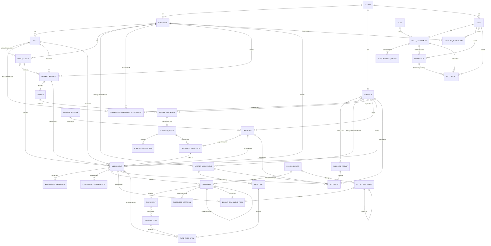

**Was das Diagramm nicht zeigt.** Die Mandantengrenze. Sie ist keine Beziehung,
sondern eine Bedingung über jeder Beziehung: eine Kante zwischen zwei Objekten
verschiedener Mandanten ist nur dort zulässig, wo Kapitel 2.3 sie ausdrücklich
erlaubt. Das betrifft insbesondere `TENDER_INVITATION` (Betreiber →
Lieferant), `ASSIGNMENT` (Betreiber ↔ Kunde ↔ Lieferant), `TIMESHEET`
(Lieferant → Kunde) und `WORKER_IDENTITY` (nur Betreiber).

## 4. Statusmodelle

Dieses Kapitel beschreibt, **welcher Übergang wann und durch wen** zulässig
ist. Die Berechtigungsmatrix 2.2 sagt mit `S` nur, *wer überhaupt* einen Status
wechseln darf; dieses Kapitel ist die zweite Hälfte dieser Aussage. Die Objekte
und ihre Felder stehen in Kapitel 3 und werden hier nicht erweitert.

- 4.1 Bedarfsanfrage
- 4.2 Einladung, Lieferantenangebot, Profilvorschlag
- 4.3 Einsatz und Verlängerung
- 4.4 Stundenzettel und Freigabeschritte
- 4.5 Abrechnungsperiode und Abrechnungsbeleg
- 4.6 Lieferantenstatus
- 4.7 Querschnitt: Statusübergang → AÜG-Prüfung → Ergebnisart

### 4.0 Konventionen für alle Statusmodelle

Die folgenden Regeln gelten für **jedes** Modell dieses Kapitels und werden in
den einzelnen Abschnitten nicht wiederholt.

1. **Nur genannte Übergänge.** Ein Status wechselt ausschließlich durch einen in
   diesem Kapitel genannten Übergang. Was nicht aufgeführt ist, ist nicht
   zulässig — auch nicht „aus Versehen" durch eine Feldänderung. Jedes Modell
   nennt deshalb ausdrücklich, welche Übergänge es **nicht** gibt.
2. **Berechtigung ist dreifach bedingt.** Die auslösende Rolle braucht `S` in
   der Matrix 2.2, die Mandantenzuordnung des Objekts und die Zuständigkeit
   (Kapitel 2). Fehlt eine der drei, ist der Übergang unzulässig, selbst wenn
   dieses Kapitel ihn nennt.
3. **Jeder Übergang wird protokolliert.** Ein Übergang erzeugt einen
   Audit-Eintrag mit `operation = transition` und `statusFrom` / `statusTo`
   (3.12). Handlungen in Vertretung tragen zusätzlich den Vertretungsvermerk
   (2.4, Regel 6). Die Spalte „Nebenwirkungen" nennt den Protokolleintrag nur
   dort gesondert, wo er über diesen Pflichtumfang hinausgeht (z. B. eine
   Pflichtbegründung).
4. **Kein genehmigender Übergang durch Fristablauf.** Zeit allein genehmigt,
   verlängert, besetzt und bestätigt nichts (2.4, Regel 1). Zeitgesteuerte
   Übergänge gibt es nur dort, wo sie **entziehen** statt zu gewähren:
   `expired` bei Bedarfsanfrage, Einladung und Angebot. Alles andere wird
   eskaliert, nicht gewechselt.
5. **Sperren sind keine Zustände.** Ein Prüfergebnis „Sperre" (5.5) verhindert
   einen Übergang; es erzeugt keinen eigenen Status. Ein gesperrter Vorgang
   bleibt in seinem Zustand stehen. Nur beim Lieferanten ist `blocked` ein
   echter Zustand (4.6) — er beschreibt die Organisation, nicht ein
   Prüfergebnis.
6. **Vier-Augen-Prinzip.** Wo ein Übergang eine Freigabe ist, darf er nicht von
   derselben Person ausgelöst werden, die den Vorgang erstellt oder beantragt
   hat — auch nicht in Vertretung (2.4, Regel 5). Das betrifft die Freigabe der
   Bedarfsanfrage (4.1), die Freigabe des Abrechnungsbelegs (4.5, Fußnote [30])
   und die Entsperrung eines Lieferanten (4.6, Fußnote [5]).
7. **Der Betreiber ersetzt keine Kundenentscheidung.** Kein Übergang, den
   dieses Kapitel einer Kundenrolle zuweist, darf vom Betreiber vollzogen
   werden — auch nicht in Vertretung und auch nicht nach Fristablauf (2.1,
   2.4 Regel 3). Liegengebliebene Entscheidungen werden eskaliert.
8. **Benachrichtigungen unterliegen den Sichtbarkeitsregeln.** Eine
   Benachrichtigung aus einem Übergang enthält nur Daten, die der Empfänger
   nach 2.3 sehen darf; mehrere Lieferanten stehen nie gemeinsam im Adressfeld
   (2.3, Regel 2).
9. **Endzustände sind endgültig.** Aus einem Endzustand führt kein Übergang
   zurück. Ein Vorgang, der nach einem Endzustand wiederholt werden soll,
   entsteht als **neues** Objekt (neue Ausschreibungsrunde, neuer Einsatz,
   Korrekturfassung, Storno- und Nachbeleg).
10. **Systemübergänge.** Zeitgesteuerte und abgeleitete Übergänge trägt das
    System. Der Audit-Eintrag führt dann ein Systemkennzeichen statt eines
    Benutzers (3.12).

**Namenskonvention.** Statusbezeichner sind modellübergreifend einheitlich:
derselbe Bezeichner bedeutet dasselbe. Wo ein Zustand fachlich etwas anderes
ist, trägt er einen anderen Namen — deshalb heißt die besetzte Bedarfsanfrage
`filled` und der regulär beendete Einsatz `completed`, nicht beides „fertig".

**Prozessfristen.** Die Fristwerte dieses Kapitels sind **Vorbelegungen** und je
Kunde über `processDeadlineConfig` (3.1) konfigurierbar (2.4, Regel 5). Sie sind
Prozessfristen ohne rechtliche Wirkung; die AÜG-Fristen stehen ausschließlich in
Kapitel 5. Fristablauf löst Erinnerung und Eskalation aus, nie einen Übergang
(Regel 4).

| Anlass | Konfigurationsschlüssel | Vorbelegung | Wirkung bei Ablauf |
|---|---|---|---|
| Entscheidung über eine eingereichte Bedarfsanfrage | `demandApprovalDeadlineDays` | 3 Arbeitstage ab `submitted` | Eskalation KG → Vertretung → KB → MD (2.4) |
| Kenntnisnahme einer Einladung | `invitationViewDeadlineDays` | 1 Arbeitstag ab `invitedAt` | Erinnerung an LD, dann LA |
| Angebotsfrist | Objektfeld `offerDeadline` (3.4, 3.5) | keine Vorbelegung — je Anfrage bzw. Runde | Einladung ohne Angebot auf `expired`; Eskalation (2.4) |
| Bindefrist eines Angebots | Objektfeld `offerValidUntil` (3.5) | keine Vorbelegung — je Angebot, optional | Angebot auf `expired`, offene Profilvorschläge werden abgelehnt (4.2) |
| Rückmeldung des Kunden auf ein vorgelegtes Profil | `submissionFeedbackDeadlineDays` | 3 Arbeitstage ab `releasedToCustomer` | Eskalation KB → Vertretung → KG → MD (2.4) |
| Entscheidung über eine Verlängerung | `extensionApprovalDeadlineDays` | 5 Arbeitstage ab `requested`, spätestens 10 Kalendertage vor Einsatzende | Eskalation KG → Vertretung → KE → MD |
| Einreichung eines Stundenzettels | `timesheetSubmissionDeadlineDays` | 3 Kalendertage nach `periodTo` | Eskalation LD → LA → MD (2.4) |
| Genehmigung eines Stundenzettels | `timesheetApprovalDeadlineDays` | bis `closingDate` der Abrechnungsperiode, Erinnerung 3 Kalendertage vorher | Eskalation; **keine** Genehmigungsfiktion |
| Prüfung eines Abrechnungsbelegs | `billingReviewDeadlineDays` | 14 Kalendertage ab `released` | Erinnerung, dann Eskalation; **keine** Bestätigungsfiktion |
| Vorlauf vor Ablauf eines Nachweises | → Kapitel 5.4 | dort festzulegen | dort festzulegen |

**Statusmodelle, die dieses Kapitel nicht führt.** Kapitel 3 verweist für jedes
Objekt auf sein Statusmodell. Sieben Objekte haben einen Lebenszyklus, für den
die Gliederung von Kapitel 4 keines vorsah. Zwei davon trägt dieses Kapitel
nach, fünf bleiben offen:

| Objekt | Stand |
|---|---|
| Einladung (3.5) | **nachgetragen** in 4.2 |
| Abrechnungsperiode (3.9) | **nachgetragen** in 4.5 |
| Rahmenvertrag (3.3) | offen — `draft` / `active` / `expired` / `terminated`, Pflege ausschließlich `MA`; gehört in ein eigenes Unterkapitel |
| Preisliste (3.3) | offen — `draft` / `active` / `expired`, dito |
| Ausschreibung (3.5) | kein eigenes Modell nötig: offen bis `closedAt`, der Fortschritt ergibt sich aus 4.1 und den Einladungen |
| Dokument / Nachweis (3.10) | gehört nach **5.4** (Anerkennung mit Fristen und Sperrwirkung), nicht in dieses Kapitel |
| Kunde, Standort, Kostenstelle (3.1) | kein Modell; aktiv/inaktiv über `validTo` und `deactivatedAt`. Die Matrix hält `S` für `MA` frei, damit ein Onboarding-Modell analog 4.6 nachgetragen werden kann |

### 4.1 Bedarfsanfrage

Objekt: `demandRequest` (3.4). Matrixzeile „Bedarfsanfrage (3.4)" in 2.2.

#### Zustände

| Deutsch | Bezeichner | Fachliche Bedeutung |
|---|---|---|
| Entwurf | `draft` | Der Bedarfsträger beschreibt den Bedarf. Der **einzige** Zustand, in dem `KB` inhaltlich ändern darf (Fußnote [11]). |
| Zur Freigabe eingereicht | `submitted` | Der Bedarf ist vollständig beschrieben und wartet auf die Entscheidung des Genehmigers. Eskalationsanlass (2.4). |
| Freigegeben | `approved` | Bedarf und Kostenwirkung sind kundenseitig freigegeben ([13]); `approvedAt` / `approvedBy` sind gesetzt. Noch nicht an Lieferanten verteilt. |
| Ausgeschrieben | `tendered` | Mindestens eine Ausschreibung (3.5) ist veröffentlicht; die Angebotsfrist läuft. Weitere Runden ändern den Zustand nicht. |
| In Auswahl | `inSelection` | Mindestens ein Profilvorschlag ist dem Kunden vorgelegt (4.2). Der Auswahlprozess läuft. |
| Besetzt | `filled` | So viele Einsätze sind wirksam, wie `headcount` verlangt (4.3). **Endzustand.** |
| Storniert | `cancelled` | Der Bedarf ist entfallen; `cancellationReason` ist Pflicht. **Endzustand.** |
| Abgelaufen | `expired` | Der Bedarfsbeginn ist erreicht, ohne dass eine Besetzung zustande kam. **Endzustand.** |

**Teilbesetzung ist kein eigener Zustand.** Sind bei `headcount > 1` erst
einige Stellen besetzt, bleibt die Anfrage in `inSelection`. Erst die letzte
Besetzung führt nach `filled`. Das hält die Zahl der Zustände klein und
verhindert, dass Teilmengen in Berichten doppelt gezählt werden.

#### Übergänge

| Von | Nach | Auslösende Rolle | Vorbedingungen | Nebenwirkungen |
|---|---|---|---|---|
| — | `draft` | `KB` (anlegen), `MD` im Auftrag ([10]) | Kunde, Standort und Kostenstelle gesetzt; Zuständigkeit des Bedarfsträgers *(offene Frage 14)* | Bei Anlage durch `MD` ist `createdOnBehalfOf` Pflicht ([10]) |
| `draft` | `submitted` | `KB` ([12]), `MD` | Pflichtfelder vollständig: `activityDescription`, mindestens eine Anforderung, `siteRef`, `startDate`, `weeklyHours`, `headcount` | Benachrichtigung an `KG`; `demandApprovalDeadlineDays` beginnt; ab hier keine inhaltliche Änderung durch `KB` ([11]); AÜG-Prüfung P8 (5.3) |
| `submitted` | `approved` | `KG` ([13]) | Auslöser ist **nicht** `requestedBy` (2.4, Regel 5); Kostenwirkung beurteilt ([8]) | `approvedAt` / `approvedBy` werden gesetzt; Benachrichtigung an `KB` und `MD`; Frist endet; AÜG-Prüfungen P8, P1-Vorschau |
| `submitted` | `draft` | `KG` ([13]) | Begründung Pflicht (Rückweisung zur Überarbeitung; 3.4 führt dafür **kein** Feld — siehe Hinweis unten) | Benachrichtigung an `KB`; `KB` darf wieder ändern ([11]); Protokolleintrag mit Begründung |
| `approved` | `tendered` | `MD`, `MA` | Ausschreibung mit mindestens einer Einladung veröffentlicht; `offerDeadline` gesetzt; je eingeladenem Lieferanten: Status `active` (4.6) und anerkannte, gültige Erlaubnis (5.4) | Einladungen entstehen in `invited` (4.2); je Lieferant **eine einzeln adressierte** Benachrichtigung (2.3, Regel 2); Angebotsfrist läuft; AÜG-Prüfungen P9 (Sperre je Einladung), P7 |
| `tendered` | `tendered` | `MD`, `MA` | Vorherige Ausschreibung geschlossen (`closedAt`); neue Ausschreibung mit `tenderRound + 1` | **Kein** Statuswechsel, aber ein Protokolleintrag am neuen Ausschreibungsobjekt; neue Einladungen; die alten Einladungen bleiben in ihrem Endzustand |
| `tendered` | `inSelection` | `MD` ([17]) | Mindestens ein Profilvorschlag steht in `releasedToCustomer` (4.2) | Benachrichtigung an `KB`; `submissionFeedbackDeadlineDays` beginnt; AÜG-Prüfungen P1, P6, P11 je Vorschlag |
| `inSelection` | `tendered` | `MD` | Alle vorgelegten Vorschläge sind abgelehnt oder zurückgezogen **und** die Angebotsfrist läuft noch oder eine neue Runde ist eröffnet | Benachrichtigung an `KB`; Protokolleintrag. Kein Rückfall, wenn bereits ein Einsatz aus der Anfrage besteht |
| `inSelection` | `filled` | `MD` | So viele Einsätze in `planned` oder `active` wie `headcount`; je Einsatz keine Sperre aus 5.1, 5.3, 5.4 | Offene Einladungen auf `expired`, offene Angebote und Vorschläge auf `rejected` mit Begründung **ohne** Bezug auf ein fremdes Angebot (2.3, Regel 3); Ausschreibung erhält `closedAt`; einzeln adressierte Benachrichtigungen |
| `draft`, `submitted`, `approved`, `tendered`, `inSelection` | `cancelled` | `KB` ([12]), `MD`, `MA` | `cancellationReason` Pflicht; **kein** wirksamer Einsatz aus dieser Anfrage (dann 4.3) | Offene Einladungen, Angebote und Vorschläge werden beendet (4.2); einzeln adressierte Benachrichtigungen; Protokolleintrag mit Begründung |
| `approved`, `tendered`, `inSelection` | `expired` | System | `startDate` erreicht und kein Einsatz zu dieser Anfrage vorhanden | Wie `cancelled`, ohne Begründungsfeld; Benachrichtigung an `KB` und `MD`; Protokolleintrag mit Systemkennzeichen. Entzieht nur — genehmigt nichts (4.0, Regel 4) |

#### Endzustände und ausgeschlossene Übergänge

**Endzustände:** `filled`, `cancelled`, `expired`.

Ausdrücklich **nicht** vorhanden:

- **Kein** `draft` → `approved`. Einreichen und Freigeben sind getrennte
  Handlungen zweier Rollen (Vier-Augen-Prinzip).
- **Keine** Freigabe durch `MA` oder `MD`. Die Freigabe ist eine
  Kundenentscheidung; eine liegengebliebene Freigabe wird eskaliert, nicht
  übernommen (2.4, Regel 3).
- **Kein** `submitted` → `tendered`. Ohne Freigabe keine Ausschreibung.
- **Kein** zeitgesteuerter Übergang nach `approved`, `tendered`, `inSelection`
  oder `filled`. Fristablauf gewährt nichts.
- **Kein** Rückweg aus `filled`, `cancelled` oder `expired`. Eine Nachbesetzung
  nach vorzeitiger Beendigung eines Einsatzes ist eine **neue** Bedarfsanfrage,
  keine Wiederöffnung — sonst verliert die Historie den Bezug zwischen Anfrage,
  Angebot und Einsatz.
- **Kein** `filled` → `cancelled`. Ein besetzter Bedarf wird über den Einsatz
  beendet (4.3), nicht über die Anfrage.
- **Kein** Übergang durch Änderung eines Feldes. Eine Verschiebung von
  `startDate` oder `endDate` im Zustand `draft` ist eine Änderung, kein
  Statuswechsel.

> **Entschieden (vormals Lücke in 3.4).** Die Rückweisung `submitted` → `draft`
> verlangt eine Begründung, damit der Bedarfsträger weiß, was zu ändern ist.
> 3.4 führt dafür jetzt das Feld `rejectionReason`; es ist bei Rückweisung
> Pflicht und für den Bedarfsträger sichtbar. Der Audit-Eintrag (`reason`,
> 3.12) entsteht zusätzlich, ersetzt das Feld aber nicht.

#### Diagramm

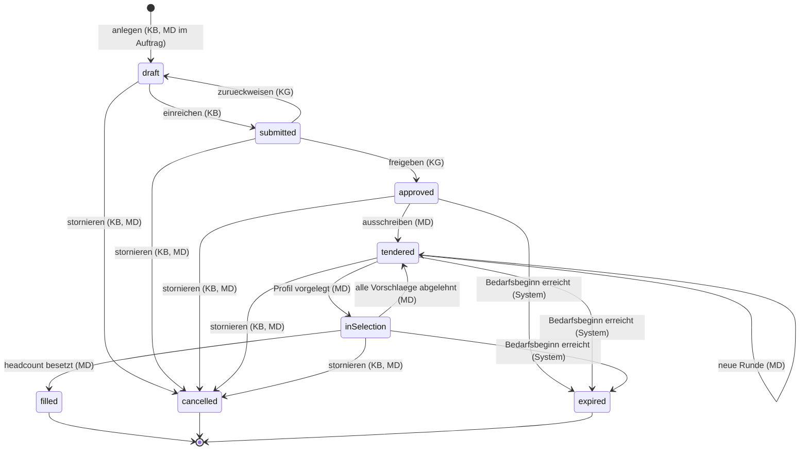

#### AÜG-Prüfungen (→ Kapitel 5)

| Übergang | Prüfung | Kapitel |
|---|---|---|
| `draft` → `submitted` | P8 Kennzeichnung und Konkretisierung: liegt eine konkrete Tätigkeitsbeschreibung vor? | 5.3 |
| `submitted` → `approved` | P8 erneut; P1 Vorschau: überschreitet der angefragte Zeitraum die Höchstüberlassungsdauer schon rechnerisch? (ohne Person, daher nur Information) | 5.3, 5.1 |
| `approved` → `tendered` | P9 Erlaubnis je eingeladenem Lieferanten; P7 Arbeitskampf am Standort | 5.4, 5.3 |
| `tendered` → `inSelection` | P1, P6, P11 je vorgelegtem Profilvorschlag — siehe 4.2 | 5.1, 5.3 |
| `inSelection` → `filled` | Keine eigene Prüfung; die Prüfungen liegen am Einsatz (4.3) | 5.1–5.4 |

Die Ergebnisarten stehen in der Querschnittstabelle 4.7.

### 4.2 Einladung, Lieferantenangebot, Profilvorschlag

Drei Objekte mit eigenem Lebenszyklus, die denselben Vorgang tragen: die
Einladung (`tenderInvitation`, 3.5) ist die Teilnahme eines Lieferanten, das
Angebot (`supplierOffer`, 3.5) seine Antwort, der Profilvorschlag
(`candidateSubmission`, 3.6) die Vorlage einer Person. Sie werden gemeinsam
behandelt, weil die Übergänge voneinander abhängen — aber sie sind **drei**
Modelle, nicht eines.

Die Matrix 2.2 führt sie in drei Zeilen: „Ausschreibung, Einladung (3.5)",
„Lieferantenangebot, Angebotsposition (3.5)" und „Kandidat / Profilvorschlag
(3.6)".

#### 4.2.1 Einladung

| Deutsch | Bezeichner | Fachliche Bedeutung |
|---|---|---|
| Eingeladen | `invited` | Die Einladung ist zugestellt; der Lieferant hat sie noch nicht geöffnet. |
| Zur Kenntnis genommen | `viewed` | Der Lieferant hat die Anfrage im Umfang von [14] gesehen; `viewedAt` ist gesetzt. Grundlage der Eskalation (2.4). |
| Angebot abgegeben | `offerSubmitted` | Zu dieser Einladung existiert ein eingereichtes Angebot. **Ende des eigenen Lebenszyklus** — der Vorgang läuft am Angebot weiter. |
| Abgesagt | `declined` | Der Lieferant bietet nicht an; `declineReason` ist Pflicht. **Endzustand.** |
| Abgelaufen | `expired` | Die Angebotsfrist ist verstrichen oder die Ausschreibung ist geschlossen, ohne dass ein Angebot vorliegt. **Endzustand.** |

| Von | Nach | Auslösende Rolle | Vorbedingungen | Nebenwirkungen |
|---|---|---|---|---|
| — | `invited` | `MD`, `MA` | Ausschreibung veröffentlicht (4.1); Lieferant `active` (4.6) mit anerkannter, gültiger Erlaubnis (5.4) | Einzeln adressierte Benachrichtigung an `LD` (2.3, Regel 2); `invitationViewDeadlineDays` beginnt; AÜG-Prüfung P9 (Sperre) |
| `invited` | `viewed` | System | Erster lesender Zugriff eines Benutzers des Lieferanten auf die Einladung | `viewedAt` wird gesetzt; Erinnerungsfrist endet. **Kein** Rechtsgeschäft und keine Zusage |
| `invited`, `viewed` | `offerSubmitted` | System, als Folge des Übergangs `draft` → `submitted` am Angebot (4.2.2) | Angebot zu dieser Einladung in `submitted` | `respondedAt` wird gesetzt; Benachrichtigung an `MD` |
| `invited`, `viewed` | `declined` | `LD` ([46]) | `declineReason` Pflicht | `respondedAt` wird gesetzt; Benachrichtigung an `MD`; die Absage enthält keinen Bezug auf andere Lieferanten |
| `invited`, `viewed` | `expired` | System | `offerDeadline` der Ausschreibung verstrichen **oder** Ausschreibung geschlossen (`closedAt`), und kein Angebot vorhanden | Benachrichtigung an `MD`; Eskalationsanlass „Ausschreibung ohne Angebot" (2.4). Entzieht nur |

**Endzustände:** `declined`, `expired`. `offerSubmitted` ist das Ende des
eigenen Lebenszyklus: die Einladung ist beantwortet, der Vorgang läuft am
Angebot weiter (4.2.2).

**Ausgeschlossen:**

- **Kein** Rückweg von `declined` oder `expired`. Eine zweite Chance ist eine
  neue Ausschreibungsrunde mit neuer Einladung (3.5), keine Wiederbelebung.
- **Kein** `offerSubmitted` → `viewed`. Zieht der Lieferant sein Angebot zurück,
  bleibt die Einladung auf `offerSubmitted`: sie **war** beantwortet, und der
  Rückzug ist am Angebot dokumentiert.
- **Keine** Mitteilung über fremde Einladungen. Kein Übergang darf erkennbar
  machen, wie viele Lieferanten eingeladen wurden oder geantwortet haben
  (2.3, „Zwischen Lieferanten").

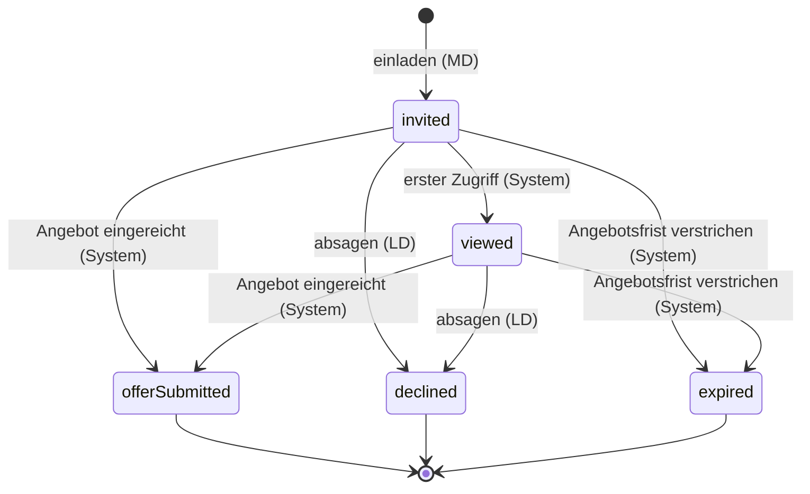

> **Entschieden (vormals offene Frage 23).** Die Einladung trägt in 3.5
> `declineReason`, `respondedAt` und den Wert `declined`; der
> Lieferantendisponent sagt seine Einladung deshalb **selbst** ab. Die Matrix
> 2.2 führt dafür in der Zeile „Ausschreibung, Einladung (3.5)" jetzt
> `L[16] S[46]` — ein eng begrenztes Statusrecht auf den eigenen Vorgang,
> analog [20]. Annahme, Fristverlängerung und der Fortschritt der
> Ausschreibung bleiben beim Betreiber.

#### 4.2.2 Lieferantenangebot

| Deutsch | Bezeichner | Fachliche Bedeutung |
|---|---|---|
| Entwurf | `draft` | Der Lieferant erfasst Verfügbarkeit, Menge und Preis. Löschen nur hier ([21]). |
| Eingereicht | `submitted` | Das Angebot liegt beim Betreiber; `submittedAt` ist gesetzt. Änderung durch `LD` noch möglich ([19]). |
| Gesichtet | `reviewed` | Der Betreiber hat das Angebot bewertet; `reviewedAt` ist gesetzt. **Ab hier keine Änderung durch `LD`** ([19]). |
| Zugesagt | `accepted` | Der Lieferant erhält den Zuschlag: mindestens ein Profilvorschlag dieses Angebots ist besetzt. **Endzustand.** |
| Abgelehnt | `rejected` | Der Betreiber lehnt ab; Begründung Pflicht und **ohne** Bezug auf ein fremdes Angebot (2.3, Regel 3). **Endzustand.** |
| Zurückgezogen | `withdrawn` | Der Lieferant zieht zurück; `withdrawnAt` ist gesetzt. **Endzustand.** |
| Abgelaufen | `expired` | Die Bindefrist `offerValidUntil` ist verstrichen, ohne Entscheidung. **Endzustand.** |

| Von | Nach | Auslösende Rolle | Vorbedingungen | Nebenwirkungen |
|---|---|---|---|---|
| — | `draft` | `LD` (anlegen) | Eigene Einladung in `invited` oder `viewed`; Angebotsfrist nicht verstrichen | Je Einladung höchstens **ein** Angebot (3.13) |
| `draft` | `submitted` | `LD` ([20]) | Mindestens eine Angebotsposition; `availableFrom` und `offeredHeadcount` gesetzt; Angebotsfrist nicht verstrichen | Einladung auf `offerSubmitted` (4.2.1); Benachrichtigung an `MD`; Angebot wird für den Betreiber sichtbar |
| `submitted` | `submitted` | `LD` ([19]) | Angebot noch nicht gesichtet | Inhaltliche Änderung, **kein** Statuswechsel; Protokolleintrag mit geänderten Feldern (3.12) |
| `submitted` | `reviewed` | `MD` ([17]), `MA` | — | `reviewedAt` wird gesetzt; ab hier keine Änderung durch `LD` ([19]); keine Benachrichtigung an andere Lieferanten |
| `reviewed` | `accepted` | `MD` ([17]) | Mindestens ein Profilvorschlag dieses Angebots in `accepted` (4.2.3) | Benachrichtigung an `LD` — Zuschlag ohne Angaben zu fremden Angeboten; Grundlage für den Einsatz (4.3) |
| `submitted`, `reviewed` | `rejected` | `MD` ([17]), `MA` | Begründung Pflicht, ohne Fremdbezug (2.3, Regel 3) | Benachrichtigung an `LD`; offene Profilvorschläge dieses Angebots auf `rejected`; Protokolleintrag mit Begründung |
| `draft`, `submitted`, `reviewed` | `withdrawn` | `LD` ([20]) | Angebot noch nicht `accepted` | Benachrichtigung an `MD`; offene Profilvorschläge dieses Angebots auf `withdrawn`; Einladung bleibt auf `offerSubmitted` |
| `submitted`, `reviewed` | `expired` | System | `offerValidUntil` verstrichen und keine Entscheidung getroffen | Benachrichtigung an `LD` und `MD`; offene Profilvorschläge auf `expired`-Wirkung (4.2.3: `rejected` mit Fristbegründung). Entzieht nur |

**Endzustände:** `accepted`, `rejected`, `withdrawn`, `expired`.

**Ausgeschlossen:**

- **Kein** `accepted` → irgendwohin. Ein Widerruf des Zuschlags ist die
  vorzeitige Beendigung des entstandenen Einsatzes (4.3), nicht ein Rückschritt
  des Angebots.
- **Keine** inhaltliche Änderung durch den Betreiber. `MA` darf sperren oder
  stornieren, aber nicht ändern (2.1); `rejected` ist deshalb kein Ersatz für
  eine Korrektur.
- **Kein** `draft` → `reviewed`. Ein nicht eingereichtes Angebot ist für den
  Betreiber nicht sichtbar.
- **Kein** Übergang, der dem Lieferanten die eigene Platzierung verrät — auch
  nicht in der Ablehnungsbegründung (2.3, „Zwischen Lieferanten").

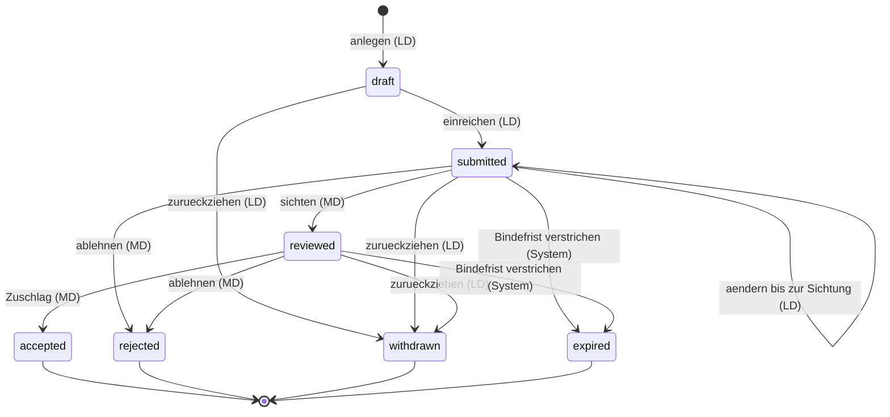

#### 4.2.3 Profilvorschlag

| Deutsch | Bezeichner | Fachliche Bedeutung |
|---|---|---|
| Entwurf | `draft` | Der Lieferant stellt den Vorschlag zusammen. Löschen nur hier ([21]). |
| Eingereicht | `submitted` | Der Vorschlag liegt beim Betreiber; `submittedAt` ist gesetzt. |
| Gesichtet | `reviewed` | Der Betreiber hat geprüft und die AÜG-Vorprüfungen ausgeführt. |
| Dem Kunden vorgelegt | `releasedToCustomer` | Der Vorschlag ist dem Bedarfsträger zugänglich — **pseudonymisiert**, `releasedToCustomerAt` gesetzt ([22], 6.4). |
| Interview vereinbart | `interviewScheduled` | Der Bedarfsträger will die Person kennenlernen; `interviewScheduledAt` ist gesetzt. |
| Zugesagt | `accepted` | Fachliche Zusage des Kunden; `decision = accepted`. Offenlegungsstufe wechselt auf `identified` (6.4). **Endzustand.** |
| Abgelehnt | `rejected` | Absage; `decisionReason` Pflicht, **ohne** Bezug auf ein fremdes Angebot (2.3, Regel 3). **Endzustand.** |
| Zurückgezogen | `withdrawn` | Der Lieferant zieht den Vorschlag zurück; `withdrawnAt` ist gesetzt. **Endzustand.** |

| Von | Nach | Auslösende Rolle | Vorbedingungen | Nebenwirkungen |
|---|---|---|---|---|
| — | `draft` | `LD` (anlegen) | Eigenes Angebot in `draft`, `submitted` oder `reviewed`; Kandidat vorhanden (3.6); `pseudonym` gesetzt | Derselbe Kandidat darf in mehreren Vorschlägen stehen, mit eigenem Status je Vorschlag (3.13) |
| `draft` | `submitted` | `LD` ([20]) | `availableFrom` gesetzt; Offenlegungsstufe `pseudonymized` | Benachrichtigung an `MD`; der Vorschlag wird für den Betreiber sichtbar, für den Kunden **nicht** |
| `submitted` | `reviewed` | `MD` ([17]), `MA` | — | AÜG-Prüfungen P1, P6, P10, P11; Doppelvorschlag desselben Kandidaten wird **nur** beim Betreiber sichtbar (2.3, Regel 4) |
| `reviewed` | `releasedToCustomer` | `MD` ([22]) | Offenlegungsstufe `pseudonymized`; Prüfergebnisse ohne Sperre; Pflichtnachweise im Umfang von 5.4 geprüft | Benachrichtigung an `KB`; `submissionFeedbackDeadlineDays` beginnt; Bedarfsanfrage auf `inSelection` (4.1); **keine** Klardaten an den Kunden (6.4) |
| `releasedToCustomer` | `interviewScheduled` | `KB` ([24]) | — | Benachrichtigung an `MD`, von dort an `LD`; Klardaten bleiben verdeckt, bis die Zusage erfolgt (6.4) |
| `releasedToCustomer`, `interviewScheduled` | `accepted` | `KB` entscheidet ([24]), wirksam gegenüber dem Lieferanten durch `MD` ([17]) | `decision`, `decidedAt`, `decidedBy` gesetzt; AÜG-Prüfungen P1, P6, P11 ohne Sperre | Offenlegungsstufe wechselt auf `identified`, jeder Zugriff auf Klardaten wird protokolliert (3.12, 6.4); Angebot auf `accepted` (4.2.2); Einsatz kann angelegt werden (4.3) |
| `submitted`, `reviewed`, `releasedToCustomer`, `interviewScheduled` | `rejected` | `KB` entscheidet ([24]) bzw. `MD` ([17]) bei Vorgängen, die den Kunden nicht erreicht haben | `decisionReason` Pflicht, ohne Fremdbezug | Benachrichtigung an `LD` über `MD`; Klardaten bleiben verdeckt; Löschfrist für abgelehnte Kandidaten läuft (6.5) |
| `draft`, `submitted`, `reviewed`, `releasedToCustomer`, `interviewScheduled` | `withdrawn` | `LD` ([20]) | Vorschlag noch nicht `accepted` | Benachrichtigung an `MD` und `KB`; Bedarfsanfrage bleibt in `inSelection`, solange ein anderer Vorschlag offen ist |

**Abschluss offener Vorschläge.** Erreicht die Bedarfsanfrage `filled`,
`cancelled` oder `expired` (4.1), setzt `MD` die noch offenen Vorschläge auf
`rejected` mit einer Begründung, die den Anlass nennt („Anfrage anderweitig
besetzt", „Bedarf entfallen", „Frist abgelaufen") und **keinen** Hinweis auf
ein fremdes Angebot enthält. Das ist ein Übergang mit Auslöser, kein
Zeitablauf (4.0, Regel 4).

**Endzustände:** `accepted`, `rejected`, `withdrawn`. Der Profilvorschlag hat
**keinen** Zustand `expired`: eine ausbleibende Entscheidung läuft nie ab, sie
wird eskaliert (2.4) und am Ende mit Begründung abgelehnt.

**Ausgeschlossen:**

- **Kein** `accepted` → `rejected`. Wird die Zusage hinfällig, ist das die
  vorzeitige Beendigung des Einsatzes (4.3).
- **Keine** Zusage durch den Betreiber. Die fachliche Auswahl ist eine
  Kundenentscheidung ([24], 2.4 Regel 3); `MD` führt nur den Status gegenüber
  dem Lieferanten.
- **Kein** `releasedToCustomer` ohne Pseudonymisierung. Der Übergang **ist**
  die Umsetzung der Datenminimierung (6.4); eine Vorlage mit Klardaten ist kein
  Sonderfall, sondern unzulässig.
- **Kein** zeitgesteuerter Übergang nach `rejected`. Eine ausbleibende
  Rückmeldung des Kunden wird eskaliert (2.4), nicht entschieden.
- **Kein** Übergang, der einem Lieferanten einen Doppelvorschlag desselben
  Kandidaten offenbart (2.3, Regel 4).

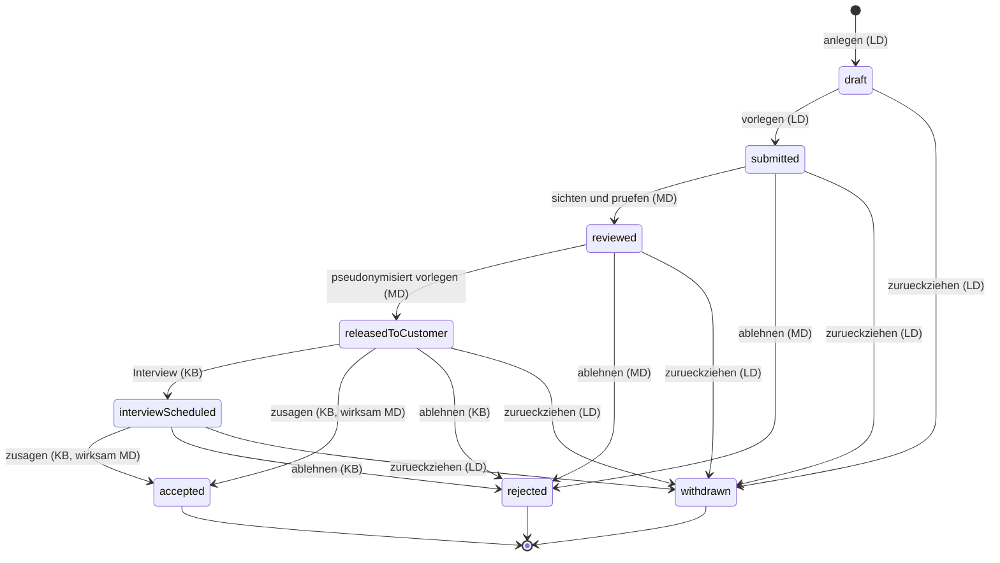

#### AÜG-Prüfungen (→ Kapitel 5)

| Übergang | Prüfung | Kapitel |
|---|---|---|
| Einladung → `invited` | P9 Erlaubnis des Lieferanten gültig und anerkannt | 5.4 |
| Profilvorschlag `submitted` → `reviewed` | P1 bisher angerechnete Dauer dieser Person bei diesem Kunden; P6 Drehtürklausel; P10 Pflichtnachweise des Kandidaten; P11 Arbeitsverhältnis beim Verleiher | 5.1, 5.3, 5.4 |
| Profilvorschlag `reviewed` → `releasedToCustomer` | Keine AÜG-Prüfung — hier greift die Datenminimierung (6.4) | 6.4 |
| Profilvorschlag → `accepted` | P1, P6, P11 erneut, jetzt mit Sperrwirkung | 5.1, 5.3 |

**Abhängigkeit von offener Frage 18.** P1 und P6 setzen voraus, dass der
Betreiber erkennt, ob zwei Kandidatensätze dieselbe Person betreffen
(`workerIdentity`, 3.6). Wird Frage 18 mit „nein" beantwortet, prüfen diese
Übergänge nur innerhalb eines Lieferanten; Kapitel 5 muss dann einen anderen
Weg beschreiben. Die Zustände und Übergänge dieses Abschnitts ändern sich
dadurch **nicht**.

### 4.3 Einsatz und Verlängerung

Zwei Modelle: der Einsatz (`assignment`, 3.7) und die Verlängerung
(`assignmentExtension`, 3.7). Beide teilen die Matrixzeile „Einsatz,
Verlängerung, Unterbrechung (3.7)" in 2.2.

#### 4.3.1 Einsatz

| Deutsch | Bezeichner | Fachliche Bedeutung |
|---|---|---|
| Geplant | `planned` | Der Einsatz ist angelegt und terminiert, die Überlassung hat nicht begonnen. `plannedStartDate` liegt in der Zukunft oder der Start ist noch nicht bestätigt. |
| Aktiv | `active` | Die Überlassung läuft; `actualStartDate` ist gesetzt. Der Fristenlauf nach 5.1 und 5.2 läuft. |
| Unterbrochen | `interrupted` | Eine dokumentierte Unterbrechung (3.7) läuft; es wird keine Arbeitsleistung erbracht. Das Arbeitsverhältnis beim Verleiher bleibt unberührt. |
| Beendet | `completed` | Die Überlassung ist zum vorgesehenen Ende abgelaufen; `actualEndDate` ist gesetzt. **Endzustand.** |
| Vorzeitig beendet | `terminatedEarly` | Die Überlassung endet vor dem geplanten Ende; `terminationReason` und `terminationRequestedBy` sind Pflicht. **Endzustand.** |

**„Verlängert" ist kein Zustand des Einsatzes.** Die Gliederung dieses Kapitels
nannte „verlängert" als Zustand. Das ist in der Ausarbeitung bewusst anders
gelöst: eine wirksame Verlängerung verschiebt `plannedEndDate` und lässt den
Einsatz in seinem Zustand (`planned` oder `active`). Der Vorgang selbst hat
seinen eigenen Lebenszyklus (4.3.2) — so bleibt sichtbar, ob eine Verlängerung
beantragt, genehmigt oder wirksam ist, ohne den Einsatz aus `active`
herauszunehmen und damit Zeiterfassung und Fristenlauf zu unterbrechen.

**Der Antrag auf vorzeitige Beendigung ist kein Zustand.** Ein offener Antrag
ändert am Einsatz nichts: er läuft weiter, Zeiten werden weiter erfasst, der
Fristenlauf läuft weiter. Erst die Wirksamkeit führt nach `terminatedEarly`.
Das ist die Anwendung von 2.4 Regel 1 — ein unentschiedener Vorgang bewirkt
nichts (siehe auch den Hinweis am Ende dieses Abschnitts).

| Von | Nach | Auslösende Rolle | Vorbedingungen | Nebenwirkungen |
|---|---|---|---|---|
| — | `planned` | `MD`, `MA` | Profilvorschlag in `accepted` (4.2.3) oder Einsatz ohne vorangegangene Anfrage; Lieferant `active` (4.6); eigene `activityDescription` (nicht nur ein Verweis, 5.3); vereinbarte Preisposition beider Seiten; AÜG-Prüfungen P1, P6, P9, P11 ohne Sperre | Benachrichtigung an `KB`, `KE` und `LD`; abgeleitete Felder `maxDurationEndDate`, `equalPayDueDate`, `countedDurationDays` werden berechnet (5.1, 5.2); Bedarfsanfrage ggf. auf `filled` (4.1) |
| `planned` | `active` | `MD` | `actualStartDate` gesetzt; P9 Erlaubnis gültig; P10 Pflichtnachweise vorhanden *(offene Frage 20)*; P7 kein Arbeitskampf am Standort; P1 Fristende nicht überschritten | **Fristenlauf beginnt** (5.1, 5.2); Stundenzettel für die laufende Abrechnungsperiode wird erwartet (4.4); Benachrichtigung an `KB` und `LD` |
| `active` | `interrupted` | `MD`, auf Anzeige von `LD` oder `KB` ([25]) | Unterbrechung (3.7) mit `interruptionFrom` und Grund angelegt | Zeiterfassung für den Unterbrechungszeitraum gesperrt (4.4); P2 bewertet die Wirkung auf die Zählung (`countsAsReset`, 5.1); Benachrichtigung an beide Seiten |
| `interrupted` | `active` | `MD` | `interruptionTo` gesetzt; P9 Erlaubnis weiterhin gültig; P7 kein Arbeitskampf | P1 und P2 werden neu gerechnet — eine Unterbrechung über der Schwelle aus 5.1 setzt die Zählung zurück; `maxDurationEndDate` wird neu abgeleitet; Benachrichtigung |
| `active` | `completed` | `MD` | `plannedEndDate` erreicht; `actualEndDate` gesetzt; keine laufende Unterbrechung | Keine neuen Zeitpositionen möglich (4.4); offene Stundenzettel müssen eingereicht und genehmigt werden; Fristenlauf endet; Löschfrist für den beendeten Einsatz beginnt (6.5) |
| `planned`, `active`, `interrupted` | `terminatedEarly` | `MD` setzt wirksam; Antrag durch `KB` oder `LD` ([25]); Genehmigung durch `KG` ([26]) **nur** bei Antrag der Kundenseite | `terminationReason` und `terminationRequestedBy` Pflicht; bei Kundenantrag Genehmigung `KG` vorhanden; `actualEndDate` gesetzt | Wie `completed`; zusätzlich Benachrichtigung an die jeweils andere Seite mit Begründung; eine Nachbesetzung ist eine **neue** Bedarfsanfrage (4.1) |

**Zuweisung der Genehmigung (Festlegung dieses Kapitels).** Fußnote [26] in 2.2
weist `KG` die Genehmigung von Verlängerung und vorzeitiger Beendigung zu,
„soweit Kapitel 4.3 sie der Kundenseite zuweist". Dieses Kapitel weist zu:

- **Verlängerung:** immer genehmigungspflichtig durch `KG`, unabhängig davon,
  wer sie beantragt — sie erzeugt Kosten beim Kunden (4.3.2).
- **Vorzeitige Beendigung auf Antrag der Kundenseite:** genehmigungspflichtig
  durch `KG`, weil Mindestlaufzeiten und Kündigungsfristen Kostenwirkung haben.
- **Vorzeitige Beendigung auf Antrag des Lieferanten:** **keine** Genehmigung
  der Kundenseite. Der Verleiher entscheidet über den Einsatz seines
  Arbeitnehmers; der Kunde wird unterrichtet, nicht gefragt.
- **Vorzeitige Beendigung aus Rechtsgründen** (entzogene Erlaubnis,
  AÜG-Sperre): `MD` setzt sie mit Pflichtbegründung wirksam. **Ob** ein
  laufender Einsatz bei Erlöschen der Erlaubnis zu beenden ist, entscheidet
  5.4 — dieses Kapitel hält nur den Übergang bereit und nimmt die Rechtsfolge
  nicht vorweg.

**Endzustände:** `completed`, `terminatedEarly`.

**Ausgeschlossen:**

- **Kein** `completed` oder `terminatedEarly` → `active`. Eine erneute
  Überlassung derselben Person beim selben Kunden ist ein **neuer** Einsatz —
  und zählt nach 5.1 weiter, statt neu zu beginnen.
- **Kein** `planned` → `completed`. Ein Einsatz, der nie begonnen hat, wird
  `terminatedEarly` mit Begründung; so bleibt erkennbar, dass keine
  Arbeitsleistung erbracht wurde.
- **Kein** Zustand `blocked`. Eine AÜG-Sperre verhindert den Übergang nach
  `active` oder die Wirksamkeit einer Verlängerung; der Einsatz bleibt stehen
  (4.0, Regel 5).
- **Kein** zeitgesteuerter Übergang nach `active`. Der Beginn wird bestätigt,
  nicht unterstellt — sonst beginnt der Fristenlauf nach 5.1 für eine
  Überlassung, die es nicht gibt.
- **Kein** zeitgesteuerter Übergang nach `completed`. Das Erreichen von
  `plannedEndDate` erzeugt eine Erinnerung; das tatsächliche Ende wird
  festgestellt, weil `actualEndDate` die Grundlage der Abrechnung und des
  Fristenlaufs ist.
- **Keine** stille Verlängerung. Das Verschieben von `plannedEndDate` ohne
  Verlängerungsvorgang ist unzulässig (3.7).
- **Kein** `interrupted` → `completed` ohne Wiederaufnahme. Endet der Einsatz
  während einer Unterbrechung, ist das `terminatedEarly`.

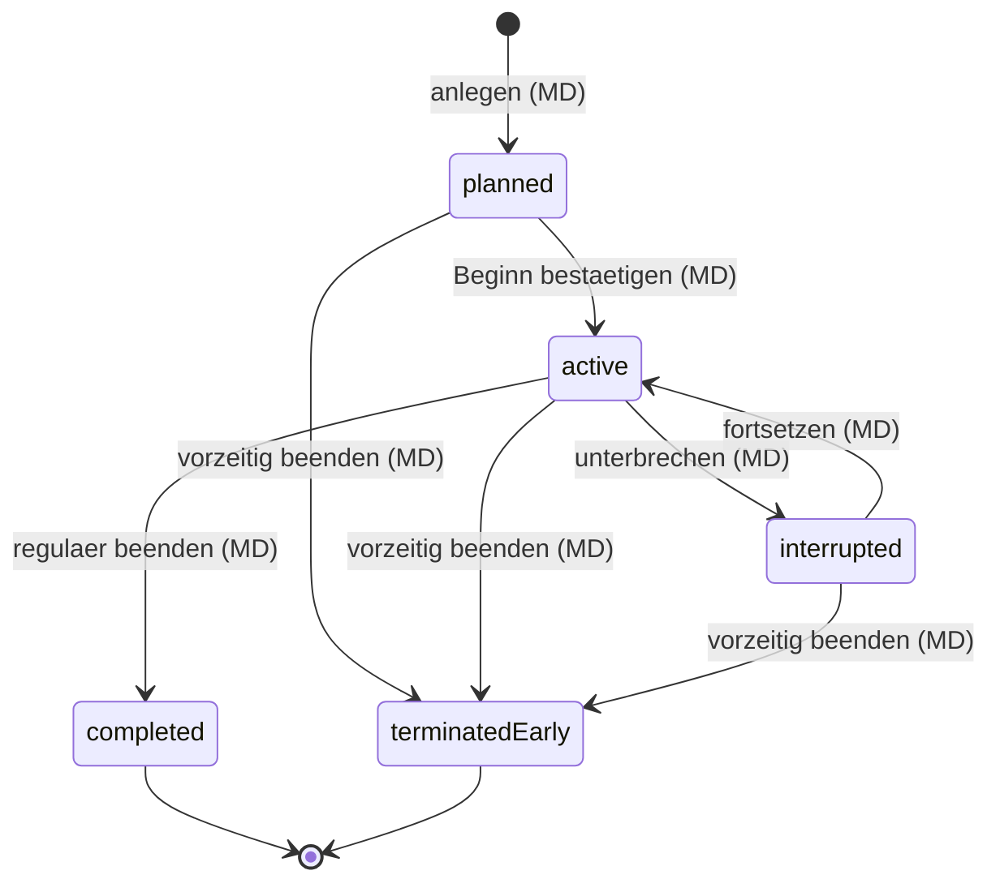

#### 4.3.2 Verlängerung

| Deutsch | Bezeichner | Fachliche Bedeutung |
|---|---|---|
| Beantragt | `requested` | Der Antrag liegt vor; `requestedAt` / `requestedBy` gesetzt. Der Einsatz läuft unverändert. |
| Genehmigt | `approved` | Die Kundenseite hat zugestimmt; `approvedAt` / `approvedBy` gesetzt. Noch **nicht** wirksam. |
| Abgelehnt | `rejected` | Die Kundenseite lehnt ab. **Endzustand.** |
| Wirksam | `effective` | Der Betreiber hat die Verlängerung vollzogen; `effectiveAt` / `effectiveBy` gesetzt und `plannedEndDate` des Einsatzes verschoben. **Endzustand.** |
| Zurückgezogen | `withdrawn` | Der Antragsteller zieht zurück. **Endzustand.** |

| Von | Nach | Auslösende Rolle | Vorbedingungen | Nebenwirkungen |
|---|---|---|---|---|
| — | `requested` | `KB` ([25]), `LD` ([25]), `MD` | Einsatz in `planned`, `active` oder `interrupted`; `newEndDate` nach dem bisherigen Ende; Begründung Pflicht | Benachrichtigung an `KG`; `extensionApprovalDeadlineDays` beginnt; AÜG-Vorprüfungen P1 und P3 als `ruleCheckResult` am Vorgang |
| `requested` | `approved` | `KG` ([26]) | Auslöser ist nicht `requestedBy` (2.4, Regel 5); Kostenwirkung beurteilt ([8]) | Benachrichtigung an `MD` und den Antragsteller; Frist endet |
| `requested` | `rejected` | `KG` ([26]) | Begründung Pflicht | Benachrichtigung an den Antragsteller; der Einsatz endet zum unveränderten `plannedEndDate` |
| `requested` | `withdrawn` | Antragsteller (`KB`, `LD` oder `MD`) | Noch nicht genehmigt | Benachrichtigung an `KG` |
| `approved` | `effective` | `MD` | P1 `newEndDate` innerhalb von `maxDurationEndDate` — sonst **Sperre** (5.1, 5.5); P9 Erlaubnis für den verlängerten Zeitraum gültig; P3 Equal-Pay-Fälligkeit geprüft | `plannedEndDate` des Einsatzes wird verschoben; `maxDurationEndDate` und `equalPayDueDate` werden neu abgeleitet; Benachrichtigung an alle Beteiligten; Protokolleintrag am Einsatz **und** am Vorgang |

**Endzustände:** `effective`, `rejected`, `withdrawn`.

**Ausgeschlossen:**

- **Kein** `requested` → `effective`. Ohne kundenseitige Genehmigung wird keine
  Verlängerung wirksam — der Betreiber ersetzt die Entscheidung nicht (2.4,
  Regel 3).
- **Kein** `approved` → `rejected`. Eine genehmigte, aber nicht gewollte
  Verlängerung wird nicht wirksam gesetzt und läuft über die Frist aus; der
  Vorgang bleibt in `approved` und ist dokumentiert.
- **Kein** zeitgesteuerter Übergang nach `approved` oder `effective`.
  Fristablauf verlängert nichts (2.4, Regel 1).
- **Keine** Verlängerung über `maxDurationEndDate` hinaus ohne dokumentierte
  Übersteuerung nach 5.5 *(offene Frage 10)*.
- **Keine** Rückgängigmachung einer wirksamen Verlängerung. Das verkürzte Ende
  ist eine vorzeitige Beendigung (4.3.1).

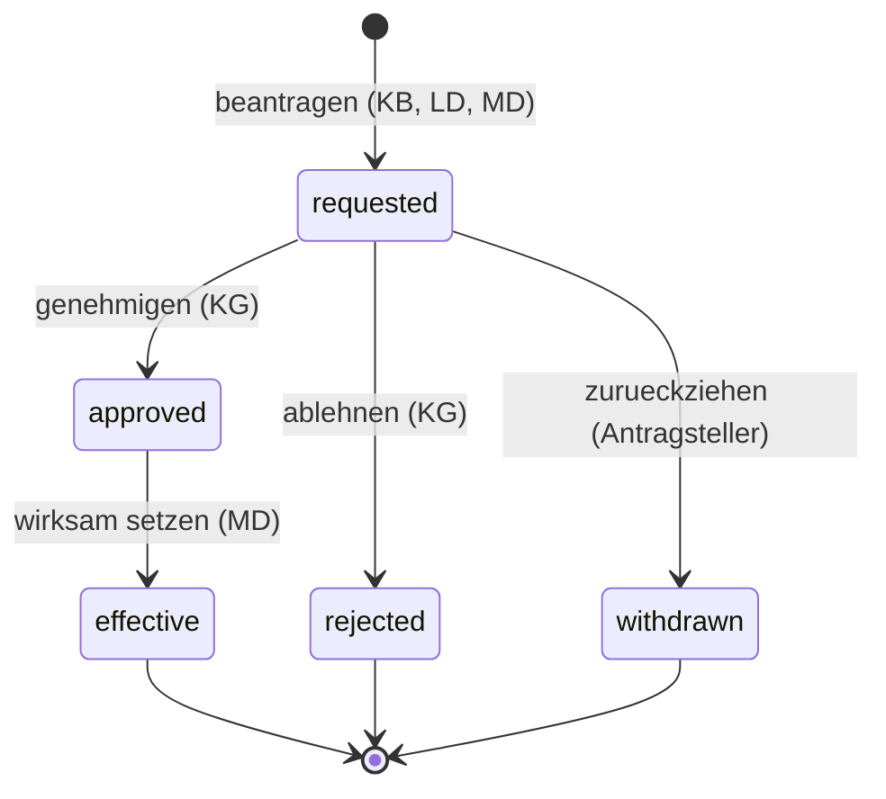

#### AÜG-Prüfungen (→ Kapitel 5)

| Übergang | Prüfung | Kapitel |
|---|---|---|
| → `planned` | P1 Höchstüberlassungsdauer über alle Vorläufer derselben Person beim selben Kunden; P6 Drehtürklausel; P9 Erlaubnis; P11 Arbeitsverhältnis beim Verleiher; P4 Vergleichsentgelt vorhanden; P5 Branchenzuschlagsschema zugeordnet | 5.1–5.4 |
| `planned` → `active` | P9 Erlaubnis am Starttag; P10 Pflichtnachweise *(offene Frage 20)*; P7 Arbeitskampf am Standort; P1 Fristende nicht erreicht | 5.4, 5.3, 5.1 |
| `active` → `interrupted` | P2 Erfassung der Unterbrechung für die Zählung | 5.1 |
| `interrupted` → `active` | P2 Bewertung der Unterbrechungsdauer (Zurücksetzen der Zählung); P1 Neuberechnung | 5.1 |
| Verlängerung `requested` → `approved` | P1 und P3 als Vorschau, damit die Kundenseite die Fristwirkung kennt | 5.1, 5.2 |
| Verlängerung `approved` → `effective` | P1 mit Sperrwirkung; P9 für den verlängerten Zeitraum; P3 / P4 Equal Pay | 5.1, 5.4, 5.2 |
| `active` → `completed` / `terminatedEarly` | P1 und P3 Abschlussrechnung der Fristen (Dokumentation, keine Sperre) | 5.1, 5.2 |

> **Hinweis auf eine Lücke in 3.7.** Die Verlängerung ist ein eigenes Objekt mit
> Antrag, Genehmigung und Wirksamkeit. Die vorzeitige Beendigung ist das
> **nicht**: 3.7 führt sie als Felder am Einsatz (`terminationReason`,
> `terminationRequestedBy`). Ein beantragter, noch nicht entschiedener
> Beendigungsvorgang hat deshalb keinen eigenen Zustand und ist nur über das
> Feld und die Eskalation sichtbar. Für den Prototyp genügt das; wird eine
> mehrstufige Genehmigung der Beendigung gewünscht, ist in 3.7 ein eigener
> Vorgang analog `assignmentExtension` nachzutragen.

### 4.4 Stundenzettel und Freigabeschritte

Objekte: `timesheet` und `timesheetApproval` (3.8). Matrixzeile „Stundenzettel,
Freigabeschritt (3.8)" in 2.2; der Freigabeschritt teilt die Zeile.

> **Abhängigkeit von offener Frage 5.** Wie viele Genehmigungsstufen es gibt und
> welche Rolle welche Stufe trägt, ist offen. Dieses Modell ist deshalb so
> gebaut, dass die **Stufenzahl in den Daten steht, nicht im Statusmodell**: die
> Zustände und Übergänge unten gelten für eine wie für fünf Stufen. Was sich mit
> der Antwort ändert, ist allein der Inhalt von `assignedRoleCode` je
> `timesheetApproval` (3.8) — kein Zustand, kein Übergang, keine Nebenwirkung.
> Die betroffenen Stellen sind mit *(offene Frage 5)* gekennzeichnet.

#### Zustände

| Deutsch | Bezeichner | Fachliche Bedeutung |
|---|---|---|
| Erfasst | `recorded` | Zeiten werden erfasst oder nachgearbeitet. Der **einzige** Zustand, in dem Zeitpositionen frei angelegt, geändert und entfernt werden dürfen ([44]). |
| Eingereicht | `submitted` | Der Zettel liegt zur Genehmigung vor; `submittedAt` / `submittedBy` gesetzt. Keine Änderung durch die erfassende Seite mehr. |
| In Prüfung | `inApproval` | Mindestens ein Freigabeschritt ist offen. Bei mehreren Stufen bleibt der Zettel so lange hier, bis die letzte Stufe entschieden ist *(offene Frage 5)*. |
| Genehmigt | `approved` | Alle Stufen haben zugestimmt; `approvedAt` / `approvedBy` tragen die **letzte** Stufe. Grundlage für Abrechnungsbelege (4.5). |
| Abgelehnt | `rejected` | Eine Stufe hat abgelehnt; `rejectionReason` ist Pflicht. Der Zettel ist zur Nacharbeit freigegeben. |
| Korrigiert | `corrected` | Eine genehmigte Korrekturfassung hat diesen Zettel ersetzt (`correctionOf` am neuen Zettel). **Endzustand.** |

**Die Zeitposition trägt keinen Status** (Fußnote [44] in 2.2). Genehmigt wird
der Zettel; die Zeitpositionen folgen seinem Zustand.

#### Übergänge

| Von | Nach | Auslösende Rolle | Vorbedingungen | Nebenwirkungen |
|---|---|---|---|---|
| — | `recorded` | `AN` *(offene Frage 4)*, `LD` im Namen des Leiharbeitnehmers ([27]), `MD` ([27]) | Einsatz in `active`, `interrupted`, `completed` oder `terminatedEarly`; Abrechnungsperiode `open` (4.5); je Einsatz und Periode genau **ein** Zettel (3.13) | `recordedBy` wird gesetzt; `timesheetSubmissionDeadlineDays` beginnt mit dem Periodenende |
| `recorded` | `submitted` | `AN` *(offene Frage 4)*, `LD` ([20]), `MD` | Mindestens eine Zeitposition; Summen abgeleitet; Zeitpositionen liegen innerhalb `periodFrom` / `periodTo` und außerhalb einer laufenden Unterbrechung (4.3) | Freigabeschritte werden nach der konfigurierten Stufenfolge erzeugt *(offene Frage 5)*; Benachrichtigung an die Rolle der ersten Stufe; AÜG-Prüfungen P1 und P4 |
| `submitted` | `inApproval` | System | Mindestens ein Freigabeschritt vorhanden | Erste Stufe wird geöffnet; `timesheetApprovalDeadlineDays` läuft gegen `closingDate` der Periode (4.5) |
| `inApproval` | `inApproval` | Rolle der offenen Stufe — `KB` oder `KG` ([29]) *(offene Frage 5)* | Entscheidung `approved` am Freigabeschritt; weitere Stufen offen | Nächste Stufe wird geöffnet; Benachrichtigung an deren Rolle; **kein** Statuswechsel des Zettels |
| `inApproval` | `approved` | Rolle der **letzten** Stufe ([29]) *(offene Frage 5)* | Alle Stufen `approved`; AÜG-Prüfungen P1 und P4 ohne Sperre | `approvedAt` / `approvedBy` gesetzt; Zeitpositionen sind gesperrt — Änderungen nur über eine Korrekturfassung ([28]); der Zettel wird für die Belegerstellung verfügbar (4.5); Benachrichtigung an `MD` und `LD` |
| `inApproval` | `rejected` | Rolle einer offenen Stufe ([29]) *(offene Frage 5)* | `rejectionReason` Pflicht | Noch offene Stufen entfallen; Benachrichtigung an die erfassende Seite mit Begründung; Protokolleintrag mit Begründung |
| `rejected` | `recorded` | `AN` *(offene Frage 4)*, `LD`, `MD` | Abrechnungsperiode noch `open` (4.5) | Vorhandene Freigabeschritte werden verworfen und bei der nächsten Einreichung neu erzeugt; Korrekturen tragen Begründung und Protokolleintrag ([28]) |
| `approved` | `corrected` | System, als Folge der Genehmigung einer Korrekturfassung | Neuer Zettel mit `correctionOf` auf diesen Zettel ist `approved` | Belegpositionen, die auf diesem Zettel beruhen, sind zu stornieren und neu zu erstellen (4.5); Benachrichtigung an `KE` bzw. `LD` |

**Korrekturen nach der Genehmigung.** Ein genehmigter Zettel wird nie wieder
geändert. Die Korrektur ist ein **neuer** Zettel mit `correctionOf` (3.8), der
den vollen Zyklus `recorded` → `submitted` → `inApproval` → `approved`
durchläuft. Erst seine Genehmigung setzt den alten Zettel auf `corrected`. Die
Regel „ein Zettel je Einsatz und Periode" (3.13) ist dadurch nicht verletzt:
genau ein Zettel ist zu jedem Zeitpunkt der **gültige**, die Korrekturfassungen
bilden eine Kette.

**Endzustände:** `corrected`. `approved` ist ein Ruhezustand: endgültig, solange
keine Korrekturfassung genehmigt wird.

**Ausgeschlossen:**

- **Kein** `recorded` → `approved`. Einreichen und Genehmigen sind getrennt.
- **Keine** Genehmigung durch die erfassende Seite. Wer den Zettel eingereicht
  hat, genehmigt ihn nicht — auch nicht in Vertretung (2.4, Regel 5). Das
  schließt insbesondere `LD` und `AN` von jeder Freigabestufe aus.
- **Keine** Genehmigung durch den Betreiber. `MD` darf erfassen und korrigieren
  ([27], [28]), aber keine Stufe entscheiden: die Zeitfreigabe ist eine
  Kundenentscheidung (2.1, 2.4 Regel 3).
- **Kein** Übergang durch Fristablauf. Ein nicht genehmigter Zettel wird mit
  Erreichen von `closingDate` eskaliert und bleibt in `inApproval`; er gilt
  **nicht** als genehmigt (2.4, Regel 1). Er kann dadurch die Abrechnung
  blockieren — das ist beabsichtigt.
- **Kein** `approved` → `recorded` und **kein** `approved` → `rejected`.
  Nachträgliche Änderungen laufen ausschließlich über die Korrekturfassung.
- **Kein** `corrected` → irgendwohin. Der ersetzte Zettel bleibt als Beleg der
  Historie stehen.
- **Keine** Erfassung von Zeiten für einen Zeitraum, in dem der Einsatz
  `interrupted` war, und keine Erfassung in einer geschlossenen
  Abrechnungsperiode (4.5).

#### Diagramm

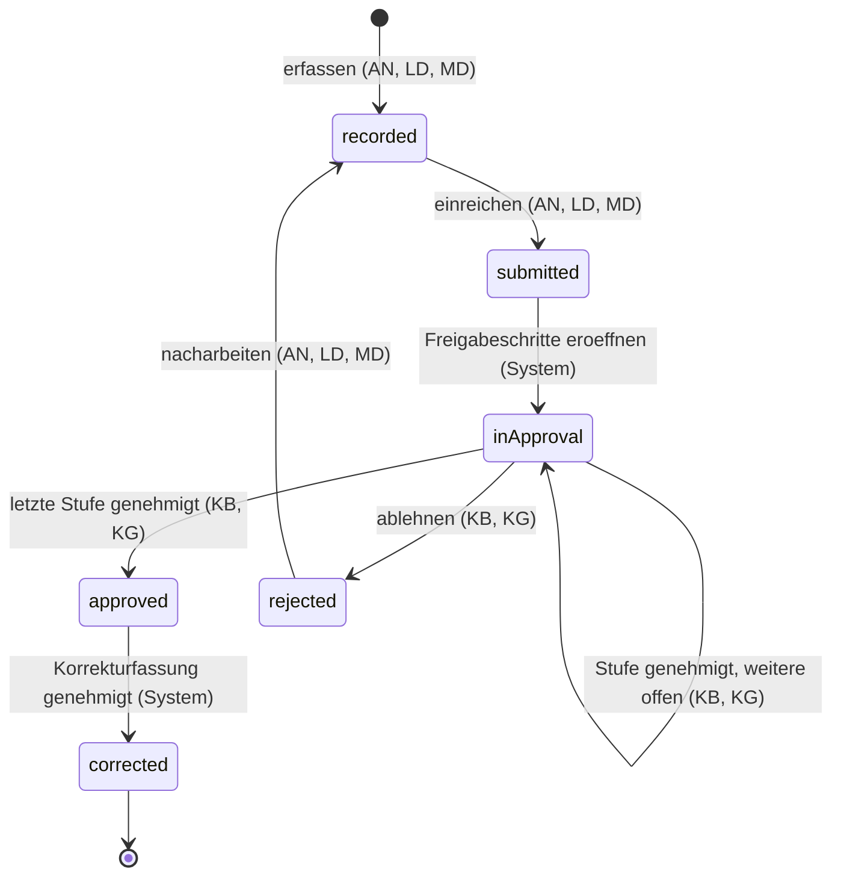

#### AÜG-Prüfungen (→ Kapitel 5)

| Übergang | Prüfung | Kapitel |
|---|---|---|
| `recorded` → `submitted` | P1 liegen Zeiten nach `maxDurationEndDate` im Zettel? P4 ist für den Zeitraum ein Vergleichsentgelt hinterlegt? | 5.1, 5.2 |
| `submitted` → `inApproval` | P3 Equal-Pay-Fälligkeit im Zeitraum erreicht? | 5.2 |
| `inApproval` → `approved` | P1 mit Sperrwirkung für Zeiten nach Fristende; P4 Vergleichsentgelt bei erreichter Fälligkeit; P10 Unterweisungsnachweis für den Standort | 5.1, 5.2, 5.4 |

### 4.5 Abrechnungsperiode und Abrechnungsbeleg

Zwei Modelle: die Abrechnungsperiode (`billingPeriod`, 3.9) und der
Abrechnungsbeleg (`billingDocument`, 3.9). Die Belegposition teilt die
Matrixzeile des Belegs.

> **Entschieden (vormals offene Frage 6).** Die Lieferantenseite läuft im
> **Gutschriftverfahren**: der Betreiber erstellt `supplierCreditNote`, der
> Lieferant bestätigt oder beanstandet. Für den Prototyp sind damit nur die
> Varianten **Verkauf** und **Einkauf A** umzusetzen. Die Spalte
> „Seite / Variante" der Übergangstabelle führt **Einkauf B**
> (Rechnungseingang) weiter mit, weil die Zustände identisch sind und sich nur
> die auslösende Rolle unterscheidet — als dokumentierte, nicht umgesetzte
> Variante.

#### 4.5.1 Abrechnungsperiode

| Deutsch | Bezeichner | Fachliche Bedeutung |
|---|---|---|
| Offen | `open` | Zeiten dürfen erfasst, eingereicht und genehmigt werden; Belege dürfen entstehen. |
| Geschlossen | `closed` | Die Periode ist abgeschlossen; keine neuen Zettel und keine neuen Belege zu dieser Periode. **Endzustand.** |

| Von | Nach | Auslösende Rolle | Vorbedingungen | Nebenwirkungen |
|---|---|---|---|---|
| — | `open` | `MA` (anlegen), `MD` öffnet ([33]) | `periodFrom`, `periodTo` und `closingDate` gesetzt; keine überlappende offene Periode für denselben Kunden | Stundenzettel können angelegt werden (4.4); Benachrichtigung an `LD` der beteiligten Lieferanten |
| `open` | `closed` | `MD` ([33]), `MA` | Kein Stundenzettel der Periode in `recorded`, `submitted` oder `inApproval`; alle Belege der Periode in `released`, `confirmed` oder `cancelled` — *(offene Frage 24)* | Keine neuen Zettel und Belege; `closedAt` / `closedBy` gesetzt; Benachrichtigung an `KE` und `LD` |

**Ausgeschlossen:**

- **Kein** `closed` → `open`. Nachträgliche Zeiten laufen über eine
  Korrekturfassung (4.4) in der **nächsten** offenen Periode, nachträgliche
  Beträge über Storno und Nachbeleg (4.5.2). Ein Wiederöffnen wäre eine
  Änderung dieses Kapitels, kein Sonderfall im Betrieb.
- **Kein** Schließen durch Fristablauf. Das Erreichen von `closingDate` erzeugt
  Erinnerung und Eskalation (2.4), nicht den Übergang.

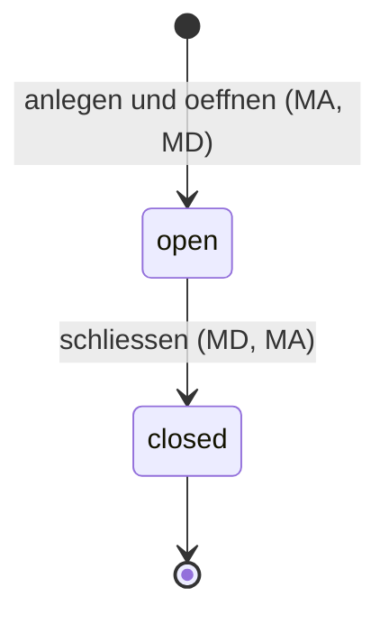

> *(offene Frage 24, neu)* Darf eine Abrechnungsperiode geschlossen werden,
> solange einzelne Stundenzettel nicht entschieden sind, und wer trägt diese
> Entscheidung? Die Vorbedingung oben verlangt heute, dass **alle** Zettel
> entschieden sind — das ist die strenge Folge aus 2.4 Regel 1 (kein
> Statuswechsel durch Fristablauf), hat aber den Preis, dass ein einzelner
> hängender Zettel die Abrechnung der ganzen Periode aufhält. Die Alternative
> (Schließen mit Übertrag der offenen Zettel in die nächste Periode) ist eine
> kaufmännische Festlegung und wird hier **nicht** geraten.

#### 4.5.2 Abrechnungsbeleg

| Deutsch | Bezeichner | Fachliche Bedeutung |
|---|---|---|
| Erstellt | `created` | Der Beleg ist aus genehmigten Stundenzetteln erzeugt, aber nicht abgegeben. Eine inhaltliche Änderung kann nur `MA` vornehmen — `MD` trägt in 2.2 kein `Ä` auf dieser Zeile; der Regelfall ist Storno und Neuerstellung. |
| In Prüfung | `inReview` | Der Beleg wird geprüft: auf der Verkaufsseite betreiberintern vor der Freigabe, auf der Einkaufsseite in Variante B die eingegangene Lieferantenrechnung. |
| Freigegeben | `released` | Vier-Augen-Freigabe erfolgt ([30]); der Beleg gilt als abgegeben. Auf der Verkaufsseite der Ruhezustand, solange keine Beanstandung erfolgt. |
| Beanstandet | `disputed` | Die Gegenseite widerspricht; `disputeReason`, `disputedAt` / `disputedBy` Pflicht. Eskalationsanlass (2.4). |
| Bestätigt | `confirmed` | Die Gegenseite hat ausdrücklich bestätigt ([32]). **Nur auf der Einkaufsseite** — die Verkaufsseite kennt keine Bestätigung. **Endzustand.** |
| Storniert | `cancelled` | Der Beleg ist aufgehoben; der Storno erzeugt einen **neuen** Beleg mit `cancellationOf` (3.9). **Endzustand.** |

| Von | Nach | Seite / Variante | Auslösende Rolle | Vorbedingungen | Nebenwirkungen |
|---|---|---|---|---|---|
| — | `created` | Verkauf, Einkauf A | `MD`, `MA` | Alle zugrunde liegenden Stundenzettel in `approved` (3.9, 4.4); Abrechnungsperiode `open`; Preisposition der jeweiligen Seite vorhanden (3.3) | Belegpositionen werden aus den Zetteln abgeleitet; `createdBy` gesetzt; AÜG-Prüfungen P9 und P4 als Warnung |
| — | `created` | **Einkauf B** *(nicht umgesetzt)* | `LD` — Recht `A` in 2.2 erst nachzutragen, siehe Hinweis | Wie oben; der Lieferant reicht die Rechnung zu genehmigten Zetteln ein | Benachrichtigung an `MD` |
| `created` | `inReview` | alle | `MD`, `MA`; in Variante B prüft `MD` die Lieferantenrechnung | Summen abgeleitet und mit den Zetteln abgeglichen | Keine inhaltliche Änderung mehr ohne Protokolleintrag |
| `inReview` | `released` | alle | `MD`, `MA` | Auslöser ist **nicht** `createdBy` ([30], 2.4 Regel 5) | `releasedAt` / `releasedBy` gesetzt; Beleg wird für die Gegenseite sichtbar; `billingReviewDeadlineDays` beginnt; Benachrichtigung an `KE` bzw. `LD` |
| `released` | `disputed` | Verkauf | `KE` ([31]) | `disputeReason` Pflicht; innerhalb der Prüffrist | Benachrichtigung an `MD`; Eskalationsanlass „Beleg beanstandet und nicht geklärt" (2.4) |
| `released` | `disputed` | Einkauf A, Einkauf B | `LD` ([32]) | Wie oben | Wie oben |
| `released` | `confirmed` | Einkauf A, Einkauf B | `LD` ([32]) | Keine offene Beanstandung | Beleg ist abgeschlossen; Übergabe an ein Fremdsystem nach *(offener Frage 7)* |
| `disputed` | `inReview` | alle | `MD`, `MA` | Beanstandung geklärt, Klärung dokumentiert; wenn sich die Zeiten ändern: Korrekturfassung genehmigt (4.4) | Erneute Freigabe erforderlich ([30]); Benachrichtigung an die beanstandende Seite |
| `created`, `inReview`, `released`, `disputed` | `cancelled` | alle | `MD`, `MA` | Begründung Pflicht; bei `released` und `disputed` entsteht ein Storno- und ggf. ein Nachbeleg mit `cancellationOf` (3.9) | Benachrichtigung an die Gegenseite; der stornierte Beleg bleibt erhalten — Belegnummern bleiben lückenlos |

**Endzustände:** `confirmed` (nur Einkaufsseite), `cancelled`. Auf der
Verkaufsseite ist `released` der Ruhezustand: 2.2 gibt `KE` mit [31] nur die
Beanstandung, keine Bestätigung — der Beleg gilt als akzeptiert, solange keine
Beanstandung erfolgt, **ohne** dass ein Übergang das feststellt.

**Ausgeschlossen:**

- **Keine** Freigabe durch den Ersteller. Vier-Augen-Prinzip ([30]).
- **Keine** Bestätigungsfiktion. Der Ablauf von `billingReviewDeadlineDays`
  erzeugt Erinnerung und Eskalation, nie den Übergang nach `confirmed` (2.4,
  Regel 1).
- **Kein** Beleg aus nicht genehmigten Zeiten. `created` setzt ausschließlich
  Zettel in `approved` voraus (3.9).
- **Keine** Änderung eines freigegebenen Belegs. Korrekturen laufen über Storno
  und Nachbeleg; der alte Beleg bleibt (3.9).
- **Kein** Übergang `disputed` → `released` ohne erneute Freigabe. Die Klärung
  führt zurück in die Prüfung, nicht direkt in die Freigabe.
- **Kein** `confirmed` oder `cancelled` → irgendwohin.
- **Keine** Statusführung durch den Lieferanten oder den Kunden über die
  Beanstandung bzw. Bestätigung hinaus ([31], [32]).

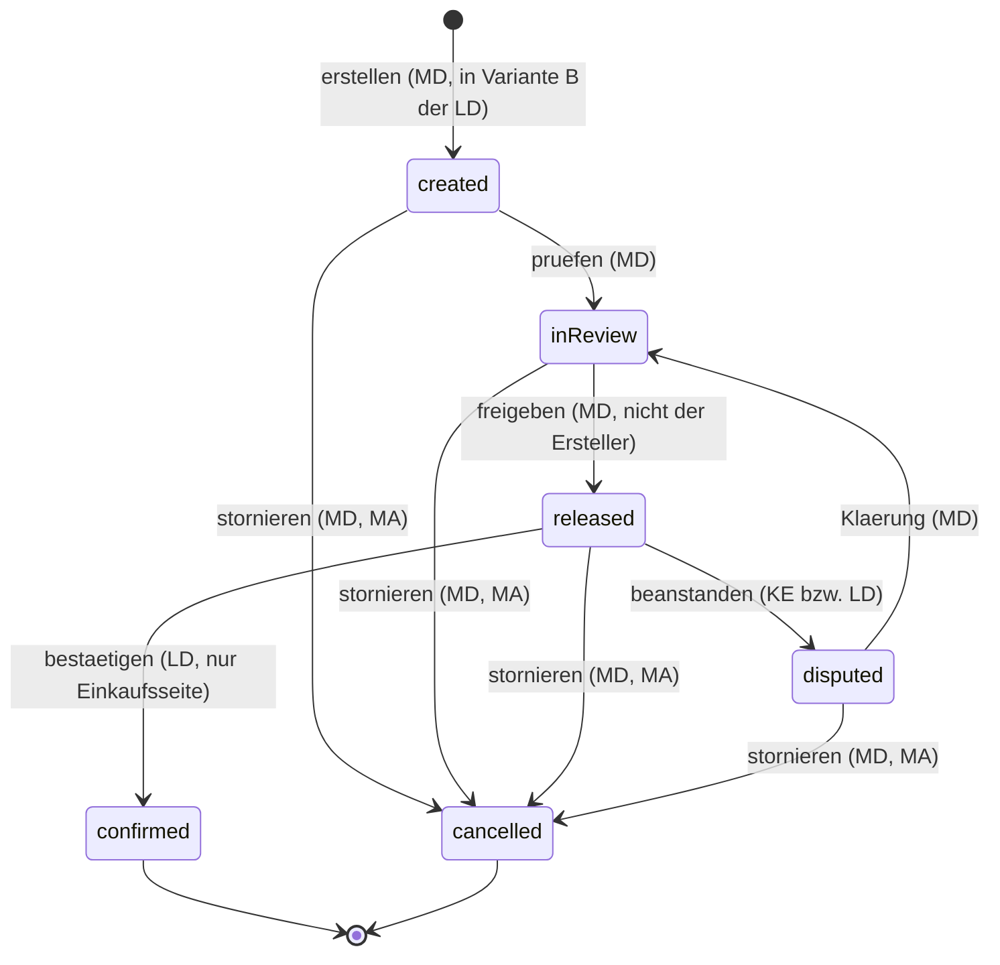

#### AÜG-Prüfungen (→ Kapitel 5)

| Übergang | Prüfung | Kapitel |
|---|---|---|
| → `created` (Einkaufsseite) | P9 war die Erlaubnis des Lieferanten im Leistungszeitraum gültig? | 5.4 |
| → `created` (beide Seiten) | P4 war für Zeiträume nach `equalPayDueDate` ein Vergleichsentgelt hinterlegt? | 5.2 |
| `inReview` → `released` | Keine eigene AÜG-Prüfung; die Prüfungen liegen am Stundenzettel (4.4) | — |

> **Erledigt (vormals Lücke in 2.2).** Variante B hätte verlangt, dass der
> Lieferant einen Beleg **anlegen** kann; die Matrix 2.2 gibt `LD` in der Zeile
> „Abrechnungsbeleg, Belegposition (3.9)" nur `L[7] S[32]`, kein `A`. Mit der
> Entscheidung für das Gutschriftverfahren bleibt die Matrix wie sie ist. Wird
> Variante B später doch umgesetzt, ist in 2.2 ein `A[7]` nachzutragen und
> Fußnote [32] um das Einreichen zu erweitern.

### 4.6 Lieferantenstatus

Objekt: `supplier` (3.2). Matrixzeile „Lieferant / Verleiher (3.2)" in 2.2. Die
AÜG-Erlaubnis ist ein eigenes Objekt mit eigenem Nachweisfluss (3.2, 5.4); sie
ist hier **Vorbedingung**, nicht Zustand.

#### Zustände

| Deutsch | Bezeichner | Fachliche Bedeutung |
|---|---|---|
| Onboarding | `onboarding` | Der Lieferant ist angelegt, die Voraussetzungen für eine Beauftragung sind noch nicht vollständig: Rahmenvertrag, Tarifbindung, anerkannte Erlaubnis, Nachweise. Keine Teilnahme am Kernprozess. |
| Aktiv | `active` | Der Lieferant darf eingeladen werden, anbieten, Kandidaten vorschlagen und Einsätze führen. |
| Gesperrt | `blocked` | Die Teilnahme ist ausgesetzt; `blockReason`, `blockedAt` / `blockedBy` Pflicht. Laufende Einsätze sind davon zunächst **nicht** betroffen (siehe unten). |
| Inaktiv | `inactive` | Die Beauftragung ist beendet. Kein neuer Vorgang; die Historie bleibt lesbar. |

`blocked` ist der einzige Zustand dieses Kapitels, der eine Sperre **ist** — er
beschreibt die Organisation. Prüfergebnisse „Sperre" aus 5.5 bleiben dagegen
Prüfergebnisse und erzeugen keinen Zustand (4.0, Regel 5).

#### Übergänge

| Von | Nach | Auslösende Rolle | Vorbedingungen | Nebenwirkungen |
|---|---|---|---|---|
| — | `onboarding` | `MA` | `supplierNumber`, `legalName`, `address`, mindestens ein Ansprechpartner | Lieferantenmandant wird angelegt (3.11); `LA` kann Stammdaten und Nachweise pflegen ([7]) |
| `onboarding` | `active` | `MA` | Rahmenvertrag `active` (3.3); `supplierCollectiveAgreement` gesetzt (3.2, Pflicht ab `active`); AÜG-Erlaubnis mit `verificationStatus = accepted` und gültigem Zeitraum (5.4); Pflichtnachweise vorhanden *(offene Frage 20)* | Benachrichtigung an `LA` und `LD`; der Lieferant erscheint im Einladungskreis (4.2); AÜG-Prüfungen P9, P10 |
| `active` | `blocked` | `MA`, `MD` ([5]) | `blockReason` Pflicht | **Keine** neue Einladung, kein neues Angebot, kein neuer Profilvorschlag, kein neuer Einsatz; offene Einladungen bleiben stehen und laufen in `expired` (4.2); laufende Einsätze, Zeiterfassung und Abrechnung laufen weiter; Benachrichtigung an `LA`; Eskalation an `MA` |
| `blocked` | `active` | **nur** `MA` ([5]) | Sperrgrund behoben und dokumentiert; Auslöser ist nicht die sperrende Person (Vier-Augen, 2.4 Regel 5); Erlaubnis gültig und anerkannt | Benachrichtigung an `LA` und `LD`; Protokolleintrag mit Aufhebungsgrund |
| `onboarding`, `active`, `blocked` | `inactive` | `MA` | `validTo` gesetzt; kein Einsatz dieses Lieferanten in `planned`, `active` oder `interrupted` | Zugänge des Lieferantenmandanten werden gesperrt (3.11); offene Einladungen und Angebote enden (4.2); Historie und Belege bleiben lesbar; Löschfristen nach 6.5 |
| `inactive` | `active` | **nur** `MA` ([5]) | Reaktivierung: Rahmenvertrag und Erlaubnis wieder gültig und anerkannt; Begründung Pflicht | Wie `onboarding` → `active`; Protokolleintrag mit Reaktivierungsgrund |

**Wirkung auf laufende Einsätze.** Eine Sperre unterbricht oder beendet keinen
laufenden Einsatz. Das ist bewusst so: ein Statuswechsel am Lieferanten darf
nicht still eine Überlassung beenden, die arbeits- und vertragsrechtliche
Folgen hat. **Ob** bei Erlöschen oder Entzug der AÜG-Erlaubnis ein laufender
Einsatz zu beenden ist — und wer das entscheidet — gehört nach **5.4**; der
Übergang dafür liegt in 4.3.1 bereit (`terminatedEarly` aus Rechtsgründen).

**Endzustände:** keiner im strengen Sinn. `inactive` ist der Ruhezustand am
Ende der Beauftragung, aus dem `MA` reaktivieren darf ([5]). Das ist die einzige
Ausnahme von 4.0 Regel 9 und steht ausdrücklich in Fußnote [5]
(„Entsperrung und Reaktivierung nur durch MA").

**Ausgeschlossen:**

- **Keine** Entsperrung durch `MD`. [5] sagt ausdrücklich: sperren ja,
  entsperren nein.
- **Keine** Entsperrung oder Reaktivierung durch den Lieferanten selbst. `LA`
  pflegt Stammdaten und Nachweise ([7]), nicht den Status seiner Organisation.
- **Kein** `onboarding` → `blocked` → … als Umweg um die Voraussetzungen.
  Fehlende Nachweise im Onboarding sind keine Sperre, sondern ein noch nicht
  erfüllter Übergang nach `active`.
- **Kein** `inactive` bei laufendem Einsatz. Erst sind die Einsätze zu beenden
  (4.3), dann endet die Beauftragung.
- **Kein** zeitgesteuerter Übergang. Ob der Ablauf der Erlaubnis oder das
  Vertragsende automatisch sperrt, ist in **5.4** zu entscheiden; dieses
  Kapitel unterstellt es nicht.
- **Keine** Vertretung für die Entsperrung, soweit sie mit einer Übersteuerung
  einer AÜG-Sperre zusammenfällt (2.4, Regel 8).

#### Diagramm

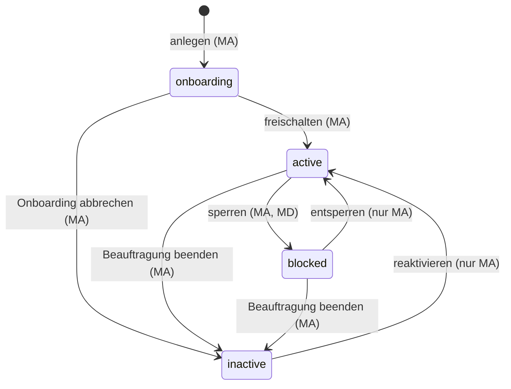

#### AÜG-Prüfungen (→ Kapitel 5)

| Übergang | Prüfung | Kapitel |
|---|---|---|
| `onboarding` → `active` | P9 Erlaubnis anerkannt und gültig; P10 Pflichtnachweise vollständig *(offene Frage 20)* | 5.4 |
| `active` → `blocked` | Die Sperre ist in der Regel das **Ergebnis** einer Prüfung (P9, P10), nicht ihr Anlass | 5.4, 5.5 |
| `blocked` → `active` | P9 und P10 erneut, mit Sperrwirkung | 5.4 |
| `inactive` → `active` | P9 und P10 wie beim erstmaligen Freischalten | 5.4 |

### 4.7 Querschnitt: Statusübergang → AÜG-Prüfung → Ergebnisart

Diese Tabelle ist die Brücke zwischen den Statusmodellen und dem Regelwerk in
Kapitel 5 — und die Vorlage für die Gherkin-Szenarien in `tests/aueg/`. Jede
Zeile ist ein prüfbarer Satz: ein Übergang, eine Prüfung, ein erwartetes
Ergebnis.

#### Die geprüften Regeln

| Kürzel | Prüfung | Bezeichner | Kapitel |
|---|---|---|---|
| P1 | Höchstüberlassungsdauer je Person und Entleiher | `maxDurationCheck` | 5.1 |
| P2 | Unterbrechung und Zurücksetzen der Zählung | `interruptionResetCheck` | 5.1 |
| P3 | Equal-Pay-Frist erreicht | `equalPayDeadlineCheck` | 5.2 |
| P4 | Vergleichsentgelt vorhanden und verwendbar | `comparableWageCheck` | 5.2 |
| P5 | Branchenzuschlagsstufe zutreffend | `industryPremiumCheck` | 5.2 |
| P6 | Drehtürklausel (Vorbeschäftigung beim Entleiher oder im Konzern) | `revolvingDoorCheck` | 5.3 |
| P7 | Einsatzverbot bei Arbeitskampf | `industrialActionCheck` | 5.3 |
| P8 | Kennzeichnungs- und Konkretisierungspflicht | `concretizationCheck` | 5.3 |
| P9 | AÜG-Erlaubnis des Lieferanten gültig und anerkannt | `permitValidityCheck` | 5.4 |
| P10 | Pflichtnachweise vorhanden und gültig | `mandatoryDocumentCheck` | 5.4 |
| P11 | Arbeitsverhältnis beim Verleiher besteht | `employmentRelationshipCheck` | 5.3 |

#### Ergebnisarten

| Ergebnisart | Bezeichner | Wirkung im Statusmodell |
|---|---|---|
| Information | `info` | Der Übergang findet statt. Das Ergebnis wird am Objekt vermerkt (`ruleCheckResult`) und protokolliert. |
| Warnung | `warning` | Der Übergang findet statt, erzeugt aber eine Benachrichtigung an die zuständige Rolle und einen Eskalationsanlass (2.4). |
| Sperre | `block` | Der Übergang findet **nicht** statt. Das Objekt bleibt in seinem Zustand (4.0, Regel 5). Eine Übersteuerung ist nur nach 5.5 möglich, mit Begründung und Protokolleintrag, und ist **nicht vertretbar** (2.4, Regel 8) — *(offene Frage 10)*. |

> **Die Spalte „Ergebnisart" ist ein Vorschlag aus Sicht der Statusmodelle.**
> Welche Prüfung sperrt und welche nur warnt, ist eine Entscheidung des
> Regelwerks und steht als offener Punkt in M2 („Entscheidung, welche Prüfung
> sperrt und welche nur warnt"). Kapitel 5.5 bestätigt oder ändert die Spalte;
> bis dahin ist sie die Arbeitsgrundlage für die Szenarien. Geändert wird sie
> dann **hier**, nicht im Code.

#### Querschnittstabelle

| Nr. | Objekt | Übergang | Prüfung | Prüfgegenstand | Ergebnisart (Vorschlag) |
|---|---|---|---|---|---|
| Q01 | Bedarfsanfrage | `draft` → `submitted` | P8 | Tätigkeitsbeschreibung vorhanden und konkret | Information |
| Q02 | Bedarfsanfrage | `submitted` → `approved` | P8 | dito, vor der Freigabe | Warnung |
| Q03 | Bedarfsanfrage | `submitted` → `approved` | P1 | angefragter Zeitraum länger als die Höchstüberlassungsdauer (ohne Person) | Information |
| Q04 | Bedarfsanfrage | `approved` → `tendered` | P9 | je eingeladenem Lieferanten: Erlaubnis anerkannt und über die Angebotsfrist hinaus gültig | **Sperre** (je Einladung) |
| Q05 | Bedarfsanfrage | `approved` → `tendered` | P7 | Arbeitskampf am Standort angezeigt | Warnung |
| Q06 | Einladung | → `invited` | P9 | Lieferant `active` und Erlaubnis gültig | **Sperre** |
| Q07 | Profilvorschlag | `submitted` → `reviewed` | P1 | bisher angerechnete Dauer dieser Person bei diesem Kunden; Warnschwelle aus 5.1 | Warnung |
| Q08 | Profilvorschlag | `submitted` → `reviewed` | P6 | Vorbeschäftigung beim Entleiher oder im Konzern innerhalb der Frist aus 5.3 | Warnung |
| Q09 | Profilvorschlag | `submitted` → `reviewed` | P11 | `employmentStatusWithSupplier = employed` oder Zusage dazu | Warnung |
| Q10 | Profilvorschlag | `submitted` → `reviewed` | P10 | Pflichtnachweise des Kandidaten (Arbeitserlaubnis, Qualifikation) | Information *(offene Frage 20)* |
| Q11 | Profilvorschlag | → `accepted` | P1 | Höchstüberlassungsdauer würde im angefragten Zeitraum überschritten | **Sperre** |
| Q12 | Profilvorschlag | → `accepted` | P6 | Drehtürklausel greift | **Sperre** |
| Q13 | Profilvorschlag | → `accepted` | P11 | kein Arbeitsverhältnis beim Verleiher | **Sperre** |
| Q14 | Einsatz | → `planned` | P1 | `maxDurationEndDate` liegt vor dem geplanten Ende | **Sperre** |
| Q15 | Einsatz | → `planned` | P6 | Drehtürklausel greift | **Sperre** |
| Q16 | Einsatz | → `planned` | P9 | Erlaubnis für den geplanten Zeitraum gültig | **Sperre** |
| Q17 | Einsatz | → `planned` | P11 | Arbeitsverhältnis beim Verleiher besteht | **Sperre** |
| Q18 | Einsatz | → `planned` | P4 | Vergleichsentgelt hinterlegt | Warnung *(offene Frage 15)* |
| Q19 | Einsatz | → `planned` | P5 | Branchenzuschlagsschema am Standort zugeordnet | Information |
| Q20 | Einsatz | `planned` → `active` | P9 | Erlaubnis am Starttag gültig und anerkannt | **Sperre** |
| Q21 | Einsatz | `planned` → `active` | P10 | Pflichtnachweise zum Einsatz, insbesondere Unterweisung am Standort | **Sperre** *(offene Frage 20)* |
| Q22 | Einsatz | `planned` → `active` | P7 | Arbeitskampf am Einsatzort | **Sperre** |
| Q23 | Einsatz | `planned` → `active` | P1 | Fristende bereits erreicht | **Sperre** |
| Q24 | Einsatz | `active` → `interrupted` | P2 | Unterbrechung wird mit Beginn und Grund erfasst | Information |
| Q25 | Einsatz | `interrupted` → `active` | P2 | Unterbrechungsdauer über der Schwelle aus 5.1 — Zählung wird zurückgesetzt | Information |
| Q26 | Einsatz | `interrupted` → `active` | P1 | Neuberechnung von `maxDurationEndDate` nach der Unterbrechung | Warnung bei Überschreitung |
| Q27 | Einsatz | → `completed` / `terminatedEarly` | P1, P3 | Abschlussstand der Fristen wird festgeschrieben | Information |
| Q28 | Verlängerung | `requested` → `approved` | P1 | Fristwirkung des neuen Endes für die Kundenseite sichtbar | Warnung |
| Q29 | Verlängerung | `requested` → `approved` | P3 | Equal-Pay-Fälligkeit fällt in den verlängerten Zeitraum | Warnung |
| Q30 | Verlängerung | `approved` → `effective` | P1 | `newEndDate` nach `maxDurationEndDate` | **Sperre** |
| Q31 | Verlängerung | `approved` → `effective` | P9 | Erlaubnis für den verlängerten Zeitraum gültig | **Sperre** |
| Q32 | Verlängerung | `approved` → `effective` | P4 | Vergleichsentgelt für den Zeitraum ab Equal-Pay-Fälligkeit | Warnung *(offene Frage 15)* |
| Q33 | Stundenzettel | `recorded` → `submitted` | P1 | Zeitpositionen nach `maxDurationEndDate` enthalten | Warnung |
| Q34 | Stundenzettel | `submitted` → `inApproval` | P3 | Equal-Pay-Fälligkeit im Zettelzeitraum erreicht | Warnung |
| Q35 | Stundenzettel | `inApproval` → `approved` | P1 | Zeiten nach Fristende sollen genehmigt werden | **Sperre** |
| Q36 | Stundenzettel | `inApproval` → `approved` | P4 | Fälligkeit erreicht, Vergleichsentgelt fehlt | **Sperre** *(offene Frage 15)* |
| Q37 | Stundenzettel | `inApproval` → `approved` | P10 | Unterweisungsnachweis für den Standort gültig | Warnung *(offene Frage 20)* |
| Q38 | Abrechnungsbeleg | → `created` (Einkauf) | P9 | Erlaubnis im gesamten Leistungszeitraum gültig | Warnung |
| Q39 | Abrechnungsbeleg | → `created` | P4 | Vergleichsentgelt für Zeiträume nach Fälligkeit hinterlegt | Warnung |
| Q40 | Abrechnungsbeleg | → `created` | P5 | Branchenzuschlagsstufe der abgerechneten Zuschläge plausibel | Information |
| Q41 | Lieferant | `onboarding` → `active` | P9 | Erlaubnis anerkannt und gültig | **Sperre** |
| Q42 | Lieferant | `onboarding` → `active` | P10 | Pflichtnachweise vollständig | **Sperre** *(offene Frage 20)* |
| Q43 | Lieferant | `blocked` → `active` | P9, P10 | Sperrgrund behoben, Nachweise gültig | **Sperre** |
| Q44 | Lieferant | `inactive` → `active` | P9, P10 | wie beim erstmaligen Freischalten | **Sperre** |

#### Ableitungsmuster für die Szenarien

Jede Zeile der Tabelle lässt sich unmittelbar in ein Gherkin-Szenario
überführen. Das Muster ist für alle drei Ergebnisarten dasselbe und
unterscheidet sich nur im `Dann`-Teil:

```
Szenario: <Nr.> <Prüfung> bei <Übergang>
  Gegeben <Ausgangslage aus Kapitel 3: Objekte, Fristen, Nachweise>
  Und das Objekt steht im Status <Von-Zustand>
  Wenn <auslösende Rolle> den Übergang nach <Nach-Zustand> auslöst
  Dann ist das Ergebnis <Information | Warnung | Sperre>
  Und der Status ist <Nach-Zustand bei Information/Warnung, Von-Zustand bei Sperre>
  Und ein Protokolleintrag mit der Regel <Kürzel> liegt vor
```

Drei Regeln für die Szenarien, die sich aus diesem Kapitel ergeben:

1. **Je Zeile mindestens zwei Szenarien** — eines, in dem die Prüfung durchgeht,
   und eines, in dem sie anspricht. Bei einer Sperre kommt ein drittes hinzu:
   die dokumentierte Übersteuerung nach 5.5 *(offene Frage 10)*.
2. **Fristablauf gehört in ein eigenes Szenario** mit der Erwartung
   „Status unverändert, Eskalation ausgelöst" — niemals „genehmigt" (2.4,
   Regel 1). Das ist die schärfste Zusicherung dieses Kapitels und muss
   ausführbar geprüft werden.
3. **Sichtbarkeit ist Teil der Erwartung.** Wo ein Übergang eine
   Benachrichtigung auslöst, prüft das Szenario mit, dass sie keine Fremddaten
   enthält (2.3, Regeln 1–4) — besonders bei `rejected` und `expired` im
   Ausschreibungsprozess.

Die `.feature`-Dateien selbst entstehen mit Kapitel 5 (Meilenstein M2), weil
erst dort die Fristwerte, Schwellen und Rechenvorschriften stehen. Dieses
Kapitel liefert die Übergänge und die erwartete Wirkung, nicht die Zahlen.

## 5. AÜG-Regeln

Verbindlich für den Prototyp. Jede Regel wird in `tests/aueg/` als
Gherkin-Szenario hinterlegt, bevor sie implementiert wird.

> **Tarifwerk ist Konfiguration, keine verdrahtete Regel** (Entscheidung zu
> offener Frage 3). Fristen, Abweichungen und Zuschlagsstufen stehen als Daten
> an der Tarifzuordnung (3.3: `maxAssignmentDurationMonths`,
> `equalPayDeadlineMonths`, `industryPremiumScheme`). Dieses Kapitel
> spezifiziert nur die **Mechanik**: wie gerechnet, gezählt und geprüft wird,
> wenn ein Tarifwerk zugeordnet ist, und was ohne Zuordnung gilt (gesetzliche
> Regelgrenzen). Ein konkretes Tarifwerk wird als erste Belegung angelegt; die
> Szenarien in `tests/aueg/` prüfen die Mechanik gegen eine synthetische
> Beispielbelegung, nicht gegen einen echten Tariftext.

### 5.1 Höchstüberlassungsdauer

- Regelgrenze 18 Monate je Leiharbeitnehmer bei demselben Entleiher
  (§ 1 Abs. 1b AÜG) — Berechnungsvorschrift TODO
- Unterbrechung von mehr als 3 Monaten setzt die Zählung zurück — TODO
- Tarifliche Abweichung (Öffnungsklausel, Betriebsvereinbarung) — TODO
- Zählung über mehrere Einsätze, Lieferanten und Standorte hinweg — TODO
- Warn- und Sperrschwellen im System (Vorlauf, Eskalation) — TODO
- Rechtsfolge bei Überschreitung und Systemverhalten — TODO

### 5.2 Equal Pay / Equal Treatment

- Gleichstellungsgrundsatz (§ 8 Abs. 1 AÜG) — TODO
- Abweichung durch Tarifvertrag der Zeitarbeitsbranche — TODO
- Equal Pay spätestens nach 9 Monaten (§ 8 Abs. 4 AÜG) — TODO
- Branchenzuschlagstarifverträge als abweichendes Modell — TODO
- Vergleichsentgelt: welche Daten der Entleiher liefern muss — TODO
- Fristenberechnung und Unterbrechungswirkung — TODO
- Systemverhalten: Warnung, Pflichtfeld, Freigabesperre — TODO

### 5.3 Drehtürklausel, Arbeitskampf, Kennzeichnung

- Drehtürklausel: vorheriges Arbeitsverhältnis beim Entleiher oder
  Konzernunternehmen (§ 8 Abs. 3 AÜG) — TODO
- Einsatzverbot bei Arbeitskampf (§ 11 Abs. 5 AÜG) — TODO
- Kennzeichnungs- und Konkretisierungspflicht des Überlassungsvertrags
  (§ 1 Abs. 1 AÜG) — TODO
- Abgrenzung zu Werk- und Dienstvertrag, verdeckte Überlassung — TODO
- Systemverhalten je Regel (harte Sperre vs. dokumentierte Ausnahme) — TODO

### 5.4 Erlaubnis, Nachweise und Fristen

- Überwachung der AÜG-Erlaubnis je Lieferant: Gültigkeit, Befristung,
  Verlängerung, unbefristete Erlaubnis — TODO
- Sperre von Lieferanten ohne gültigen Nachweis — TODO
- Erinnerungs- und Eskalationsfristen vor Ablauf — TODO
- Weitere Nachweise (Unbedenklichkeitsbescheinigungen, Qualifikationen,
  Unterweisungen) — TODO
- Aufzeichnungs- und Dokumentationspflichten — TODO

### 5.5 Regelwerk-Mechanik

- Wo greifen Prüfungen: Statusübergang, Speicherung, nächtlicher Lauf — TODO
- Ergebnisarten: Information, Warnung, Sperre — TODO
- Ausnahmen: wer darf übersteuern, mit welcher Begründung, Protokoll — TODO
- Stichtagslogik und rückwirkende Änderungen — TODO

## 6. Datenschutz und Löschfristen

- 6.1 Rollen nach DSGVO: Verantwortlicher, Auftragsverarbeiter, gemeinsame
  Verantwortlichkeit im MSP-Modell — TODO
- 6.2 Verzeichnis der Verarbeitungstätigkeiten (Gliederung) — TODO
- 6.3 Datenkategorien und Rechtsgrundlagen je Objekt — TODO
- 6.4 Datenminimierung: welche Kandidatendaten der Kunde überhaupt sieht
  (Pseudonymisierung von Profilen) — TODO
- 6.5 Löschfristen je Datenkategorie (abgelehnte Kandidaten, beendete
  Einsätze, Abrechnungsbelege mit handels-/steuerrechtlicher
  Aufbewahrungspflicht) — TODO
- 6.6 Löschkonzept: Löschung vs. Anonymisierung vs. Sperrung, Umgang mit
  Protokoll- und Audit-Daten — TODO
- 6.7 Betroffenenrechte: Auskunft, Berichtigung, Löschung, Übertragbarkeit —
  Umsetzung im System — TODO
- 6.8 Technische und organisatorische Maßnahmen: Mandantentrennung,
  Verschlüsselung, Zugriffsprotokollierung, Berechtigungsreview — TODO
- 6.9 Hosting: Serverstandort Deutschland/EU, AVV, Unterauftragnehmer — TODO
- 6.10 Umgang mit Testdaten (nur synthetisch, siehe CLAUDE.md) — TODO

## 7. Offene Fragen

| # | Frage | Betrifft | Status |
|---|-------|----------|--------|
| 1 | Tech-Stack (Sprache, Framework, Datenbank, ORM) | gesamtes Projekt | **entschieden:** Next.js (App Router) mit TypeScript, PostgreSQL über Prisma — siehe CLAUDE.md |
| 2 | Konkreter Hoster und Betriebsmodell (Hetzner / IONOS / anderer DE-EU-Anbieter) | Kapitel 6.9 | offen |
| 3 | Welcher Tarifvertrag ist zugrunde zu legen (iGZ/BAP, Branchenzuschläge)? | Kapitel 5.1, 5.2 | **entschieden:** Tarifwerk ist Konfiguration an der Tarifzuordnung (3.3), nicht verdrahtet; Kapitel 5 spezifiziert nur die Mechanik |
| 4 | Bekommen Leiharbeitnehmer einen eigenen Zugang (z. B. Zeiterfassung)? | Kapitel 2 | offen |
| 5 | Mehrstufige Genehmigung der Stundenzettel: wie viele Stufen, welche Rollen? | Kapitel 4.4 | offen |
| 6 | Gutschriftverfahren oder Rechnungseingang des Lieferanten? | Kapitel 3.9 | **entschieden:** Gutschriftverfahren; der Rechnungseingang bleibt als Variante dokumentiert, im Prototyp nicht umgesetzt |
| 7 | Schnittstellen zu Fremdsystemen (ERP, Zeitwirtschaft, HR4YOU) im Prototyp? | Kapitel 1.4 | offen |
| 8 | Werden mehrere Kunden eines MSP in einer Instanz oder getrennt betrieben? | Kapitel 1.3 | offen |
| 9 | Welche Kennzahlen muss das Reporting zwingend liefern? | Kapitel 3 | offen |
| 10 | Wie werden Ausnahmen von AÜG-Sperren fachlich genehmigt? | Kapitel 5.5 | offen |
| 11 | Erfährt der Kunde, welcher Lieferant ein Angebot oder einen Kandidaten stellt, oder tritt der MSP als einziger sichtbarer Vertragspartner auf? | Kapitel 2.2, 2.3 | offen |
| 12 | Wer verwaltet kundenseitige Benutzer und Vertretungen — der Betreiber oder eine zusätzliche kundenseitige Administratorrolle? | Kapitel 2.1, 2.2, 2.4 | offen |
| 13 | Wie wird eine Organisation behandelt, die gleichzeitig Kunde und Lieferant ist (Mandantenzuordnung, Sichtbarkeit)? | Kapitel 2.3 | offen |
| 14 | Dürfen Kundenrollen (Bedarfsträger, Genehmiger) für mehrere Standorte und Kostenstellen eingeschränkt werden, und wer pflegt diese Zuständigkeit? | Kapitel 2.2, 3.1, 3.11 | offen |
| 15 | Wie wird das Vergleichsentgelt für Equal Pay geführt — je Einsatz, je Tätigkeit am Standort oder je Kostenstelle — und in welcher Form liefert der Entleiher es? | Kapitel 3.3, 3.7, 5.2 | offen |
| 16 | Granularität der Zeiterfassung: Zeitposition je Tag mit Stundensumme oder je Abschnitt mit Beginn, Ende und Pause? | Kapitel 3.8, 4.4 | offen |
| 17 | Darf je Einsatz ein von der Preisliste abweichender Satz vereinbart werden, und wer genehmigt die Abweichung? | Kapitel 3.3, 3.5, 3.7 | offen |
| 18 | Führt der Betreiber eine Personenidentität über Lieferanten hinweg, mit welchen Merkmalen und auf welcher Rechtsgrundlage? Ohne sie ist die Zählung aus 5.1 über Lieferanten hinweg nicht möglich. | Kapitel 3.6, 5.1, 5.3, 6.3 | offen |
| 19 | Sind mehrere gleichzeitige Einsätze derselben Person beim selben Kunden zulässig (Teilzeit, mehrere Kostenstellen), und wie zählen sie auf die Höchstüberlassungsdauer? | Kapitel 3.7, 5.1 | offen |
| 20 | Welche Nachweisarten sind Pflicht — je Lieferant und je Einsatz — und blockiert ein fehlender Nachweis den Einsatzstart oder warnt er nur? | Kapitel 3.10, 5.4, 5.5 | offen |
| 21 | Wird im Stundenzettel eine Abwesenheitsart geführt (z. B. „krank") oder nur „keine Arbeitsleistung"? Krankheit ist ein Gesundheitsdatum nach Art. 9 DSGVO. | Kapitel 3.8, 6.3 | offen |
| 22 | Wie lange werden Audit-Einträge aufbewahrt, und wie verhält sich das zum Löschanspruch der betroffenen Person? | Kapitel 3.12, 6.5, 6.6 | offen |
| 23 | Darf der Lieferantendisponent eine Einladung selbst absagen? | Kapitel 2.2, 3.5, 4.2 | **entschieden:** ja, eng begrenzt auf die eigene Einladung; Matrix 2.2 trägt dafür `S[46]` |
| 24 | Darf eine Abrechnungsperiode geschlossen werden, solange einzelne Stundenzettel nicht entschieden sind — und wer entscheidet das? Heute verhindert ein hängender Zettel das Schließen der ganzen Periode. | Kapitel 3.9, 4.4, 4.5 | offen |

Neue Fragen werden hier ergänzt, nicht im Code beantwortet.
